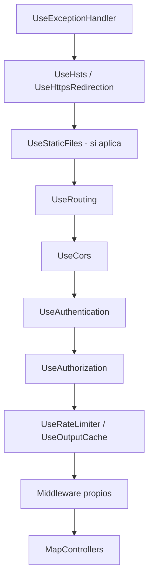

# Orden de los middleware en ASP.NET Core

Parte de: [[Pipeline y middleware]]

> [!info] Cómo avanzar
> `progreso`: **pendiente** → **viendo** (estudiando) → **visto** (contestaste la autoevaluación sin abrir las respuestas) → **dominado** (hiciste el laboratorio o lo aplicaste de verdad).

## Contenido

### Qué es
El orden en que llamas `app.Use...` en `Program.cs` es el orden en que corren los middleware al entrar la petición, y el inverso al salir la respuesta. No es un detalle estético: cada middleware solo ve lo que hicieron los anteriores y solo protege a los que vienen después. Un orden incorrecto produce errores silenciosos: excepciones que no se convierten en ProblemDetails, 401 con tokens válidos o preflights de CORS rechazados. Es parte de [[Pipeline y middleware]].

### Cómo funciona
El pipeline es una cebolla. Un middleware solo puede atrapar excepciones, leer el usuario autenticado o saber qué endpoint se eligió si lo que produce eso corrió **antes** que él.

Orden recomendado para una API con controllers (simplificado del que publica Microsoft):



Por qué cada uno va donde va:
- **`UseExceptionHandler` al principio**: solo atrapa excepciones que ocurren en los middleware registrados **después** de él. Si lo pones al final, un error en autenticación o en tu middleware sale como 500 vacío sin tu `codigo`.
- **`UseRouting` antes de la seguridad**: elige el endpoint y lo deja en `HttpContext`. Así CORS, autorización, rate limiting y output cache pueden leer los atributos del endpoint (`[Authorize]`, `[EnableCors]`, `[EnableRateLimiting]`, `[OutputCache]`).
- **`UseCors` antes de autenticación**: el navegador manda un *preflight* `OPTIONS` **sin** el header `Authorization`. Si autenticación/autorización corren antes, el preflight recibe 401 y el navegador bloquea la petición real.
- **`UseAuthentication` antes de `UseAuthorization`**: la autenticación lee el token y llena `HttpContext.User`; la autorización decide con ese usuario. Al revés, la autorización ve un usuario anónimo y los endpoints protegidos responden 401 aunque el token sea válido.
- **Endpoints al final**: `MapControllers` registra los endpoints que se ejecutan cuando todo lo anterior dejó pasar.

`WebApplication` (desde .NET 6) agrega `UseRouting` al inicio si no lo llamas, y desde .NET 7 agrega autenticación y autorización automáticamente si registraste sus servicios y no los llamaste tú. Aun así, en una API real conviene escribirlos explícitamente para que el orden sea visible y controlado.

### Ejemplo
`Program.cs` de una API estilo Hermes con su sesión local y su manejador de errores:

```csharp
var app = builder.Build();

app.UseExceptionHandler();          // 1. red de seguridad para todo lo de abajo
if (!app.Environment.IsDevelopment())
    app.UseHsts();
app.UseHttpsRedirection();

app.UseRouting();                   // 2. elige endpoint
app.UseCors("Iris");                // 3. preflight sin auth
app.UseAuthentication();            // 4. llena HttpContext.User
app.UseAuthorization();             // 5. aplica [Authorize] / FallbackPolicy
app.UseRateLimiter();               // 6. necesita el endpoint para leer su política

app.MapOpenApi();
app.MapControllers();               // 7. endpoints
app.Run();
```

Fíjate en que el orden de salida es el inverso: la respuesta del controller pasa primero por el rate limiter, luego por autorización, y al final por `UseExceptionHandler`, que es el último en verla. Por eso un middleware que mide tiempos conviene registrarlo arriba: así mide todo el trabajo de los de abajo.

Prueba mental de "qué pasa si": mueve `UseCors` debajo de `UseAuthorization` y abre Itzamna.Clio en Vite: verás en la consola del navegador un error de CORS en el `OPTIONS`, aunque Postman funcione perfecto (Postman no hace preflight).

### Cuándo usarlo y cuándo no
- Sigue el orden recomendado como punto de partida y desvíate solo con una razón concreta.
- Middleware propios que necesitan el usuario van después de `UseAuthentication`; los que solo miden tiempos pueden ir muy arriba para medir todo.
- Lo que depende de datos de MVC no es tema de orden de middleware: va en [[Filtros]].

### Errores comunes
- **`UseExceptionHandler` tarde**: excepciones de middleware previos no se traducen a ProblemDetails.
- **CORS después de auth**: preflight 401 y error de CORS en el navegador.
- **`UseAuthorization` antes de `UseAuthentication`**: 401 con token válido; además, la `FallbackPolicy` rechaza todo.
- **`UseRateLimiter` antes de `UseRouting`** cuando usas políticas por endpoint: no encuentra la política del endpoint.
- **Confiar en que "Postman sí funciona"**: Postman no aplica CORS; prueba con el navegador.

### Para profundizar
- [Orden de los middleware (Microsoft Learn)](https://learn.microsoft.com/aspnet/core/fundamentals/middleware/#middleware-order)
- [Habilitar CORS en ASP.NET Core (Microsoft Learn)](https://learn.microsoft.com/aspnet/core/security/cors)
- [Manejo de errores en ASP.NET Core (Microsoft Learn)](https://learn.microsoft.com/aspnet/core/fundamentals/error-handling)

## Autoevaluación

Contesta primero en voz alta o en papel; luego despliega la respuesta.

> [!question]- ¿Por qué `UseExceptionHandler` va al principio?
> Solo atrapa excepciones de los middlewares que están **después** de él.

> [!question]- ¿Qué orden lleva la parte de seguridad?
> `UseRouting` → `UseCors` → `UseAuthentication` → `UseAuthorization` → `MapControllers`. CORS antes de auth para que el preflight no falle con 401.

> [!question]- Pusiste `UseAuthorization` antes de `UseAuthentication`. ¿Qué pasa?
> Al autorizar aún no hay usuario autenticado: los endpoints protegidos responden 401 aunque el token sea válido.

## Práctica

- [[Lab 6 - API con controllers, FluentValidation, ProblemDetails y Options]]

