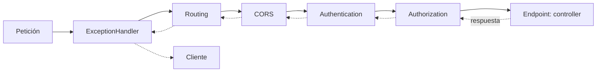

# Pipeline y middleware

Parte de: [[03-CSharp-DotNet/05 ASP.NET Core/_Índice ASP.NET Core|ASP.NET Core]]

> [!info] Cómo avanzar
> `progreso`: **pendiente** → **viendo** (estudiando) → **visto** (contestaste la autoevaluación sin abrir las respuestas) → **dominado** (hiciste el laboratorio o lo aplicaste de verdad).

## Contenido

### Qué es
El **pipeline** de ASP.NET Core es la cadena de componentes por la que pasa cada petición HTTP antes de que se genere la respuesta. Cada eslabón es un **middleware**: una función que recibe el `HttpContext`, puede hacer trabajo antes, decide si llama al siguiente (`next`) y puede hacer trabajo después, cuando la respuesta ya viene de regreso. Todo lo transversal de una API vive ahí: manejo de errores, HTTPS, CORS, autenticación, autorización, rate limiting, caché de salida y, al final, tus controllers.

Este tema tiene dos subtemas:
- [[Orden de los middleware en ASP.NET Core]]: por qué el orden en `Program.cs` cambia el comportamiento y cuál es el orden recomendado.
- [[Middleware personalizado en ASP.NET Core]]: cómo escribir el tuyo como clase, con DI y sin romper la respuesta.

### Cómo funciona
Al arrancar, `app.Use...` y `app.Map...` registran delegados en un `IApplicationBuilder`. Cuando llamas `app.Run()`, el builder los "envuelve" uno dentro de otro, del último al primero, y produce un único `RequestDelegate`. Por eso el primero que registras es la capa más externa: ve la petición primero y la respuesta al final.



Un middleware **corta** el pipeline (lo "cortocircuita") cuando escribe la respuesta y no llama a `next`. Los siguientes no se ejecutan. Ejemplos reales: el middleware de archivos estáticos cuando encuentra el archivo, CORS al responder un *preflight* `OPTIONS`, el rate limiter cuando responde 429 o tu propio middleware cuando rechaza una petición sin cierto header.

Hay tres formas básicas de registrar:
- **`app.Use(...)`**: agrega un middleware que recibe `next` y decide si lo llama.
- **`app.Run(...)`**: middleware **terminal**; no recibe `next`, siempre responde. Lo que registres después de él nunca corre.
- **`app.Map("/ruta", rama => ...)`**: ramifica el pipeline según el inicio de la ruta; la rama tiene su propio pipeline. `MapWhen` ramifica por cualquier condición y `UseWhen` ramifica pero se reincorpora al pipeline principal.

No confundas `app.Map(...)` (rama del pipeline) con `app.MapGet(...)` o `app.MapControllers()`, que registran **endpoints** para el routing.

¿Cómo encaja con el resto? El pipeline es lo que corre **fuera** de MVC. Cuando el routing elige una acción de controller, empieza un segundo "mini pipeline" dentro del endpoint: los [[Filtros]] de MVC (autorización, recurso, acción, excepción y resultado). Una regla práctica para decidir dónde poner algo: si funciona igual para `/salud`, `/openapi/v1.json` y `/api/egresos`, es middleware; si necesita saber qué acción o qué argumentos hay, es filtro.

Cada middleware también comparte el mismo `HttpContext`: puede dejar datos en `HttpContext.Items` para los siguientes, leer `HttpContext.User` (si ya pasó la autenticación) o consultar `HttpContext.GetEndpoint()` (si ya pasó el routing).

### Ejemplo
Pipeline típico de una API como Itzamna.Dionisio o Hermes, con un middleware en línea que agrega un header de correlación:

```csharp
var builder = WebApplication.CreateBuilder(args);
builder.Services.AddControllers();
builder.Services.AddProblemDetails();
builder.Services.AddCors(o => o.AddPolicy("Front", p => p.WithOrigins("https://localhost:5173").AllowAnyHeader().AllowAnyMethod()));
builder.Services.AddAuthentication().AddJwtBearer();
builder.Services.AddAuthorization();

var app = builder.Build();

app.UseExceptionHandler();            // capa más externa: atrapa lo de abajo

app.Use(async (ctx, next) =>          // middleware en línea
{
    var id = ctx.Request.Headers["X-Correlacion"].FirstOrDefault() ?? Guid.NewGuid().ToString("N");
    ctx.Response.Headers["X-Correlacion"] = id;   // antes de next: la respuesta no ha empezado
    await next(ctx);
});

app.Map("/ping", rama => rama.Run(ctx => ctx.Response.WriteAsync("pong"))); // rama terminal

app.UseRouting();
app.UseCors("Front");
app.UseAuthentication();
app.UseAuthorization();
app.MapControllers();

app.Run();
```

### Cuándo usarlo y cuándo no
- Usa middleware para lo que aplica a **toda** petición HTTP sin importar el endpoint: correlación, tiempos, headers de seguridad, rechazo temprano.
- Si necesitas los argumentos ya vinculados de la acción o sus atributos, usa [[Filtros]] de MVC.
- Para errores, no escribas tu propio `try/catch` en middleware: usa [[Manejo global de errores (IExceptionHandler)]].
- Para lógica de negocio, nunca: va en el slice ([[Vertical Slice Architecture]]).

### Errores comunes
- **Orden equivocado**: `UseAuthorization` antes de `UseAuthentication`, o `UseExceptionHandler` al final. El detalle está en [[Orden de los middleware en ASP.NET Core]].
- **Olvidar `await next(ctx)`**: la petición se queda con una respuesta vacía 200 y nadie sabe por qué.
- **Poner algo después de `app.Run(...)` terminal**: nunca se ejecuta.
- **Escribir headers después de `next`**: si la respuesta ya empezó lanza `InvalidOperationException`.
- **Confundir `Map` con `MapGet`**: uno ramifica el pipeline y el otro define un endpoint.

### Para profundizar
- [Middleware de ASP.NET Core (Microsoft Learn)](https://learn.microsoft.com/aspnet/core/fundamentals/middleware/)
- [Escribir middleware personalizado (Microsoft Learn)](https://learn.microsoft.com/aspnet/core/fundamentals/middleware/write)
- [Routing en ASP.NET Core (Microsoft Learn)](https://learn.microsoft.com/aspnet/core/fundamentals/routing)

## Subtemas

- [[Orden de los middleware en ASP.NET Core]]
- [[Middleware personalizado en ASP.NET Core]]

## Autoevaluación

Contesta primero en voz alta o en papel; luego despliega la respuesta.

> [!question]- ¿Qué es el pipeline de ASP.NET Core?
> Una cadena de *middlewares*: cada uno recibe el `HttpContext`, puede hacer algo antes, llamar al siguiente (`next`) y hacer algo después con la respuesta.

> [!question]- ¿Qué significa que un middleware "corte" el pipeline?
> Que responde sin llamar a `next` (p. ej. archivos estáticos o CORS preflight); los siguientes no se ejecutan.

> [!question]- ¿Qué diferencia hay entre `app.Use`, `app.Run` y `app.Map`?
> `Use` agrega un middleware que puede llamar a `next`. `Run` es terminal. `Map` ramifica el pipeline según la ruta.

## Práctica

- [[Lab 6 - API con controllers, FluentValidation, ProblemDetails y Options]]

## Progreso de los subtemas

```base
filters:
  and:
    - file.inFolder("03-CSharp-DotNet/05 ASP.NET Core/Pipeline y middleware")
    - file.name != "Pipeline y middleware"
views:
  - type: table
    name: Progreso
    order:
      - file.name
      - progreso
      - nivel
```
