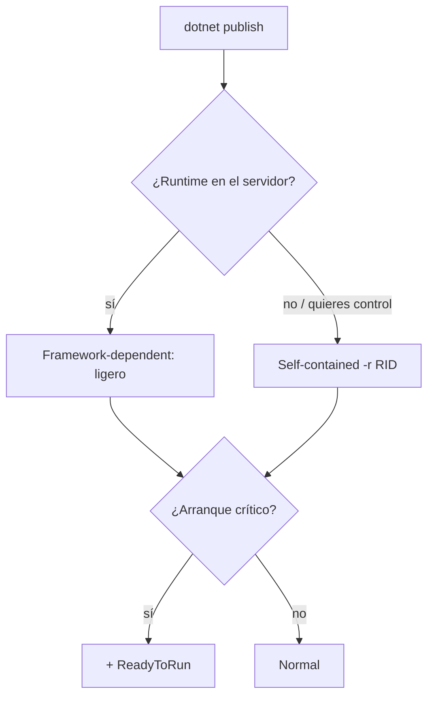

# Publicación y despliegue de .NET

Parte de: [[03-CSharp-DotNet/05 ASP.NET Core/_Índice ASP.NET Core|ASP.NET Core]]

> [!info] Cómo avanzar
> `progreso`: **pendiente** → **viendo** (estudiando) → **visto** (contestaste la autoevaluación sin abrir las respuestas) → **dominado** (hiciste el laboratorio o lo aplicaste de verdad).

## Contenido

### Qué es
**Publicar** es convertir tu proyecto en los archivos listos para ejecutarse en otro lugar: ensamblados compilados en Release, dependencias, `appsettings*.json`, archivos estáticos y, según el modo, el runtime de .NET. El comando es `dotnet publish`. **Desplegar** es llevar esa salida al servidor: IIS ([[Publicar en IIS (FTP y FileZilla)]]), Azure App Service, una imagen de contenedor ([[Dockerfile para .NET]]) o un servicio de Windows.

### Cómo funciona
Decisiones al publicar:

**1. Framework-dependent vs. self-contained.**
- **Framework-dependent** (por defecto): la salida contiene solo tu app y sus paquetes; el servidor debe tener **instalado** el runtime de .NET correcto (en IIS, el *Hosting Bundle*). Pesa poco (unos MB) y el runtime se actualiza con parches de seguridad del sistema.
- **Self-contained** (`--self-contained -r win-x64`): la salida incluye el runtime completo. No hay que instalar nada en el servidor, pero pesa decenas de MB más, es específico de una plataforma (*RID*: `win-x64`, `linux-x64`, `linux-arm64`) y **tú** eres responsable de republicar cuando salga un parche de seguridad del runtime.

**2. Optimizaciones opcionales.**
- **ReadyToRun** (`-p:PublishReadyToRun=true`, requiere RID): precompila el IL a código nativo para la plataforma. La app **arranca más rápido** porque el JIT trabaja menos al inicio; los ensamblados pesan más. El JIT sigue disponible y, con *tiered compilation*, puede reoptimizar el código caliente.
- **Single file** (`-p:PublishSingleFile=true`): un solo ejecutable.
- **Trimming** (`-p:PublishTrimmed=true`, solo self-contained): elimina código no usado; requiere cuidado con reflexión.
- **Native AOT**: compilación nativa completa, con fuertes restricciones ([[Native AOT y rendimiento]]).



**3. Configuración.** Desde .NET 8, `dotnet publish` usa la configuración **Release** por defecto; aun así, escribir `-c Release` deja el comando explícito y claro en pipelines y scripts.

### Ejemplo
Publicaciones típicas:

```powershell
dotnet publish src/Itzamna.Dionisio.API -c Release -o ./publicar
dotnet publish src/Itzamna.Dionisio.API -c Release -r win-x64 --self-contained -o ./publicar-sc
dotnet publish src/Itzamna.Dionisio.API -c Release -r linux-x64 -p:PublishReadyToRun=true -o ./publicar-r2r
```

La primera es framework-dependent, para IIS con Hosting Bundle o App Service; la segunda incluye el runtime para un servidor sin .NET; la tercera precompila con ReadyToRun para Linux.

Perfil de publicación en el `.csproj` para no repetir parámetros:

```xml
<PropertyGroup Condition="'$(Configuration)' == 'Release'">
  <RuntimeIdentifier>win-x64</RuntimeIdentifier>
  <SelfContained>false</SelfContained>
  <PublishReadyToRun>true</PublishReadyToRun>
</PropertyGroup>
```

En Azure DevOps, el pipeline hace lo mismo y deja la salida como artefacto:

```yaml
steps:
  - task: DotNetCoreCLI@2
    inputs:
      command: publish
      projects: src/Itzamna.Dionisio.API/Itzamna.Dionisio.API.csproj
      arguments: -c Release -o $(Build.ArtifactStagingDirectory)/api
      publishWebProjects: false
      zipAfterPublish: true
  - publish: $(Build.ArtifactStagingDirectory)/api
    artifact: api
```

Después, una etapa de despliegue toma el artefacto y lo sube a App Service (`AzureWebApp@1`) o a un servidor IIS ([[Azure Pipelines]]). La configuración y secretos **no** van en la salida: se ponen como variables de entorno o settings del servidor ([[Configuración y appsettings]]).

### Cuándo usarlo y cuándo no
- **Framework-dependent** por defecto en servidores administrados (IIS con Hosting Bundle, App Service).
- **Self-contained** cuando no controlas el servidor, necesitas una versión de runtime que no está instalada o distribuyes una herramienta.
- **ReadyToRun** cuando el arranque importa (escalado rápido, funciones, apps que se reciclan seguido); en una API que arranca una vez al día, la ganancia es pequeña.
- **No** publiques desde tu máquina a producción si existe un pipeline: lo que no está en CI no es reproducible.

### Errores comunes
- **Publicar en Debug** con scripts viejos que no ponen `-c Release`.
- **Self-contained sin actualizar**: el runtime incluido se queda sin parches de seguridad.
- **Copiar `appsettings.Development.json`** con secretos al servidor: exclúyelo o, mejor, no pongas secretos en ningún json.
- **RID incorrecto** (publicar `linux-x64` para un Windows).
- **Mezclar archivos viejos y nuevos** al copiar sobre la carpeta de una versión anterior: limpia o usa despliegue atómico.

### Para profundizar
- [Panorama de publicación de aplicaciones .NET (Microsoft Learn)](https://learn.microsoft.com/dotnet/core/deploying/)
- [Compilación ReadyToRun (Microsoft Learn)](https://learn.microsoft.com/dotnet/core/deploying/ready-to-run)
- [dotnet publish (Microsoft Learn)](https://learn.microsoft.com/dotnet/core/tools/dotnet-publish)

## Autoevaluación

Contesta primero en voz alta o en papel; luego despliega la respuesta.

> [!question]- ¿Qué diferencia hay entre *framework-dependent* y *self-contained*?
> Framework-dependent requiere el runtime instalado en el servidor y pesa poco. Self-contained incluye el runtime (`--self-contained -r win-x64`): más grande pero sin instalar nada.

> [!question]- ¿Qué comando publica en Release?
> `dotnet publish -c Release -o ./publicar`.

> [!question]- ¿Qué es ReadyToRun?
> Precompila el IL a nativo (`-p:PublishReadyToRun=true`) para arrancar más rápido; el JIT sigue disponible.

