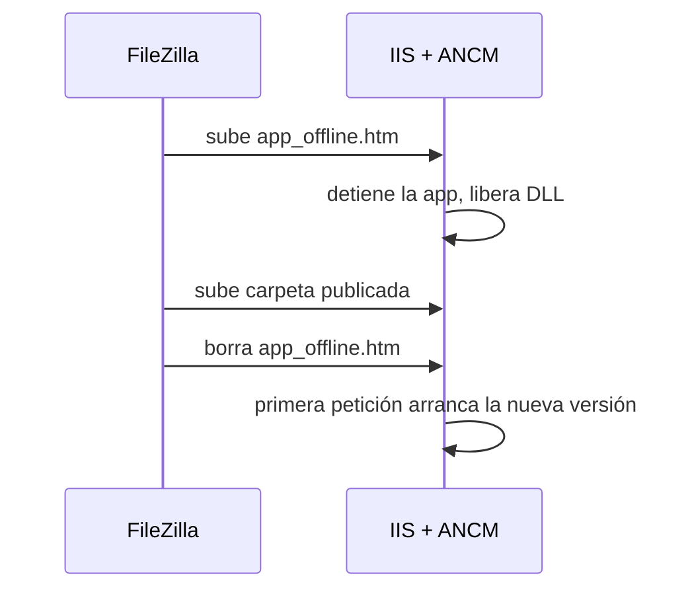

# Publicar en IIS (FTP y FileZilla)

Parte de: [[03-CSharp-DotNet/05 ASP.NET Core/_Índice ASP.NET Core|ASP.NET Core]]

> [!info] Cómo avanzar
> `progreso`: **pendiente** → **viendo** (estudiando) → **visto** (contestaste la autoevaluación sin abrir las respuestas) → **dominado** (hiciste el laboratorio o lo aplicaste de verdad).

## Contenido

### Qué es
Publicar una API ASP.NET Core en **IIS** (Internet Information Services, el servidor web de Windows Server) es muy común en empresas con servidores propios. El flujo manual típico: `dotnet publish` en tu máquina o en el pipeline, y copiar la carpeta de salida al servidor por **FTP/FTPS** con un cliente como **FileZilla** (gratuito). IIS recibe las peticiones y, mediante el **ASP.NET Core Module (ANCM)**, ejecuta tu app.

### Cómo funciona
**Lo que necesita el servidor:**
1. El **ASP.NET Core Hosting Bundle** de la versión **mayor** de .NET que usa tu app (por ejemplo, 10.0). Instala el runtime de .NET, el runtime de ASP.NET Core y el módulo **`AspNetCoreModuleV2`** para IIS. Si instalas el bundle antes que IIS, hay que repararlo después. Tras instalarlo suele requerirse reiniciar IIS (`iisreset`) o el servidor.
2. Un **App Pool** con ".NET CLR version" en **"No Managed Code"**: la app no corre sobre el CLR de .NET Framework, sino sobre .NET, que el módulo carga.
3. Un **sitio** o **aplicación** apuntando a la carpeta publicada, con permisos de lectura para la identidad del App Pool (`IIS AppPool\NombreDelPool`) y de escritura solo donde haga falta (logs).

**El `web.config`** que genera `dotnet publish` le indica a IIS:
- Que use el handler `AspNetCoreModuleV2` para todas las rutas.
- Qué ejecutar: `processPath="dotnet"` y `arguments=".\Mi.Api.dll"` (o el `.exe` si es self-contained).
- El **modelo de hospedaje**: `inprocess` (por defecto, la app corre dentro del proceso `w3wp.exe` de IIS, más rápido) u `outofprocess` (IIS hace de proxy hacia Kestrel en otro proceso).
- Variables de entorno (`ASPNETCORE_ENVIRONMENT`) y el **log de stdout** (`stdoutLogEnabled`, `stdoutLogFile`) para diagnosticar fallas al arrancar.

**Por qué falla sobrescribir las DLL por FTP:** mientras la app corre, el proceso de IIS tiene **bloqueados** los ensamblados. FileZilla reporta error al reemplazar `Mi.Api.dll`. La solución estándar es **`app_offline.htm`**: al subir un archivo con ese nombre a la raíz de la app, el módulo detiene la aplicación (y muestra ese HTML a quien entre); copias los archivos nuevos y luego **borras** `app_offline.htm` para que arranque la nueva versión.



### Ejemplo
Procedimiento:
1. `dotnet publish src/Itzamna.Dionisio.API -c Release -o ./publicar`.
2. En FileZilla, conecta por **FTPS** (FTP sobre TLS) o SFTP si el servidor lo ofrece; FTP plano manda la contraseña en claro.
3. Sube `app_offline.htm` a la raíz del sitio.
4. Sube el contenido de `./publicar` (sin `appsettings.Development.json`).
5. Borra `app_offline.htm` y prueba `/salud/vivo` ([[Health checks]]).

`web.config` con el log de stdout encendido temporalmente:

```xml
<?xml version="1.0" encoding="utf-8"?>
<configuration>
  <location path="." inheritInChildApplications="false">
    <system.webServer>
      <handlers>
        <add name="aspNetCore" path="*" verb="*" modules="AspNetCoreModuleV2" resourceType="Unspecified" />
      </handlers>
      <aspNetCore processPath="dotnet" arguments=".\Itzamna.Dionisio.API.dll"
                  stdoutLogEnabled="true" stdoutLogFile=".\logs\stdout" hostingModel="inprocess">
        <environmentVariables>
          <environmentVariable name="ASPNETCORE_ENVIRONMENT" value="Production" />
        </environmentVariables>
      </aspNetCore>
    </system.webServer>
  </location>
</configuration>
```

La carpeta `logs` debe existir y el App Pool debe poder escribir en ella. Apaga `stdoutLogEnabled` al terminar: no rota ni limpia archivos.

**"HTTP Error 500.30 - ASP.NET Core app failed to start"**: la app **falló al arrancar** en modo in-process. Revisa:
- El **Visor de eventos** de Windows (Registros de Windows → Aplicación), donde el módulo escribe la excepción.
- El log de **stdout** con el error completo.
- Causas típicas: falta configuración y `ValidateOnStart` de [[Options pattern]] lo detectó (¡bien!), cadena de conexión inválida, la identidad del App Pool no tiene permiso en SQL o en una carpeta, o el runtime instalado no coincide con el de la app.

Otros códigos útiles: **500.19** (no se entiende el `web.config`; casi siempre falta el Hosting Bundle), **500.31** (no encuentra el runtime requerido) y **502.5** (falla del proceso en modo out-of-process).

### Cuándo usarlo y cuándo no
- **FTP manual** está bien para un servidor de pruebas o una app pequeña; para producción, automatiza con Azure Pipelines y un agente en el servidor o Web Deploy ([[Azure Pipelines]]).
- Si buscas evitar el corte de `app_offline.htm`, el módulo admite *shadow copy* (copia las DLL antes de cargarlas) como alternativa (Pendiente de confirmar la configuración exacta en tu versión de IIS y .NET).
- En Azure, App Service hace todo esto por ti.

### Errores comunes
- **App Pool con CLR v4.0** en vez de "No Managed Code".
- **Olvidar `app_offline.htm`** o dejarlo subido: la app queda "en mantenimiento".
- **Sobrescribir el `web.config` del servidor** con uno que no tiene sus variables de entorno.
- **FTP sin TLS** en internet.
- **Dejar stdout encendido** semanas: llena el disco.

### Para profundizar
- [Hospedar ASP.NET Core en Windows con IIS (Microsoft Learn)](https://learn.microsoft.com/aspnet/core/host-and-deploy/iis/)
- [ASP.NET Core Hosting Bundle (Microsoft Learn)](https://learn.microsoft.com/aspnet/core/host-and-deploy/iis/hosting-bundle)
- [Solucionar problemas de ASP.NET Core en Azure App Service e IIS (Microsoft Learn)](https://learn.microsoft.com/aspnet/core/test/troubleshoot-azure-iis)
- [Cliente FileZilla](https://filezilla-project.org/)

## Autoevaluación

Contesta primero en voz alta o en papel; luego despliega la respuesta.

> [!question]- ¿Qué necesita el servidor IIS?
> El *ASP.NET Core Hosting Bundle* de la versión de .NET (instala el runtime y el módulo `AspNetCoreModuleV2`) y un App Pool con "No Managed Code".

> [!question]- ¿Por qué al subir por FTP falla al sobrescribir las DLL?
> La app en ejecución las tiene bloqueadas. Sube primero un `app_offline.htm` a la raíz (IIS detiene la app), copia los archivos y bórralo.

> [!question]- ¿Qué hace el `web.config` que genera `dotnet publish`?
> Le dice a IIS que use el módulo de ASP.NET Core, con qué ejecutable y modelo de hospedaje (`inprocess` u `outofprocess`); ahí también se habilita `stdoutLogEnabled` para diagnosticar fallas al arrancar.

> [!question]- La app da "HTTP Error 500.30". ¿Qué revisas?
> Que falló al arrancar: revisa el Visor de eventos o el log de stdout. Causas típicas: falta configuración (gracias a `ValidateOnStart`), cadena de conexión, runtime incorrecto.

