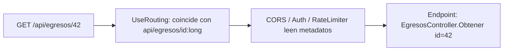

# Routing

Parte de: [[03-CSharp-DotNet/05 ASP.NET Core/_Índice ASP.NET Core|ASP.NET Core]]

> [!info] Cómo avanzar
> `progreso`: **pendiente** → **viendo** (estudiando) → **visto** (contestaste la autoevaluación sin abrir las respuestas) → **dominado** (hiciste el laboratorio o lo aplicaste de verdad).

## Contenido

### Qué es
El **routing** es el mecanismo que relaciona una petición (verbo + URL) con el código que la atiende. En ASP.NET Core moderno se llama **endpoint routing**: todo lo que puede responder (acciones de controllers, Minimal APIs, health checks, el documento OpenAPI) se registra como un *endpoint* con su plantilla de ruta y sus metadatos (atributos). En una API con controllers, las rutas se declaran con atributos: `[Route]` en la clase y `[HttpGet]`, `[HttpPost]`... en las acciones.

### Cómo funciona
El trabajo se divide en dos pasos separados dentro del [[Pipeline y middleware]]:
1. **`UseRouting`** compara la petición con todas las plantillas y **elige** el endpoint. Lo deja en `HttpContext.GetEndpoint()` junto con sus metadatos y los valores de ruta (`id`, `slug`...).
2. El middleware de **endpoints** (al final del pipeline, implícito en `MapControllers`) lo **ejecuta**.

Entre ambos pasos corren CORS, autenticación, autorización, rate limiting y output caching, y todos pueden preguntar "¿qué endpoint es y qué atributos tiene?". Por eso `[Authorize]`, `[EnableRateLimiting]` o `[OutputCache]` funcionan aunque los middleware corran antes del controller.



**Combinación de atributos.** El `[Route("api/egresos")]` de la clase es un prefijo; la plantilla de cada acción se le concatena. `[HttpGet("{id:long}")]` en la acción produce `GET api/egresos/{id}`. Si la plantilla de la acción empieza con `/` o `~/`, **ignora** el prefijo del controller. También existen *tokens* como `[Route("api/[controller]")]`, que se reemplaza por el nombre de la clase sin "Controller"; muchos equipos prefieren el texto literal para que renombrar la clase no rompa la URL pública.

**Restricciones de ruta.** `{id:long}`, `{id:guid}`, `{version:int}`, `{slug:minlength(3)}`, `{n:range(1,100)}`... hacen que la plantilla solo coincida si el segmento cumple el tipo. Si no cumple, la ruta **no coincide** y el resultado es 404 (o se prueba otra ruta). Sirven para desambiguar (`/{id:long}` contra `/{slug}`) y para no entrar a la acción con basura. **No son validación de negocio**: "el monto debe ser positivo" o "el id debe existir" va en FluentValidation o en el handler, con un 400 o 404 con tu `codigo`.

### Ejemplo
Controller delgado al estilo de tus slices:

```csharp
[ApiController]
[Route("api/egresos")]                       // prefijo
public sealed class EgresosController : ControllerBase
{
    [HttpGet]                                 // GET api/egresos
    public Task<IReadOnlyList<ListarEgresos.Item>> Listar(
        [FromQuery] ListarEgresos.Query q, [FromServices] ListarEgresos.Handler h, CancellationToken ct) =>
        h.Handle(q, ct);

    [HttpGet("{id:long}")]                    // GET api/egresos/42 ; /api/egresos/abc -> 404
    public Task<ActionResult<ObtenerEgreso.Dto>> Obtener(
        long id, [FromServices] ObtenerEgreso.Handler h, CancellationToken ct) =>
        h.Handle(new(id), ct);

    [HttpPost("{id:long}/cancelar")]          // POST api/egresos/42/cancelar
    public Task<IActionResult> Cancelar(long id, [FromServices] CancelarEgreso.Handler h, CancellationToken ct) =>
        h.Handle(new(id), ct);
}
```

Para ver qué rutas quedaron registradas, abre el documento OpenAPI (`/openapi/v1.json`) o usa el *Endpoints Explorer* de Visual Studio.

### Cuándo usarlo y cuándo no
- En APIs, usa **attribute routing** siempre; el *conventional routing* (`{controller}/{action}/{id?}`) es para MVC con vistas.
- Usa restricciones de tipo en ids (`long`, `guid`, `int`); evita las de regex complejas, que cuestan y confunden.
- Usa rutas en sustantivo plural y acciones como subrecurso (`/{id}/cancelar`) cuando no encajan en CRUD.
- Si la API necesita versiones en la URL, combina con [[Versionado de API en ASP.NET Core]].

### Errores comunes
- **Usar restricciones como validación** y esperar un 400: dan 404.
- **Rutas ambiguas** (`{id}` y `{slug}` sin restricción): `AmbiguousMatchException` en ejecución.
- **Empezar la plantilla de acción con `/`** sin querer y perder el prefijo del controller.
- **`[Route("api/[controller]")]` y luego renombrar la clase**: rompe a los clientes (Clio, Iris).
- **Olvidar el verbo** (`[HttpGet]`) en una acción: con `[ApiController]` la acción no tiene ruta y no se expone como esperas.

### Para profundizar
- [Routing en ASP.NET Core (Microsoft Learn)](https://learn.microsoft.com/aspnet/core/fundamentals/routing)
- [Routing a acciones de controllers (Microsoft Learn)](https://learn.microsoft.com/aspnet/core/mvc/controllers/routing)
- [[ASP.NET Core Controllers]]

## Autoevaluación

Contesta primero en voz alta o en papel; luego despliega la respuesta.

> [!question]- ¿Qué hace el *endpoint routing*?
> `UseRouting` elige el endpoint que coincide con la URL y el verbo; el middleware de endpoints lo ejecuta al final. Entre ambos, auth y CORS ya saben qué endpoint es.

> [!question]- ¿Para qué son las restricciones de ruta como `{id:long}`?
> Para que la ruta solo coincida con el tipo esperado; si no, responde 404 en lugar de entrar a la acción con un valor inválido. No son validación de negocio.

> [!question]- ¿Qué diferencia hay entre `[Route("api/egresos")]` en el controller y `[HttpGet("{id:long}")]` en la acción?
> Se combinan: la acción queda en `GET api/egresos/{id}`.

