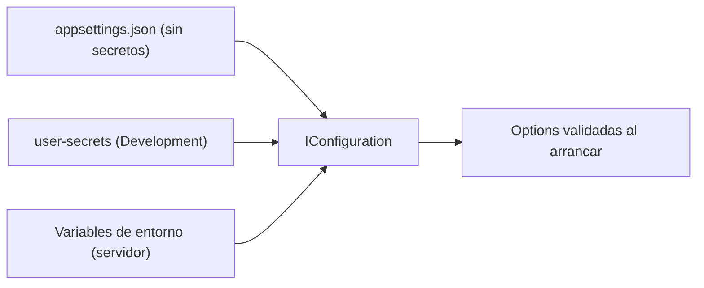

---
proyecto:
  - Ocelotl.Hermes
  - Itzamna.Dionisio
proyectos:
  - "[[Ocelotl.Hermes]]"
  - "[[Itzamna.Dionisio]]"
tipo: concepto
nivel: basico
estado: completo
tags:
  - conocimiento
  - backend
  - dotnet
  - seguridad
  - configuracion
progreso: pendiente
area: C# y .NET
---
# Secretos con User Secrets

> Los tokens, llaves y cadenas de conexión **no van en `appsettings.json`**: en desarrollo viven en *user-secrets* y en el servidor en variables de entorno o en un almacén de secretos.

## Qué es y qué problema resuelve
`appsettings.json` se sube al repositorio y se copia al publicar. Un secreto ahí queda en el historial de git, en cada carpeta de publicación y en cada copia del proyecto. User Secrets guarda los valores **fuera del proyecto**, en el perfil del usuario, y ASP.NET los mezcla con la configuración.

## Cómo funciona por dentro
- `<UserSecretsId>` en el `.csproj` identifica el proyecto.
- `dotnet user-secrets set "Seccion:Llave" "valor" --project API` escribe en:
  - Windows: `%APPDATA%\Microsoft\UserSecrets\<id>\secrets.json`
  - Linux/macOS: `~/.microsoft/usersecrets/<id>/secrets.json`
- `WebApplication.CreateBuilder` los carga **solo en Development** y después de `appsettings.*.json`, así que ganan.
- En el servidor: variables de entorno con `__` como separador (`Azure__Pat`), App Service → Variables de entorno, o Azure Key Vault.
- **No cifra nada**: es un archivo de texto fuera del repositorio, no una bóveda.

## Cuándo usarla y cuándo no
### Ventajas
- Cero cambios de código: la llave se lee igual (`Azure:Pat`).
- Cada desarrollador usa su propio token.
### Desventajas
- Solo para desarrollo; en el servidor hace falta otra fuente.
- Si falta el secreto, sin validación la app arranca con un valor vacío.

## Alternativas
| Alternativa | En qué se diferencia |
|---|---|
| Variables de entorno | Lo normal en servidores; también sirve en local |
| Azure Key Vault | Bóveda real con rotación y auditoría |
| `appsettings.Development.json` fuera de git | Fácil de subir por error |
| Managed Identity | Sin secreto: el servidor se autentica con su identidad |

## Cómo se usó en ReporteriaAzure

[[ReporteriaAzure]] lo probó y **lo descartó**: se publica copiando la carpeta al servidor por FileZilla, sin variables de entorno, así que el PAT se queda en `appsettings.json`. Lo que sí se conservó es la validación al arrancar (`ValidateOnStart`): sin PAT la API no levanta ([[Options pattern]]).

Cuando la publicación es por copia de carpeta, lo que protege el token es:
- un PAT con el **mínimo alcance** (*Work Items: Read*) y fecha de caducidad;
- acceso restringido a la carpeta del servidor y al repositorio.

> [!warning] Un secreto que estuvo en un archivo se da por filtrado
> Si el repositorio o la carpeta de publicación se comparten, quitarlo del archivo no basta: hay que **revocarlo y crear otro**, porque sigue en copias, publicaciones e historial.

## Cómo se usó en otros proyectos
- [[Ocelotl.Hermes]]: `Argo:ApiKey` por user-secrets o `Argo__ApiKey`.
- [[Itzamna.Dionisio]]: cadena de conexión por user-secrets; en producción, App Service → Variables de entorno.

## Errores comunes y buenas prácticas
- Pensar que borrar el secreto del archivo lo "des-filtra".
- Olvidar que user-secrets no se carga fuera de Development.
- No validar al arrancar: la app falla a media petición con un 401 confuso.

## Qué estudiar después
- [[Options pattern]] (`ValidateOnStart`), Azure Key Vault, Managed Identity.

## Documentación oficial
- https://learn.microsoft.com/aspnet/core/security/app-secrets

## Autoevaluación

Contesta primero en voz alta o en papel; luego despliega la respuesta.

> [!question]- ¿Dónde se guardan los User Secrets?
> Fuera del repositorio, en `%APPDATA%\Microsoft\UserSecrets\<UserSecretsId>\secrets.json` (en Windows). El proyecto solo guarda el `UserSecretsId`.

> [!question]- ¿Están cifrados?
> No: son texto plano en tu perfil. Sirven para no subir secretos a git, no como bóveda.

> [!question]- ¿Cómo agregas uno y cuándo se cargan?
> `dotnet user-secrets set "ConnectionStrings:Principal" "..."`. Se cargan automáticamente solo en el entorno `Development`.

