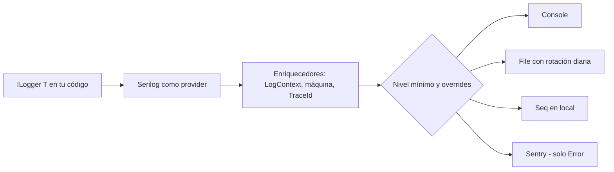

# Serilog

Parte de: [[03-CSharp-DotNet/05 ASP.NET Core/_Índice ASP.NET Core|ASP.NET Core]]

> [!info] Cómo avanzar
> `progreso`: **pendiente** → **viendo** (estudiando) → **visto** (contestaste la autoevaluación sin abrir las respuestas) → **dominado** (hiciste el laboratorio o lo aplicaste de verdad).

## Contenido

### Qué es
**Serilog** es una biblioteca de logging estructurado para .NET muy usada en producción. Se conecta debajo del `ILogger<T>` estándar ([[Logging con ILogger]]): tu código sigue escribiendo `log.LogInformation("Egreso {EgresoId} creado", id)` y Serilog se encarga de **a dónde** va cada evento y con qué propiedades extra. Es de código abierto (licencia Apache 2.0) y gratuita.

Lo que agrega sobre los providers que trae .NET:
- **Sinks**: decenas de destinos (consola con formato, archivos con rotación, Seq, Sentry, Application Insights, Elasticsearch, SQL Server), cada uno como paquete NuGet.
- **Enriquecedores**: agregan propiedades a todos los eventos (`FromLogContext`, nombre de máquina, hilo, entorno, versión).
- **Configuración desde `appsettings.json`** con `Serilog.Settings.Configuration`.
- **Request logging**: una sola línea resumida por petición HTTP en lugar de varias líneas de ASP.NET Core.

### Cómo funciona


1. Serilog reemplaza a los providers por defecto de `ILogger` (o se agrega a ellos).
2. Cada evento conserva la plantilla y sus propiedades.
3. Los enriquecedores le suman propiedades comunes.
4. Cada sink puede tener su propio nivel mínimo.

Integración en ASP.NET Core con el paquete `Serilog.AspNetCore` (incluye consola, archivo y lectura de configuración):
- `builder.Services.AddSerilog(...)` lo registra como sistema de logging.
- `app.UseSerilogRequestLogging()` emite **una línea por petición** con método, ruta, status y duración. Conviene ponerlo temprano en el pipeline y bajar a `Warning` los logs de `Microsoft.AspNetCore` para no duplicar.
- Un *bootstrap logger* captura errores que ocurren antes de que la app termine de arrancar.

### Ejemplo
`Program.cs`:

```csharp
using Serilog;

Log.Logger = new LoggerConfiguration()
    .WriteTo.Console()
    .CreateBootstrapLogger();          // log mínimo mientras arranca

try
{
    var builder = WebApplication.CreateBuilder(args);

    builder.Services.AddSerilog((sp, lc) => lc
        .ReadFrom.Configuration(builder.Configuration)
        .ReadFrom.Services(sp)
        .Enrich.FromLogContext());

    builder.Services.AddControllers();
    var app = builder.Build();

    app.UseSerilogRequestLogging();
    app.UseExceptionHandler();
    app.MapControllers();
    app.Run();
}
catch (Exception ex)
{
    Log.Fatal(ex, "La aplicación no pudo arrancar");
}
finally
{
    Log.CloseAndFlush();               // vacía los buffers de los sinks
}
```

`appsettings.json`:

```json
{
  "Serilog": {
    "MinimumLevel": {
      "Default": "Information",
      "Override": { "Microsoft.AspNetCore": "Warning" }
    },
    "WriteTo": [
      { "Name": "Console" },
      { "Name": "File", "Args": { "path": "logs/dionisio-.log", "rollingInterval": "Day", "retainedFileCountLimit": 14 } }
    ]
  }
}
```

**Serilog y Sentry.** Cumplen papeles distintos y se complementan:
- **Sentry** (`Sentry.AspNetCore` con `builder.WebHost.UseSentry(...)`) captura excepciones, agrupa errores, guarda contexto de la petición y trazas de rendimiento.
- **Serilog** guarda el historial de lo que pasó.
- Con el paquete **`Sentry.Serilog`** agregas Sentry como sink: los eventos `Error` o mayores se envían como eventos de Sentry y los de `Information` quedan como *breadcrumbs* (migas que dan contexto al error). Configura `MinimumEventLevel` en `Error` para no llenar Sentry de ruido, y si ya inicializaste el SDK con `UseSentry`, no repitas el DSN en el sink.

### Cuándo usarlo y cuándo no
- **Sí** cuando necesitas archivos con rotación, Seq para buscar logs en local o varios destinos con niveles distintos.
- **Sí** en apps desplegadas en IIS o servidores propios, donde la consola no la ve nadie.
- **Quizá no** si todo va a Azure y ya usas OpenTelemetry con Application Insights: el `ILogger` estándar con el exportador puede bastar.
- Tu código de negocio **no** debe depender de `Serilog.Log` estático; usa `ILogger<T>`.

### Errores comunes
- **No llamar `Log.CloseAndFlush()`**: se pierden los últimos eventos al apagar.
- **Duplicar logs** de peticiones: `UseSerilogRequestLogging` más los de `Microsoft.AspNetCore` en `Information`.
- **Archivos sin `retainedFileCountLimit`**: llenan el disco del servidor.
- **Mandar todo a Sentry**: consumes la cuota del plan y escondes los errores reales.
- **Escribir logs en la carpeta de la app en IIS** sin permisos para el App Pool: no se crea nada y no hay error visible.

### Para profundizar
- [Serilog.AspNetCore (GitHub)](https://github.com/serilog/serilog-aspnetcore)
- [Sitio oficial de Serilog](https://serilog.net/)
- [Sentry para ASP.NET Core](https://docs.sentry.io/platforms/dotnet/guides/aspnetcore/)
- [Sentry con Serilog](https://docs.sentry.io/platforms/dotnet/guides/serilog/)

## Autoevaluación

Contesta primero en voz alta o en papel; luego despliega la respuesta.

> [!question]- ¿Qué agrega Serilog sobre el `ILogger` estándar?
> Muchos *sinks* (archivo, Seq, Sentry, Application Insights), enriquecedores (`FromLogContext`, máquina, hilo) y configuración desde `appsettings`. Tu código sigue usando `ILogger<T>`.

> [!question]- ¿Cómo se integra en ASP.NET Core?
> Paquete `Serilog.AspNetCore` y `builder.Services.AddSerilog((sp, lc) => lc.ReadFrom.Configuration(builder.Configuration));` más `app.UseSerilogRequestLogging()` para una línea por petición.

> [!question]- ¿Cómo conviven Serilog y Sentry?
> Sentry captura excepciones y trazas; Serilog los logs. Con `Sentry.Serilog` los eventos `Error` también llegan a Sentry, configurando el nivel mínimo para no duplicar ruido.

