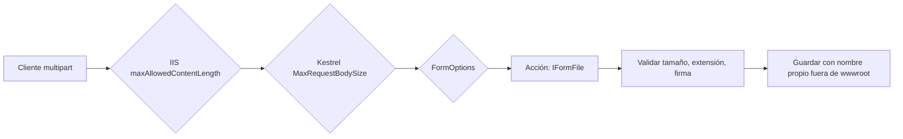

# Subida y descarga de archivos

Parte de: [[03-CSharp-DotNet/05 ASP.NET Core/_Índice ASP.NET Core|ASP.NET Core]]

> [!info] Cómo avanzar
> `progreso`: **pendiente** → **viendo** (estudiando) → **visto** (contestaste la autoevaluación sin abrir las respuestas) → **dominado** (hiciste el laboratorio o lo aplicaste de verdad).

## Contenido

### Qué es
Recibir archivos (fotos para la biblioteca de medios de Dionisio, un Excel de carga masiva, un PDF de comprobante) y devolverlos (reportes de Wee.Reporteria, descargas de documentos) son tareas comunes en una API. ASP.NET Core las resuelve con `IFormFile` para subir mediante `multipart/form-data` y con los resultados `File(...)` para descargar. Lo delicado no es el código, sino los **límites** de tamaño y la **seguridad**: un archivo es entrada no confiable.

### Cómo funciona
**Subida.** El navegador o cliente manda un `multipart/form-data` con una o varias partes. En la acción recibes `IFormFile` (o `IFormFileCollection`) con `[FromForm]`, y con `[ApiController]` se infiere. `IFormFile` te da `FileName`, `ContentType`, `Length` y `OpenReadStream()`. ASP.NET Core **guarda en búfer** el archivo (en memoria si es pequeño, en un archivo temporal si pasa de cierto tamaño), así que con `IFormFile` el archivo completo ya llegó al servidor antes de que tu acción corra. Para archivos muy grandes (cientos de MB o más) existe la lectura por **streaming** con `MultipartReader`, que procesa por partes sin almacenar todo.

**Límites** (los tres deben permitir el tamaño que esperas):
- **Kestrel**: `MaxRequestBodySize`, por defecto **30,000,000 bytes (unos 28.6 MB)**. Se cambia globalmente en `KestrelServerOptions.Limits` o por acción con `[RequestSizeLimit(bytes)]` (o `[DisableRequestSizeLimit]`).
- **Formularios**: `FormOptions.MultipartBodyLengthLimit`, por defecto 128 MB; por acción con `[RequestFormLimits(MultipartBodyLengthLimit = ...)]`.
- **IIS**: `requestLimits maxAllowedContentLength` en `web.config`, también unos 30,000,000 bytes por defecto. Si publicas en IIS ([[Publicar en IIS (FTP y FileZilla)]]) y no lo ajustas, IIS rechaza con 413 antes de llegar a tu app.

**Descarga.** `return File(stream, contentType, nombreDescarga)` envía el contenido con `Content-Disposition: attachment; filename=...`. Con `enableRangeProcessing: true` el servidor acepta peticiones `Range`, que permiten **reanudar descargas** y adelantar video. `PhysicalFile(ruta, ...)` sirve un archivo del disco de forma eficiente. El stream se libera al terminar la respuesta.



### Ejemplo
Subida de un comprobante con validaciones:

```csharp
[HttpPost("{egresoId:long}/comprobante")]
[Consumes("multipart/form-data")]
[RequestSizeLimit(10 * 1024 * 1024)]                         // 10 MB para esta acción
public async Task<IActionResult> SubirComprobante(long egresoId, [FromForm] IFormFile archivo,
    [FromServices] GuardarComprobante.Handler h, CancellationToken ct)
{
    var r = await h.Handle(new(egresoId, archivo), ct);
    return r.EsExito ? Created($"api/egresos/{egresoId}/comprobante", null) : this.Problema(r);
}

// Dentro del handler: validación por contenido, no por lo que dice el cliente
private static readonly byte[] FirmaPdf = "%PDF"u8.ToArray();
private static readonly byte[] FirmaPng = [0x89, 0x50, 0x4E, 0x47];

static async Task<bool> EsPermitido(IFormFile f, CancellationToken ct)
{
    var ext = Path.GetExtension(f.FileName).ToLowerInvariant();
    if (ext is not (".pdf" or ".png") || f.Length is 0 or > 10 * 1024 * 1024) return false;

    var cabecera = new byte[4];
    await using var s = f.OpenReadStream();
    await s.ReadExactlyAsync(cabecera, ct);
    return ext == ".pdf" ? cabecera.AsSpan().StartsWith(FirmaPdf) : cabecera.AsSpan().SequenceEqual(FirmaPng);
}

// Guardar con nombre generado, fuera de wwwroot (o en Azure Blob Storage)
var nombre = $"{Guid.NewGuid():N}{ext}";
var ruta = Path.Combine(opciones.CarpetaComprobantes, nombre);
```

Descarga de un reporte de Excel generado en memoria:

```csharp
[HttpGet("reportes/ventas/{mes}")]
public async Task<IActionResult> Ventas(string mes, [FromServices] ReporteVentas.Handler h, CancellationToken ct)
{
    Stream excel = await h.Handle(new(mes), ct);    // MemoryStream con Position = 0
    return File(excel, "application/vnd.openxmlformats-officedocument.spreadsheetml.sheet",
        $"ventas-{mes}.xlsx", enableRangeProcessing: true);
}
```

Recuerda exponer `Content-Disposition` en CORS si el front necesita leer el nombre ([[CORS en ASP.NET Core]]).

### Cuándo usarlo y cuándo no
- **`IFormFile`** para archivos de hasta decenas de MB.
- **Streaming con `MultipartReader`** o subida directa del cliente a Azure Blob Storage con una URL SAS para archivos grandes: la API no carga con el tráfico.
- **Base64 en JSON** solo para archivos diminutos; infla el tamaño en un 33 %.
- Guarda en **Blob Storage** en vez de disco local si tienes varias instancias.

### Errores comunes
- **Confiar en `FileName` o `ContentType`**: los controla el cliente. Valida extensión contra una lista permitida y la **firma** de los primeros bytes; para imágenes, idealmente vuelve a procesarlas.
- **Usar el nombre original como ruta**: permite *path traversal* (`..\..\web.config`) y sobrescribir archivos. Genera tu propio nombre.
- **Guardar en `wwwroot`**: el archivo queda descargable (o ejecutable) por URL directa.
- **Subir solo el límite de Kestrel** y olvidar IIS o `FormOptions`: 413 misterioso.
- **Leer todo en memoria** (`CopyTo(MemoryStream)`) con archivos grandes: memoria disparada por petición.

### Para profundizar
- [Subir archivos en ASP.NET Core (Microsoft Learn)](https://learn.microsoft.com/aspnet/core/mvc/models/file-uploads)
- [Opciones y límites de Kestrel (Microsoft Learn)](https://learn.microsoft.com/aspnet/core/fundamentals/servers/kestrel/options)
- [OWASP: File Upload Cheat Sheet](https://cheatsheetseries.owasp.org/cheatsheets/File_Upload_Cheat_Sheet.html)

## Autoevaluación

Contesta primero en voz alta o en papel; luego despliega la respuesta.

> [!question]- ¿Cómo recibes un archivo en un controller?
> `IFormFile archivo` con `[FromForm]` (multipart/form-data). Para archivos grandes, lee el stream por partes en lugar de cargarlo en memoria.

> [!question]- ¿Qué límites existen?
> Kestrel limita el cuerpo a ~30 MB por defecto (`MaxRequestBodySize`); `[RequestSizeLimit]` y `FormOptions.MultipartBodyLengthLimit` lo ajustan.

> [!question]- ¿Qué validaciones de seguridad haces?
> No confiar en el nombre ni en el `ContentType` del cliente: valida extensión y firma del contenido, genera un nombre propio y guarda fuera de `wwwroot`.

> [!question]- ¿Cómo devuelves un archivo?
> `return File(stream, "application/pdf", "reporte.pdf");`. Con `enableRangeProcessing: true` permite descargas parciales.

