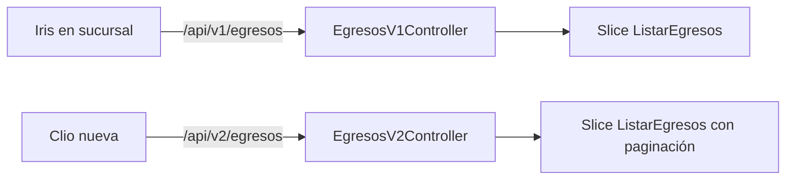

# Versionado de API en ASP.NET Core

Parte de: [[03-CSharp-DotNet/05 ASP.NET Core/_Índice ASP.NET Core|ASP.NET Core]]

> [!info] Cómo avanzar
> `progreso`: **pendiente** → **viendo** (estudiando) → **visto** (contestaste la autoevaluación sin abrir las respuestas) → **dominado** (hiciste el laboratorio o lo aplicaste de verdad).

## Contenido

### Qué es
**Versionar una API** es permitir que convivan dos o más contratos del mismo recurso (`v1` y `v2`) para poder evolucionarla **sin romper** a los clientes que ya la usan: Itzamna.Clio en producción, Ocelotl.Iris instalada en sucursales o integraciones de terceros que no se actualizan al mismo ritmo que tu backend.

### Cómo funciona
**Estrategias** para que el cliente diga qué versión quiere:
- **En la URL**: `/api/v1/egresos`. La más visible: se ve en logs, se prueba en el navegador y se cachea sin problemas. Es la más usada en APIs públicas.
- **En query string**: `/api/egresos?api-version=1.0`. Fácil de agregar a una API existente sin cambiar rutas.
- **En un header**: `X-Api-Version: 1.0` (o `api-version`). URLs limpias, pero menos visible y más difícil de probar a mano.
- **En el media type**: `Accept: application/json;v=2`. La más "REST purista" y la menos práctica.

Se pueden combinar lectores, pero conviene elegir una principal y ser consistente.

**Paquete**: `Asp.Versioning.Mvc` para controllers (la familia **Asp.Versioning**, sucesora de `Microsoft.AspNetCore.Mvc.Versioning`) y `Asp.Versioning.Mvc.ApiExplorer` para que cada versión tenga su propio documento OpenAPI. Se configura con `AddApiVersioning()` y se marca cada controller con `[ApiVersion("1.0")]`. Con `ReportApiVersions = true`, las respuestas incluyen headers `api-supported-versions` y `api-deprecated-versions` para que los clientes sepan qué existe.



**¿Cuándo hace falta una versión nueva?** Solo ante un **cambio que rompe** el contrato:
- Quitar o renombrar un campo, endpoint o parámetro.
- Cambiar el tipo o el significado de un campo (de `string` a objeto, de pesos a centavos).
- Volver obligatorio algo que era opcional.
- Cambiar códigos de estado o la forma de los errores (por ejemplo, tu `codigo` en ProblemDetails).

**No** hace falta para cambios compatibles: agregar un endpoint, agregar un campo **opcional** en la petición o un campo nuevo en la respuesta (si los clientes ignoran campos desconocidos, que es lo normal con JSON). La mayoría de las evoluciones caben en la misma versión.

### Ejemplo
Configuración con versión en la URL:

```csharp
using Asp.Versioning;

builder.Services.AddApiVersioning(o =>
    {
        o.DefaultApiVersion = new ApiVersion(1, 0);
        o.AssumeDefaultVersionWhenUnspecified = true;
        o.ReportApiVersions = true;
        o.ApiVersionReader = new UrlSegmentApiVersionReader();
    })
    .AddMvc()
    .AddApiExplorer(o =>
    {
        o.GroupNameFormat = "'v'VVV";          // v1, v2
        o.SubstituteApiVersionInUrl = true;
    });
```

Dos versiones del mismo recurso, cada una delgada y apuntando a su slice:

```csharp
[ApiController]
[ApiVersion("1.0", Deprecated = true)]
[Route("api/v{version:apiVersion}/egresos")]
public sealed class EgresosV1Controller : ControllerBase
{
    [HttpGet]
    public Task<IReadOnlyList<ListarEgresos.Item>> Listar([FromQuery] ListarEgresos.Query q,
        [FromServices] ListarEgresos.Handler h, CancellationToken ct) => h.Handle(q, ct);
}

[ApiController]
[ApiVersion("2.0")]
[Route("api/v{version:apiVersion}/egresos")]
public sealed class EgresosV2Controller : ControllerBase
{
    [HttpGet]
    public Task<Pagina<ListarEgresosV2.Item>> Listar([FromQuery] ListarEgresosV2.Query q,
        [FromServices] ListarEgresosV2.Handler h, CancellationToken ct) => h.Handle(q, ct);
}
```

Con el generador integrado de OpenAPI registras un documento por versión (`AddOpenApi("v1")` y `AddOpenApi("v2")`) para que Scalar muestre ambas ([[Microsoft.AspNetCore.OpenApi vs Swashbuckle]]).

Marcar `v1` como `Deprecated` no la apaga: avisa por header. Define y comunica una fecha de retiro, revisa en los logs quién sigue llamando a `v1` y retírala cuando llegue a cero.

### Cuándo usarlo y cuándo no
- **Sí** en APIs con clientes que no controlas o que no se despliegan junto con el backend (apps instaladas, terceros).
- **Sí** desde el primer día en APIs públicas, aunque solo exista `v1`: agregar el prefijo después rompe a todos.
- **Quizá no** en una API interna que solo consume un front que se despliega en el mismo pipeline: ahí basta con cambios compatibles y desplegar ambos juntos.
- **No** crees una versión por cada cambio pequeño.

### Errores comunes
- **Versionar todo por costumbre**: duplicas controllers y pruebas sin necesidad.
- **Copiar la lógica en `v2`**: versiona el contrato (controller y DTOs), no el negocio; reutiliza lo que no cambia.
- **Romper `v1` "solo un poquito"**: un campo renombrado ya es una versión nueva.
- **Nunca retirar versiones viejas**: el mantenimiento crece sin fin.
- **Versiones distintas en ruta y en OpenAPI** por no usar `SubstituteApiVersionInUrl`.

### Para profundizar
- [API Versioning para ASP.NET Core (GitHub)](https://github.com/dotnet/aspnet-api-versioning)
- [API versioning en aplicaciones .NET 10 (.NET Blog)](https://devblogs.microsoft.com/dotnet/api-versioning-in-dotnet-10-applications/)
- [Microsoft REST API Guidelines (GitHub)](https://github.com/microsoft/api-guidelines)

## Autoevaluación

Contesta primero en voz alta o en papel; luego despliega la respuesta.

> [!question]- ¿Qué estrategias de versionado hay?
> En la URL (`/api/v1/...`), en query (`?api-version=1.0`), en header o en media type. La de URL es la más visible y fácil de probar.

> [!question]- ¿Qué paquete se usa?
> `Asp.Versioning.Mvc` (y `.ApiExplorer` para OpenAPI): `AddApiVersioning()` y `[ApiVersion("1.0")]` en el controller.

> [!question]- ¿Cuándo hace falta una nueva versión?
> Ante un cambio que rompe a clientes: quitar o renombrar campos, cambiar tipos o significados. Agregar campos opcionales normalmente no la requiere.

