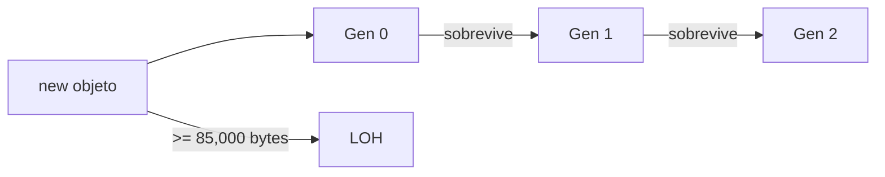

# Allocations y modos del GC

Parte de: [[03-CSharp-DotNet/06 Rendimiento en .NET/_Índice Rendimiento en .NET|Rendimiento en .NET]]

> [!info] Cómo avanzar
> `progreso`: **pendiente** → **viendo** (estudiando) → **visto** (contestaste la autoevaluación sin abrir las respuestas) → **dominado** (hiciste el laboratorio o lo aplicaste de verdad).

## Contenido

### Qué es
Una *allocation* es cada vez que tu código pide memoria en el heap administrado: crear un objeto, un arreglo, un `string`, una lambda que captura variables o un valor que se "encajona" (*boxing*). El recolector de basura (GC) de .NET recupera esa memoria cuando ya nadie la referencia. Entender cuánto y qué asignas, y en qué modo corre el GC, es la base para bajar latencia y consumo de memoria en una API como Itzamna.Dionisio. Repasa primero [[Recolector de basura]] si no tienes claras las generaciones.

### Cómo funciona
El heap se divide en generaciones:

- **Gen 0**: objetos recién creados. Se recolecta muy seguido y rápido.
- **Gen 1**: zona de paso entre los de vida corta y los de vida larga.
- **Gen 2**: objetos que sobrevivieron varias recolecciones (cachés, singletons). Recolectarla es caro.
- **LOH** (*Large Object Heap*): objetos de 85,000 bytes o más; se recolecta junto con gen 2 y por defecto no se compacta.
- **POH** (*Pinned Object Heap*): objetos fijados en memoria para interop.

Cada allocation consume presupuesto de gen 0; cuando se agota, ocurre una recolección. Durante partes de ella los hilos administrados se pausan. Por eso **menos allocations = menos recolecciones = menos pausas**, y además menos trabajo de CPU y mejor uso de caché. Si muchos objetos "medianos" sobreviven (porque los guardas un rato en una lista o en una tarea larga), pasan a gen 1 y gen 2 y provocan recolecciones completas, que son las que más se notan en la latencia p99.



#### Modos del GC
- **Workstation GC**: un solo heap y un hilo de recolección. Es el predeterminado en apps de consola y escritorio; minimiza memoria.
- **Server GC**: un heap y un hilo de GC por núcleo lógico. Prioriza *throughput*; es el predeterminado en ASP.NET Core. Usa más memoria porque cada heap tiene su propio presupuesto.
- **Concurrent / background GC**: en ambos modos, la recolección de gen 2 puede hacerse en segundo plano mientras tu código sigue corriendo (activado por defecto).
- **DATAS** (*Dynamic Adaptation To Application Sizes*): variante de Server GC que arranca con un solo heap y agrega o quita heaps según la carga, para que la memoria sea proporcional a los datos vivos y no al número de núcleos. Fue opcional en .NET 8 y está **activo por defecto desde .NET 9** cuando usas Server GC. Es muy útil en contenedores con varios núcleos y poca memoria.

Se configuran en el `.csproj` o en `runtimeconfig.json`:

```xml
<PropertyGroup>
  <ServerGarbageCollector>true</ServerGarbageCollector>
  <ConcurrentGarbageCollection>true</ConcurrentGarbageCollection>
</PropertyGroup>
<ItemGroup>
  <!-- 0 desactiva DATAS si necesitas el Server GC clásico -->
  <RuntimeHostConfigurationOption Include="System.GC.DynamicAdaptationMode" Value="0" />
</ItemGroup>
```

### Ejemplo
Un endpoint de Wee.Reporteria arma claves de caché así:

```csharp
// Antes: concatena, hace boxing del int y crea un arreglo por llamada
public string Clave(int id, string tipo) => string.Format("{0}:{1}", tipo, id);

// Después: interpolación con handler (sin boxing) sobre un buffer en la pila
public string Clave(int id, string tipo) => string.Create(null, stackalloc char[64], $"{tipo}:{id}");

// Antes: LINQ y lambda que captura 'minimo' en cada petición
var caros = pedidos.Where(p => p.Total > minimo).ToList();

// Después: bucle simple cuando es un camino caliente medido
var caros = new List<Pedido>(pedidos.Count);
foreach (var p in pedidos) if (p.Total > minimo) caros.Add(p);
```

Mídelo siempre con [[BenchmarkDotNet]] y `[MemoryDiagnoser]` antes y después (columna *Allocated*), como en [[Lab 8 - BenchmarkDotNet midiendo allocations]]. No reescribas todo el código: solo los caminos calientes que el perfil señala.

### Fuentes comunes de allocations ocultas
- **Boxing**: pasar un `int` o `struct` como `object` o interfaz (`string.Format`, colecciones no genéricas, `IComparable`).
- **Closures**: lambdas que capturan variables locales generan una clase y un delegado por llamada.
- **LINQ**: cada operador crea un iterador; `ToList()` crea la lista y sus redimensionamientos.
- **Strings**: concatenar en bucles, `Substring`, `Split`. Usa [[StringBuilder]] o [[Span y Memory]].
- **`params`** y arreglos temporales, `async` que no termina de forma síncrona (la máquina de estado va al heap).

### Cuándo usarlo y cuándo no
Optimiza allocations cuando un perfil o `dotnet-counters` muestra mucho tiempo en GC, tasa de asignación alta o p99 inestable. No lo hagas "por si acaso": el código con `Span`, pools y bucles manuales es más difícil de leer. Elige modo de GC según el escenario: Server (con DATAS) para APIs, Workstation para herramientas de consola o contenedores muy pequeños.

### Errores comunes
- **Optimizar sin medir**: cambias legibilidad por una ganancia que no existe. Mide primero.
- **Arreglos grandes temporales**: un `byte[100_000]` por petición cae en el LOH y fragmenta. Usa `ArrayPool<byte>.Shared`.
- **Olvidar devolver al pool**: `Rent` sin `Return` en `finally` pierde la ventaja.
- **Cachés sin límite**: todo termina en gen 2 y la memoria sólo crece. Usa expiración o tamaño máximo.
- **Llamar `GC.Collect()`**: casi nunca ayuda y rompe la heurística del runtime.

### Para profundizar
- [Fundamentos de la recolección de elementos no utilizados (Microsoft Learn)](https://learn.microsoft.com/dotnet/standard/garbage-collection/fundamentals)
- [Workstation y Server GC (Microsoft Learn)](https://learn.microsoft.com/dotnet/standard/garbage-collection/workstation-server-gc)
- [DATAS (Microsoft Learn)](https://learn.microsoft.com/dotnet/standard/garbage-collection/datas)
- [Opciones de configuración del GC (Microsoft Learn)](https://learn.microsoft.com/dotnet/core/runtime-config/garbage-collector)

## Autoevaluación

Contesta primero en voz alta o en papel; luego despliega la respuesta.

> [!question]- ¿Por qué reducir *allocations* mejora la latencia?
> Menos objetos nuevos significa menos recolecciones y pausas; en una API reduce la latencia p99 más que optimizar CPU.

> [!question]- ¿Qué diferencia hay entre Workstation GC y Server GC?
> Workstation: un heap, pensado para apps de escritorio. Server: un heap y un hilo de GC por núcleo, más rendimiento y más memoria; es el predeterminado en ASP.NET Core.

> [!question]- ¿Qué es DATAS?
> *Dynamic Adaptation To Application Sizes*: el Server GC ajusta el número de heaps según la carga; activo por defecto desde .NET 9. Útil en contenedores con poca memoria.

> [!question]- Tres fuentes comunes de allocations ocultas
> Closures en lambdas, *boxing* (`object`, interfaces sobre structs), `string` intermedios (`Substring`, `+`), LINQ en rutas calientes y `params` con arrays.

## Práctica

- [[Lab 8 - BenchmarkDotNet midiendo allocations]]

