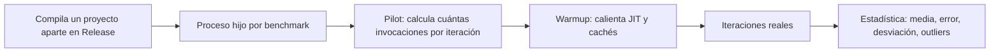

# BenchmarkDotNet

Parte de: [[03-CSharp-DotNet/06 Rendimiento en .NET/_Índice Rendimiento en .NET|Rendimiento en .NET]]

> [!info] Cómo avanzar
> `progreso`: **pendiente** → **viendo** (estudiando) → **visto** (contestaste la autoevaluación sin abrir las respuestas) → **dominado** (hiciste el laboratorio o lo aplicaste de verdad).

## Contenido

### Qué es
BenchmarkDotNet es la biblioteca estándar en .NET para hacer *microbenchmarks* confiables: mide cuánto tarda y cuánta memoria asigna un fragmento de código, repitiéndolo muchas veces y aplicando estadística para darte un resultado reproducible. Sirve para decidir entre dos implementaciones (por ejemplo, `string.Join` contra `StringBuilder`) con datos y no con intuición. Lo usa el propio equipo de .NET para medir el runtime.

### Cómo funciona
Medir con un `Stopwatch` en un bucle da números engañosos por varias razones: la primera llamada incluye la compilación JIT (ver [[JIT y tiered compilation]]), el compilador puede eliminar código cuyo resultado no usas, el GC puede dispararse en medio, la CPU cambia de frecuencia y otros procesos compiten. BenchmarkDotNet resuelve esto así:



1. Genera y compila un proyecto en **Release**, y se niega a correr si detecta Debug o un depurador conectado, porque el código sin optimizar no representa producción.
2. Ejecuta cada benchmark en un **proceso separado**, para aislar el estado.
3. Hace fases de *pilot* y *warmup* y luego muchas iteraciones; descarta valores atípicos.
4. Con diagnosticadores (`[MemoryDiagnoser]`, `[ThreadingDiagnoser]`, etc.) agrega columnas de memoria o hilos.

### Ejemplo
Proyecto de consola aparte (`Dionisio.Benchmarks`) con el paquete `BenchmarkDotNet`:

```csharp
using BenchmarkDotNet.Attributes;
using BenchmarkDotNet.Running;
using System.Text;

BenchmarkRunner.Run<ConcatenacionBenchmarks>();

[MemoryDiagnoser] // agrega Gen0, Gen1 y Allocated
public class ConcatenacionBenchmarks
{
    private string[] _codigos = [];

    [Params(10, 1000)]            // corre cada método con ambos tamaños
    public int Cantidad { get; set; }

    [GlobalSetup]
    public void Preparar() =>
        _codigos = Enumerable.Range(0, Cantidad).Select(i => $"C{i:D5}").ToArray();

    [Benchmark(Baseline = true)]
    public string ConSuma()
    {
        var r = "";
        foreach (var c in _codigos) r += c + ",";
        return r; // devolver el valor evita que el JIT elimine el trabajo
    }

    [Benchmark]
    public string ConStringBuilder()
    {
        var sb = new StringBuilder();
        foreach (var c in _codigos) sb.Append(c).Append(',');
        return sb.ToString();
    }

    [Benchmark]
    public string ConJoin() => string.Join(',', _codigos);
}
```

Se ejecuta con `dotnet run -c Release` (y sin depurador; desde la terminal, no con F5).

### Cómo leer el resultado
- **Mean**: tiempo promedio por operación. Es la columna principal.
- **Error** y **StdDev**: mitad del intervalo de confianza y desviación estándar. Si son grandes respecto a Mean, la medición es ruidosa; cierra programas y repite.
- **Median**: útil cuando hay picos.
- **Ratio**: comparación contra el método marcado `Baseline = true` (1.00). Un 0.10 es diez veces más rápido.
- **Gen0 / Gen1 / Gen2**: recolecciones por cada 1,000 operaciones.
- **Allocated**: bytes asignados por operación. Muchas veces es la métrica más estable y la que más importa en APIs (ver [[Allocations y modos del GC]]).

Los resultados se guardan en `BenchmarkDotNet.Artifacts/results` (Markdown, CSV, HTML) para compararlos o pegarlos en un PR.

### Cuándo usarlo y cuándo no
Úsalo para comparar implementaciones de código caliente, validar una optimización antes de mezclarla o detectar regresiones en funciones críticas (serialización, parsing, mapeos de Dapper). No sirve para medir un endpoint completo bajo carga ni la latencia de base de datos: para eso usa pruebas de carga (k6, `bombardier`) y [[Perfilado de rendimiento]] con [[dotnet-counters, dotnet-trace y dotnet-dump]]. Tampoco tiene sentido para código que corre una vez al arrancar.

### Errores comunes
- **Correr en Debug o con F5**: resultados inútiles; la herramienta lo advierte por algo.
- **No usar el resultado**: si el método es `void` y no devuelve nada, el JIT puede eliminar el cálculo y verás tiempos de nanosegundos irreales.
- **Preparar datos dentro del benchmark**: mides la creación de datos, no el algoritmo. Ponla en `[GlobalSetup]`.
- **Medir I/O real** (red, base): el ruido domina; aísla la lógica.
- **Optimizar por diferencias mínimas**: un 3 % dentro del margen de error no es una mejora.

### Para profundizar
- [Documentación de BenchmarkDotNet](https://benchmarkdotnet.org/articles/overview.html)
- [Repositorio en GitHub](https://github.com/dotnet/BenchmarkDotNet)
- Práctica guiada: [[Lab 8 - BenchmarkDotNet midiendo allocations]]

## Autoevaluación

Contesta primero en voz alta o en papel; luego despliega la respuesta.

> [!question]- ¿Por qué no medir rendimiento con un `Stopwatch` en un bucle?
> No calienta el JIT, no separa el ruido, no repite suficientes veces ni calcula errores; además el compilador puede eliminar código cuyo resultado no usas. BenchmarkDotNet resuelve todo eso.

> [!question]- ¿Cómo se escribe un benchmark que también mida memoria?
> ```csharp
> [MemoryDiagnoser]
> public class Concat {
>     [Params(10, 1000)] public int N;
>     [Benchmark(Baseline = true)] public string Mas() { var s = ""; for (int i = 0; i < N; i++) s += i; return s; }
>     [Benchmark] public string Builder() { var sb = new StringBuilder(); for (int i = 0; i < N; i++) sb.Append(i); return sb.ToString(); }
> }
> // BenchmarkRunner.Run<Concat>();
> ```

> [!question]- ¿Por qué debe correr en Release y sin depurador?
> En Debug el JIT no optimiza; BenchmarkDotNet incluso se niega a correr en Debug. Ejecuta `dotnet run -c Release`.

> [!question]- ¿Qué columnas miras en el resultado?
> `Mean` (tiempo medio), `Error`/`StdDev` (ruido), `Ratio` contra la línea base, `Allocated` (bytes por operación) y `Gen0` (recolecciones cada 1000 operaciones).

## Práctica

- [[Lab 8 - BenchmarkDotNet midiendo allocations]]

