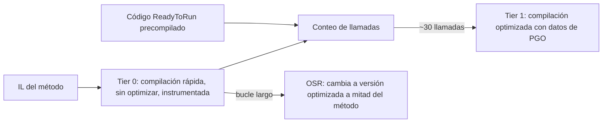

# JIT y tiered compilation

Parte de: [[03-CSharp-DotNet/06 Rendimiento en .NET/_Índice Rendimiento en .NET|Rendimiento en .NET]]

> [!info] Cómo avanzar
> `progreso`: **pendiente** → **viendo** (estudiando) → **visto** (contestaste la autoevaluación sin abrir las respuestas) → **dominado** (hiciste el laboratorio o lo aplicaste de verdad).

## Contenido

### Qué es
El código C# se compila a IL (lenguaje intermedio). Al ejecutarse, el **JIT** (*just-in-time compiler*, RyuJIT) traduce cada método a código máquina la primera vez que se llama. La **tiered compilation** (compilación por niveles) hace que el JIT compile primero rápido y sin optimizar, y luego recompile de forma optimizada solo los métodos que se usan mucho. Así se logra arranque rápido sin renunciar al rendimiento sostenido.

### Cómo funciona


1. **Tier 0**: la primera llamada compila el método casi sin optimizaciones. Compilar es barato y la app arranca pronto.
2. **Conteo**: el runtime cuenta las llamadas. Cuando un método pasa un umbral (del orden de 30 llamadas, después de un breve periodo de arranque), se encola para recompilar en segundo plano.
3. **Tier 1**: se compila con todas las optimizaciones (inlining, eliminación de comprobaciones de límites, registro de variables) y se reemplaza el punto de entrada.
4. Si el ensamblado tiene código **ReadyToRun** (precompilado con `PublishReadyToRun`), ese código se usa al inicio en lugar de tier 0 y luego también puede promoverse a tier 1.

#### Dynamic PGO
PGO significa *Profile-Guided Optimization*. Con **Dynamic PGO**, activo por defecto desde .NET 8, la versión tier 0 de los métodos calientes se instrumenta para registrar qué tipos concretos llegan a una llamada de interfaz o virtual, qué ramas se toman y qué tan seguido. Con esos datos, tier 1 aplica optimizaciones guiadas: por ejemplo, *guarded devirtualization* (si casi siempre `IConsulta` es `ConsultaPedidos`, el JIT pone un `if` rápido y hace inline de esa implementación), reordena bloques calientes y fríos y mejora el inlining. Es una de las razones por las que .NET moderno corre más rápido sin cambiar código.

#### OSR (On-Stack Replacement)
Un método que se llama una sola vez pero tiene un bucle de millones de iteraciones (un proceso batch que lee un Excel grande en Wee.Reporteria) nunca llegaría a 30 llamadas, así que se quedaría en tier 0 lento. Con **OSR**, el runtime detecta que el bucle lleva muchas vueltas, compila una versión optimizada y **salta a ella en medio de la ejecución**, conservando el estado de las variables locales. Antes de OSR, los métodos con bucles se compilaban directo optimizados, lo que hacía más lento el arranque.

### Por qué las primeras peticiones son más lentas
Al arrancar una API, la primera petición paga: carga de ensamblados, compilación JIT de controllers, middleware, serializadores y Dapper; construcción del contenedor de DI y de [[Options pattern|Options]]; apertura de la primera conexión del pool de SQL Server; generación de caches de mapeo. Las siguientes van con código tier 0 y, conforme se calientan, con tier 1.

### Ejemplo
Opciones en el `.csproj` de Itzamna.Dionisio para reducir el arranque en frío:

```xml
<PropertyGroup>
  <!-- Precompila a código nativo dentro de los ensamblados (sigue usando JIT para optimizar) -->
  <PublishReadyToRun>true</PublishReadyToRun>
  <!-- Valores por defecto; sólo cámbialos para experimentar -->
  <TieredCompilation>true</TieredCompilation>
  <TieredPGO>true</TieredPGO>
</PropertyGroup>
```

Y un calentamiento sencillo tras el despliegue (por ejemplo, en un paso del pipeline de Azure DevOps o en un *readiness probe*): invocar `/health` y uno o dos endpoints de lectura antes de enviar tráfico real. En Azure App Service puedes configurar *warm-up* con slots de despliegue.

### Cuándo usarlo y cuándo no
No necesitas tocar la tiered compilation en la mayoría de los casos: los valores por defecto son buenos. Considera **ReadyToRun** cuando el arranque importa (escalado automático, funciones, contenedores que se reciclan). Considera [[Native AOT y rendimiento|Native AOT]] si necesitas arranque mínimo y poca memoria, aceptando sus límites (sin reflexión dinámica libre, sin PGO dinámico). Desactivar tiered compilation (`TieredCompilation=false`) hace que todo se compile optimizado desde el inicio: arranque más lento, útil solo para ciertas mediciones.

### Errores comunes
- **Medir la primera llamada**: confundes costo de JIT con costo del algoritmo. Usa [[BenchmarkDotNet]], que calienta antes de medir.
- **Juzgar el rendimiento en los primeros segundos de una prueba de carga**: deja un periodo de calentamiento.
- **Desactivar PGO o tiers "para que sea más rápido"**: casi siempre empeora el arranque o el estado estable.
- **Esperar que ReadyToRun dé el máximo rendimiento sostenido**: su código es menos optimizado; tier 1 lo reemplaza después en métodos calientes.

### Para profundizar
- [Opciones de configuración de compilación (Microsoft Learn)](https://learn.microsoft.com/dotnet/core/runtime-config/compilation)
- [Compilación ReadyToRun (Microsoft Learn)](https://learn.microsoft.com/dotnet/core/deploying/ready-to-run)
- [Native AOT (Microsoft Learn)](https://learn.microsoft.com/dotnet/core/deploying/native-aot/)

## Autoevaluación

Contesta primero en voz alta o en papel; luego despliega la respuesta.

> [!question]- ¿Qué es la *tiered compilation*?
> El JIT primero compila rápido y sin optimizar (tier 0) para arrancar; los métodos que se llaman mucho se recompilan optimizados (tier 1).

> [!question]- ¿Qué es Dynamic PGO?
> El tier 0 instrumenta el código y el tier 1 lo optimiza según el uso real (desvirtualiza la implementación más común, ordena ramas). Activo por defecto desde .NET 8.

> [!question]- ¿Qué es OSR (On-Stack Replacement)?
> Permite pasar a la versión optimizada de un método que está dentro de un bucle largo sin esperar a que se vuelva a llamar.

> [!question]- ¿Por qué las primeras peticiones de una API son más lentas?
> JIT de los métodos, carga de ensamblados y cachés vacías. ReadyToRun o un *warm-up* reducen el efecto.

## Práctica

- [[Lab 8 - BenchmarkDotNet midiendo allocations]]

