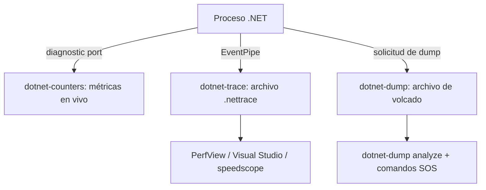

# dotnet-counters, dotnet-trace y dotnet-dump

Parte de: [[03-CSharp-DotNet/06 Rendimiento en .NET/_Índice Rendimiento en .NET|Rendimiento en .NET]]

> [!info] Cómo avanzar
> `progreso`: **pendiente** → **viendo** (estudiando) → **visto** (contestaste la autoevaluación sin abrir las respuestas) → **dominado** (hiciste el laboratorio o lo aplicaste de verdad).

## Contenido

### Qué es
Son tres herramientas de diagnóstico de línea de comandos, multiplataforma y gratuitas, que se conectan a un proceso .NET en ejecución sin necesidad de Visual Studio. Cada una responde a una pregunta distinta:

- [[dotnet-counters]]: **¿qué está pasando ahora?** Muestra métricas en vivo (CPU, GC, memoria, thread pool, peticiones por segundo).
- [[dotnet-trace]]: **¿en qué se va el tiempo?** Graba una traza de eventos y muestreo de CPU para analizar después.
- [[dotnet-dump]]: **¿qué hay en memoria en este instante?** Captura un volcado del proceso para inspeccionar objetos, hilos y pilas.

Juntas forman el kit básico de [[Perfilado de rendimiento]] en .NET, útil en tu PC, en un servidor IIS o dentro de un contenedor.

### Cómo funciona
Todas usan **EventPipe** y el *diagnostic port*: un canal (socket Unix o *named pipe* en Windows) que el runtime abre en cada proceso .NET. La herramienta se conecta por ese canal con el PID o el nombre del proceso, pide eventos, contadores o un dump, y el runtime los entrega. No necesitan que la app tenga código especial.



### Instalación
Son herramientas globales de .NET:

```bash
dotnet tool install --global dotnet-counters
dotnet tool install --global dotnet-trace
dotnet tool install --global dotnet-dump
dotnet-counters ps   # lista procesos .NET y sus PID
```

En contenedores puedes instalarlas en una imagen de diagnóstico, copiarlas o usar un contenedor *sidecar* que comparta `/tmp` (donde vive el diagnostic port). En servidores sin SDK existen descargas directas de cada herramienta en Microsoft Learn.

### Ejemplo: flujo de diagnóstico
Caso: Itzamna.Dionisio responde lento después de un despliegue.

1. **Empieza por `dotnet-counters`** porque es barato y no detiene nada: `dotnet-counters monitor -n Itzamna.Dionisio`. Mira CPU, tiempo en GC, tamaño del heap y la cola del thread pool.
2. **Si la CPU está baja pero la latencia alta**, el proceso está *esperando*, no calculando: sospecha bloqueo de hilos (sync over async, `.Result`), locks o la base de datos. Revisa la longitud de la cola del thread pool y el número de hilos: si la cola crece y los hilos suben poco a poco, es *thread pool starvation* (ver [[Sync over async y thread pool starvation]]). Confírmalo con un dump y mira qué están haciendo los hilos.
3. **Si la CPU está alta**, graba unos 30 segundos con `dotnet-trace` y busca en el flame graph qué métodos consumen más.
4. **Si la memoria sube y nunca baja**, toma dos dumps separados por unos minutos y compara qué tipos crecen con `dumpheap -stat`.

### Cuándo usarlo y cuándo no
Úsalas cuando hay un problema concreto de rendimiento o de memoria y necesitas datos del proceso real. Para monitoreo continuo en producción es mejor exportar métricas y trazas con [[OpenTelemetry]] hacia Application Insights u otro backend; estas herramientas son para la investigación puntual. En Windows con Visual Studio también tienes el perfilador integrado; PerfView es otra alternativa gratuita más profunda.

### Errores comunes
- **Ir directo al dump**: es pesado y congela el proceso; casi siempre conviene mirar contadores primero.
- **Diagnosticar en Debug**: el comportamiento del JIT y del GC difiere; reproduce en Release.
- **Olvidar permisos**: la herramienta debe correr con el mismo usuario que el proceso (o administrador) y, en contenedores, compartir el directorio temporal.
- **Dejar archivos de dump en el servidor**: contienen datos sensibles; bórralos al terminar.

### Para profundizar
- [Herramientas de diagnóstico de .NET (Microsoft Learn)](https://learn.microsoft.com/dotnet/core/diagnostics/tools-overview)
- [Diagnóstico en contenedores (Microsoft Learn)](https://learn.microsoft.com/dotnet/core/diagnostics/diagnostics-in-containers)
- [PerfView en GitHub](https://github.com/microsoft/perfview)

## Subtemas

- [[dotnet-counters]]
- [[dotnet-trace]]
- [[dotnet-dump]]

## Autoevaluación

Contesta primero en voz alta o en papel; luego despliega la respuesta.

> [!question]- ¿Para qué sirve cada herramienta?
> `dotnet-counters`: métricas en vivo (CPU, GC, thread pool, peticiones). `dotnet-trace`: grabar eventos y muestreo de CPU para ver dónde se va el tiempo. `dotnet-dump`: foto de la memoria y los hilos del proceso para analizar después.

> [!question]- ¿Cómo se instalan?
> Como herramientas globales: `dotnet tool install -g dotnet-counters` (igual con `dotnet-trace` y `dotnet-dump`). `dotnet-counters ps` lista los procesos.

> [!question]- La API está lenta y la CPU baja. ¿Por cuál empiezas?
> `dotnet-counters`: si la cola del thread pool crece, sospecha sync over async; luego un `dotnet-dump` para ver qué están esperando los hilos.

## Progreso de los subtemas

```base
filters:
  and:
    - file.inFolder("03-CSharp-DotNet/06 Rendimiento en .NET/dotnet-counters, dotnet-trace y dotnet-dump")
    - file.name != "dotnet-counters, dotnet-trace y dotnet-dump"
views:
  - type: table
    name: Progreso
    order:
      - file.name
      - progreso
      - nivel
```
