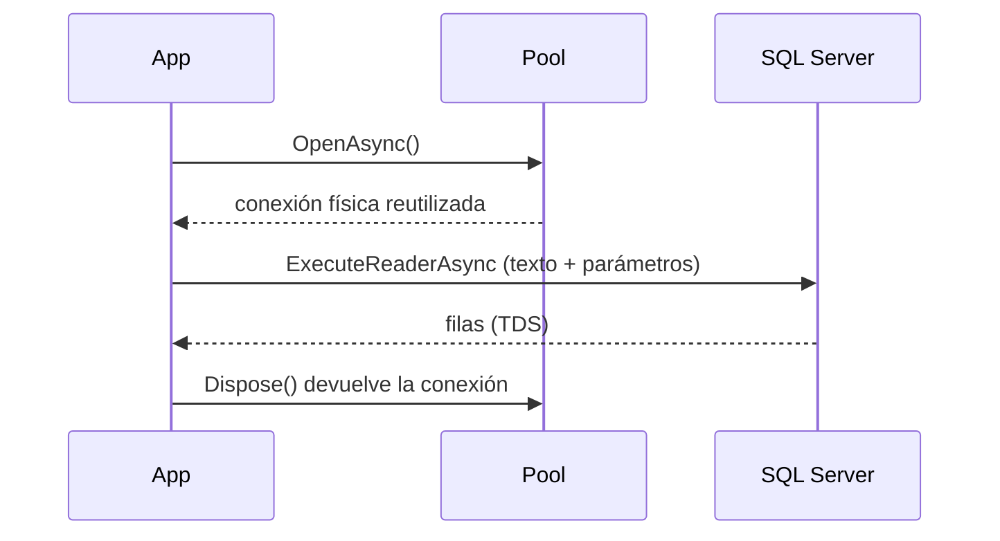

# ADO.NET

Parte de: [[03-CSharp-DotNet/07 Acceso a datos y ORMs/_Índice Acceso a datos y ORMs|Acceso a datos y ORMs]]

> [!info] Cómo avanzar
> `progreso`: **pendiente** → **viendo** (estudiando) → **visto** (contestaste la autoevaluación sin abrir las respuestas) → **dominado** (hiciste el laboratorio o lo aplicaste de verdad).

## Contenido

### Qué es
ADO.NET es la capa base de acceso a datos de .NET: un conjunto de clases para abrir conexiones, ejecutar comandos SQL y leer resultados. Todo lo demás se construye encima: [[Dapper]] son métodos de extensión sobre `DbConnection`, y [[Entity Framework Core]] usa ADO.NET por dentro para hablar con el servidor. Conocerlo te ayuda a entender qué hacen tus herramientas, a diagnosticar problemas (conexiones, parámetros, tipos) y a escribir código de máximo control cuando hace falta.

### Cómo funciona
Las piezas son abstractas (`System.Data.Common`) y cada proveedor las implementa. Para SQL Server el proveedor es el paquete **`Microsoft.Data.SqlClient`**; el antiguo `System.Data.SqlClient` ya no recibe nuevas funciones y no debes usarlo en proyectos nuevos. Para Postgres (Pochteca.Nomisma) sería `Npgsql`, y para SQLite `Microsoft.Data.Sqlite`.

| Pieza | Clase en SQL Server | Para qué |
|---|---|---|
| Conexión | `SqlConnection` | Abre la sesión con el servidor (usa el [[Connection pooling|pool]]). |
| Comando | `SqlCommand` | Texto SQL o nombre de procedimiento, con su tipo y tiempo de espera. |
| Parámetro | `SqlParameter` | Valor tipado que viaja aparte del texto SQL. |
| Lector | `SqlDataReader` | Recorre filas hacia adelante, una a la vez, sin cargar todo. |
| Transacción | `SqlTransaction` | Agrupa comandos en una unidad atómica. |
| Desconectado | `DataTable`, `DataSet`, `SqlDataAdapter` | Carga resultados en memoria (útil para TVP o reportes). |



### Ejemplo
Lectura de un pedido con un procedimiento almacenado, como harías en Itzamna.Dionisio si no tuvieras Dapper:

```csharp
using Microsoft.Data.SqlClient;
using System.Data;

public sealed record PedidoDto(int Id, string Codigo, decimal Total);

public async Task<PedidoDto?> ObtenerAsync(string codigo, CancellationToken ct)
{
    await using var cn = new SqlConnection(_cadena);
    await using var cmd = new SqlCommand("dbo.Pedido_ObtenerPorCodigo", cn)
    {
        CommandType = CommandType.StoredProcedure,
        CommandTimeout = 30
    };
    // Tipo y tamaño explícitos, iguales a la columna (VARCHAR(20))
    cmd.Parameters.Add("@Codigo", SqlDbType.VarChar, 20).Value = codigo;

    await cn.OpenAsync(ct);
    await using var rd = await cmd.ExecuteReaderAsync(CommandBehavior.SingleRow, ct);
    if (!await rd.ReadAsync(ct)) return null;

    return new PedidoDto(
        rd.GetInt32(rd.GetOrdinal("Id")),
        rd.GetString(rd.GetOrdinal("Codigo")),
        rd.GetDecimal(rd.GetOrdinal("Total")));
}
```

Para escrituras usas `ExecuteNonQueryAsync` (devuelve filas afectadas) y para un solo valor `ExecuteScalarAsync`.

### El problema de `AddWithValue`
`cmd.Parameters.AddWithValue("@codigo", codigo)` **infiere el tipo SQL a partir del valor .NET**. Un `string` se manda como `NVARCHAR` con la longitud del valor recibido. Esto trae dos problemas:

1. **Conversión implícita**: si la columna es `VARCHAR`, SQL Server convierte la columna a `NVARCHAR` para comparar, lo que puede impedir usar el índice y provocar un *scan* completo.
2. **Contaminación de la caché de planes**: `'A1'` se manda como `NVARCHAR(2)` y `'ABC123'` como `NVARCHAR(6)`; son consultas distintas para el servidor y se compila un plan por cada longitud.

Con `Add(nombre, SqlDbType, tamaño)` defines el tipo exacto. En Dapper el equivalente es `new DbString { Value = codigo, IsAnsi = true, Length = 20 }` o `DynamicParameters` con `DbType.AnsiString`.

### Cuándo usarlo y cuándo no
Úsalo directo cuando necesitas control total: lectura en *streaming* de millones de filas para un Excel de Wee.Reporteria, `SqlBulkCopy` para cargas masivas, manejo fino de `CommandBehavior`, o en código de infraestructura muy caliente. Para el día a día, Dapper te ahorra el mapeo manual con casi el mismo rendimiento, y EF Core te da cambios rastreados y LINQ. Ve la comparación en [[Dapper vs EF Core vs ADO.NET]].

### Errores comunes
- **No liberar conexiones ni lectores**: sin `using` agotas el pool. Usa siempre `await using`.
- **Concatenar valores en el texto SQL**: abre la puerta a inyección; ver [[Parametrización y SQL injection]].
- **`AddWithValue` con strings y fechas**: tipos inferidos incorrectos (`DateTime` contra `date`, `nvarchar` contra `varchar`).
- **Leer por índice fijo** (`rd.GetInt32(0)`): se rompe si cambia el orden de columnas del procedimiento. Usa `GetOrdinal` una vez fuera del bucle.
- **Olvidar `Encrypt`/certificados**: desde `Microsoft.Data.SqlClient` 4 la conexión se cifra por defecto; en desarrollo local con certificado autofirmado necesitas `TrustServerCertificate=True` (nunca en producción).

### Para profundizar
- [Información general de ADO.NET (Microsoft Learn)](https://learn.microsoft.com/dotnet/framework/data/adonet/ado-net-overview)
- [Microsoft.Data.SqlClient (Microsoft Learn)](https://learn.microsoft.com/sql/connect/ado-net/introduction-microsoft-data-sqlclient-namespace)
- [Configurar parámetros y tipos de datos (Microsoft Learn)](https://learn.microsoft.com/dotnet/framework/data/adonet/configuring-parameters-and-parameter-data-types)

## Autoevaluación

Contesta primero en voz alta o en papel; luego despliega la respuesta.

> [!question]- ¿Qué piezas básicas tiene ADO.NET?
> `SqlConnection`, `SqlCommand` con `SqlParameter`, `SqlDataReader` para leer en avance y `SqlTransaction`. Dapper está construido encima.

> [!question]- ¿Qué paquete usas para SQL Server?
> `Microsoft.Data.SqlClient`. `System.Data.SqlClient` está obsoleto.

> [!question]- ¿Qué problema tiene `cmd.Parameters.AddWithValue("@codigo", codigo)`?
> Infiere el tipo: un `string` se manda como `nvarchar(longitud)`; contra una columna `varchar` provoca conversión implícita y puede impedir usar el índice. Especifica `SqlDbType` y tamaño.

> [!question]- Escribe una lectura con ADO.NET.
> ```csharp
> await using var cn = new SqlConnection(cs);
> await cn.OpenAsync(ct);
> await using var cmd = new SqlCommand("SELECT Id, Nombre FROM dbo.Cliente WHERE Id = @Id", cn);
> cmd.Parameters.Add("@Id", SqlDbType.Int).Value = id;
> await using var rd = await cmd.ExecuteReaderAsync(ct);
> while (await rd.ReadAsync(ct)) { var nombre = rd.GetString(1); }
> ```

## Práctica

- [[Lab 9 - Dapper con stored procedures y transacción]]

