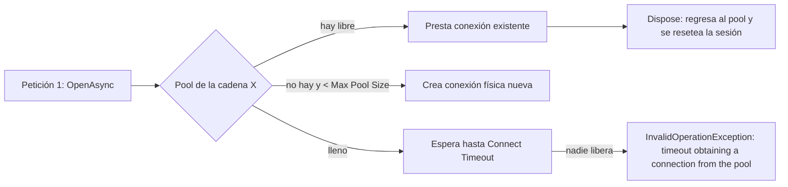

# Connection pooling

Parte de: [[03-CSharp-DotNet/07 Acceso a datos y ORMs/_Índice Acceso a datos y ORMs|Acceso a datos y ORMs]]

> [!info] Cómo avanzar
> `progreso`: **pendiente** → **viendo** (estudiando) → **visto** (contestaste la autoevaluación sin abrir las respuestas) → **dominado** (hiciste el laboratorio o lo aplicaste de verdad).

## Contenido

### Qué es
Abrir una conexión física a SQL Server es caro: conexión TCP, negociación TLS, autenticación y creación de la sesión. El **connection pooling** mantiene un conjunto de conexiones ya abiertas y las reutiliza. Cuando tu código llama `OpenAsync()`, el proveedor te presta una conexión del pool; cuando llamas `Dispose()` o `Close()`, no se cierra: regresa al pool para la siguiente petición. Está activo por defecto en `Microsoft.Data.SqlClient` y es la razón por la que crear un `SqlConnection` por consulta es barato.

### Cómo funciona


- Hay **un pool por cadena de conexión exacta** (texto idéntico), por proceso. Con seguridad integrada, además, por identidad de Windows.
- **Max Pool Size** es 100 por defecto y **Min Pool Size** 0. Puedes cambiarlos en la cadena (`Max Pool Size=200;`).
- Si el pool está lleno, la siguiente apertura espera hasta el **Connect Timeout** (15 segundos por defecto) y luego falla con *"Timeout expired. The timeout period elapsed prior to obtaining a connection from the pool"*.
- Al reutilizar una conexión, el proveedor resetea la sesión (por ejemplo, tablas temporales y ajustes `SET`), aunque algunos estados como el nivel de aislamiento pueden arrastrarse; si cambias el aislamiento, restáuralo.
- Las conexiones inactivas se cierran después de un tiempo y las rotas se descartan.

### Abrir tarde y cerrar pronto
El pool funciona bien sólo si cada conexión se presta el menor tiempo posible. Si abres la conexión al inicio del método, luego llamas a un API externo o procesas un archivo, y al final consultas, la tienes ocupada todo ese tiempo sin usarla. Bajo carga, 100 peticiones lentas así agotan el pool aunque SQL Server esté ocioso. La regla: abre justo antes del primer comando y libérala justo después del último, con `await using`.

### Ejemplo
```csharp
// Mal: la conexión queda ocupada mientras se llama al servicio externo
await using var cn = new SqlConnection(_cadena);
await cn.OpenAsync(ct);
var tipoCambio = await _banxico.ObtenerAsync(ct);     // segundos de espera
var pedidos = await cn.QueryAsync<Pedido>(sql, new { tipoCambio.Valor });

// Bien: primero lo externo, luego la base, con alcance corto
var tc = await _banxico.ObtenerAsync(ct);
await using (var cn2 = new SqlConnection(_cadena))
{
    var lista = await cn2.QueryAsync<Pedido>(sql, new { tc.Valor }); // Dapper abre y cierra si la conexión estaba cerrada
}
```

En Itzamna.Dionisio, una `SesionSql` con ciclo de vida Scoped (ver [[Dapper - transacciones]]) comparte una conexión por petición; está bien siempre que la petición sea corta y no mantenga la conexión durante trabajo ajeno a la base.

### Qué pasa si no liberas las conexiones
Cada conexión no liberada queda "prestada" hasta que el GC finalice el objeto, lo cual puede tardar mucho o no pasar a tiempo. Con tráfico, el pool llega a 100, las peticiones nuevas esperan 15 s y fallan con el timeout del pool. Los síntomas suelen confundirse con "la base está lenta". Se diagnostica viendo en SQL Server las sesiones del programa (`sys.dm_exec_sessions` filtrando por `program_name`) con estado *sleeping* y muchas conexiones abiertas, o con los contadores de `Microsoft.Data.SqlClient` en [[dotnet-counters]].

### Cadenas distintas por usuario
Si construyes la cadena de conexión con datos de cada usuario (usuario y contraseña de SQL por persona, o un `Application Name` distinto por petición), cada variante crea **su propio pool**. Con cientos de usuarios tienes cientos de pools pequeños, casi sin reutilización, muchas conexiones físicas en el servidor y uso alto de memoria. Usa una cadena fija por aplicación y resuelve los permisos por usuario en la lógica o con contexto de sesión (`sp_set_session_context`).

### Cuándo usarlo y cuándo no
Déjalo activo siempre en aplicaciones normales. Sólo lo desactivarías (`Pooling=false`) para diagnósticos muy puntuales. Ajusta `Max Pool Size` únicamente después de confirmar que el código libera bien las conexiones: subir el límite para tapar una fuga sólo retrasa el problema y carga al servidor.

### Errores comunes
- **Olvidar `using`** o retornar un `IDataReader` sin cerrar la conexión.
- **Mantener la conexión durante trabajo externo** (HTTP, archivos, `Task.Delay`).
- **Sync over async**: hilos bloqueados que tienen conexiones prestadas multiplican el efecto.
- **Cadenas que varían** por espacios, orden de parámetros o datos de usuario: pools separados sin querer.
- **Guardar una `SqlConnection` en un singleton**: no es segura para uso concurrente; crea una por operación o por petición.

### Para profundizar
- [Agrupación de conexiones de SQL Server (Microsoft Learn)](https://learn.microsoft.com/sql/connect/ado-net/sql-server-connection-pooling)
- [Propiedad SqlConnection.ConnectionString (Microsoft Learn)](https://learn.microsoft.com/dotnet/api/microsoft.data.sqlclient.sqlconnection.connectionstring)
- Relacionado: [[ADO.NET]], [[Dapper]]

## Autoevaluación

Contesta primero en voz alta o en papel; luego despliega la respuesta.

> [!question]- ¿Qué es el connection pooling?
> ADO.NET mantiene conexiones físicas abiertas y las reutiliza: `Open()` toma una del pool y `Dispose()` la devuelve. Hay un pool por cadena de conexión exacta.

> [!question]- ¿Qué pasa si no liberas las conexiones?
> El pool se agota (100 por defecto, `Max Pool Size`) y las siguientes peticiones esperan hasta `Connection Timeout` y fallan con "timeout expired... max pool size was reached".

> [!question]- ¿Por qué abrir tarde y cerrar pronto?
> Retener una conexión durante trabajo que no es de BD (llamadas HTTP) reduce las disponibles para los demás.

> [!question]- Error común: construir la cadena de conexión con datos distintos por usuario. ¿Qué efecto tiene?
> Cada cadena distinta crea su propio pool: muchas conexiones físicas y poca reutilización.

## Práctica

- [[Lab 9 - Dapper con stored procedures y transacción]]

