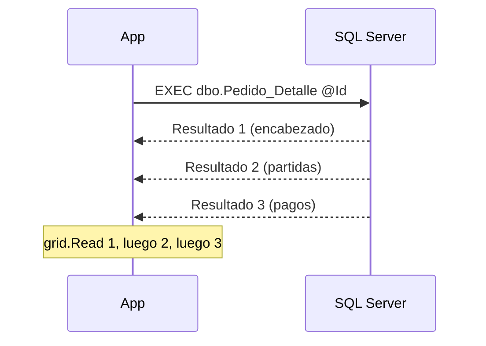

# Dapper - QueryMultiple y multi-mapping

Parte de: [[03-CSharp-DotNet/07 Acceso a datos y ORMs/_Índice Acceso a datos y ORMs|Acceso a datos y ORMs]]

> [!info] Cómo avanzar
> `progreso`: **pendiente** → **viendo** (estudiando) → **visto** (contestaste la autoevaluación sin abrir las respuestas) → **dominado** (hiciste el laboratorio o lo aplicaste de verdad).

## Contenido

### Qué es
Son dos técnicas de [[Dapper]] para leer datos relacionados sin hacer muchas consultas:

- **`QueryMultipleAsync`** ejecuta un lote SQL (o un procedimiento) que devuelve **varios conjuntos de resultados** y te permite leerlos uno por uno en un solo viaje a la base.
- **Multi-mapping** convierte **cada fila de un JOIN** en varios objetos (por ejemplo, `Pedido` y su `Cliente`) y te deja unirlos con una función.

Ambas evitan el [[Problema N+1]] y encajan con tu regla de SQL en archivos `.sql` y procedimientos almacenados.

### Cómo funciona
#### QueryMultiple
El servidor regresa los resultados en orden. Dapper te da un `GridReader` y cada llamada a `ReadAsync<T>()`, `ReadSingleAsync<T>()` o `ReadFirstOrDefaultAsync<T>()` consume **el siguiente** conjunto. No hay forma de saltar ni de volver atrás.



#### Multi-mapping
Le pasas varios tipos genéricos y una función de unión. Dapper recorre las columnas de cada fila y, cuando encuentra la columna indicada en **`splitOn`**, empieza a llenar el siguiente objeto. Por defecto `splitOn` es `"Id"`; si tu JOIN trae `ClienteId` como primera columna del cliente, debes indicarlo. Con más de dos tipos, `splitOn` lleva varios nombres separados por coma.

### Ejemplo
`Sql/Pedidos/ObtenerDetalle.sql` (o un procedimiento con el mismo contenido):

```sql
SELECT p.Id, p.Codigo, p.Total, p.ClienteId
FROM dbo.Pedido p WHERE p.Id = @Id;

SELECT d.Id, d.PedidoId, d.Producto, d.Cantidad, d.Precio
FROM dbo.PedidoDetalle d WHERE d.PedidoId = @Id;
```

```csharp
public sealed class ObtenerDetallePedido(ISesionSql sesion, ISentencias sql) : IObtenerDetallePedido
{
    public async Task<PedidoDetalleDto?> EjecutarAsync(int id, CancellationToken ct)
    {
        var cmd = new CommandDefinition(sql["Pedidos.ObtenerDetalle"], new { Id = id },
                                        sesion.Transaccion, cancellationToken: ct);
        await using var grid = await sesion.Conexion.QueryMultipleAsync(cmd);

        var pedido = await grid.ReadSingleOrDefaultAsync<PedidoDetalleDto>(); // 1er resultado
        if (pedido is null) return null;
        pedido.Partidas = (await grid.ReadAsync<PartidaDto>()).AsList();      // 2o resultado
        return pedido;
    }
}
```

Multi-mapping para un listado con su cliente:

```sql
SELECT p.Id, p.Codigo, p.Total,
       c.ClienteId, c.Nombre, c.Rfc
FROM dbo.Pedido p
JOIN dbo.Cliente c ON c.ClienteId = p.ClienteId
WHERE p.Fecha >= @Desde;
```

```csharp
var pedidos = await cn.QueryAsync<PedidoDto, ClienteDto, PedidoDto>(
    cmd,
    (pedido, cliente) => { pedido.Cliente = cliente; return pedido; },
    splitOn: "ClienteId"); // a partir de esta columna se llena ClienteDto
```

Para relaciones uno a muchos con multi-mapping (pedido con muchas partidas en un JOIN), se repite el pedido en cada fila; usa un `Dictionary<int, PedidoDto>` dentro de la función para no duplicarlos. Si el detalle es grande, `QueryMultiple` suele ser más limpio y transfiere menos datos repetidos.

### Cuándo usarlo y cuándo no
- **QueryMultiple**: pantallas de detalle con varias secciones (encabezado, partidas, pagos, bitácora) o un dashboard con varios totales. También para paginación: un resultado con la página y otro con el `COUNT(*)`.
- **Multi-mapping**: listados donde cada fila necesita datos de una o dos tablas relacionadas uno a uno.
- **Ninguno**: si los conjuntos son independientes y se usan en momentos distintos, o si una sola consulta plana con un DTO aplanado (`ClienteNombre`) es suficiente; a veces es lo más simple.

### Errores comunes
- **Leer en distinto orden** del que devuelve el SQL, o con tipos cruzados: obtienes columnas mal mapeadas o excepciones. Documenta el orden en el archivo `.sql`.
- **Leer un conjunto dos veces o después de liberar el `GridReader`**: lanza excepción; cada resultado se consume una sola vez y dentro del `using`.
- **`splitOn` mal puesto**: si la columna no existe o no es la primera del segundo objeto, Dapper lanza *"When using the multi-mapping APIs ensure you set the splitOn param"* o deja objetos vacíos.
- **Columnas con el mismo nombre** (`Id` en ambas tablas) sin alias claros: confunden el corte; usa alias como `ClienteId`.
- **Procedimientos que imprimen mensajes o devuelven resultados extra** (`SELECT` de depuración): desplazan el orden. Usa `SET NOCOUNT ON` y quita los `SELECT` sobrantes.

### Para profundizar
- [Dapper en GitHub (README: multi mapping y multiple results)](https://github.com/DapperLib/Dapper)
- Práctica: [[Lab 9 - Dapper con stored procedures y transacción]]

## Autoevaluación

Contesta primero en voz alta o en papel; luego despliega la respuesta.

> [!question]- ¿Para qué sirve `QueryMultipleAsync`?
> Ejecutar varias consultas (o un SP con varios `SELECT`) en una sola ida y leer cada resultado en orden: `using var g = await cn.QueryMultipleAsync(sql, p); var cab = await g.ReadSingleAsync<Cab>(); var lineas = (await g.ReadAsync<Linea>()).ToList();`.

> [!question]- ¿Qué es multi-mapping?
> Mapear una fila de un JOIN a varios objetos: `cn.QueryAsync<Pedido, Cliente, Pedido>(sql, (p, c) => { p.Cliente = c; return p; }, splitOn: "ClienteId")`.

> [!question]- ¿Qué indica `splitOn`?
> La columna donde empieza el siguiente objeto (por defecto `Id`). Si está mal, el segundo objeto llega vacío o con datos corridos.

> [!question]- ¿Qué error común hay al leer resultados de `QueryMultiple`?
> Leerlos en distinto orden o saltar uno: los resultados se leen en el orden en que el SQL los produce.

## Práctica

- [[Lab 9 - Dapper con stored procedures y transacción]]

