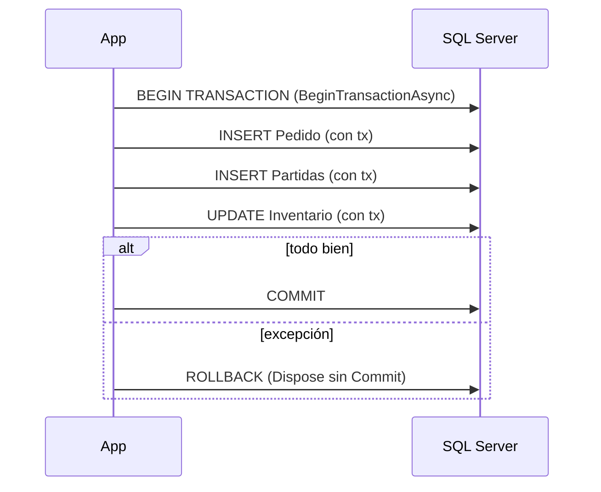

# Dapper - transacciones

Parte de: [[03-CSharp-DotNet/07 Acceso a datos y ORMs/_Índice Acceso a datos y ORMs|Acceso a datos y ORMs]]

> [!info] Cómo avanzar
> `progreso`: **pendiente** → **viendo** (estudiando) → **visto** (contestaste la autoevaluación sin abrir las respuestas) → **dominado** (hiciste el laboratorio o lo aplicaste de verdad).

## Contenido

### Qué es
Una **transacción** agrupa varias operaciones en la base para que se apliquen todas o ninguna (atomicidad), y aísla sus cambios de otras sesiones hasta confirmarlos. [[Dapper]] no tiene un mecanismo propio: usa la `DbTransaction` de [[ADO.NET]], que pasas a cada comando. Es imprescindible cuando, por ejemplo, Itzamna.Dionisio crea un pedido, sus partidas y descuenta inventario: si falla la tercera operación, las dos primeras no deben quedar.

### Cómo funciona


1. Abres la conexión y llamas `BeginTransactionAsync`, opcionalmente con un `IsolationLevel`.
2. Cada comando debe recibir **esa** transacción (`transaction:` o `CommandDefinition`).
3. Si todo sale bien llamas `CommitAsync`. Si hay una excepción y la transacción se libera sin commit, el `Dispose` hace *rollback*.

### Ejemplo
```csharp
public async Task<int> CrearAsync(NuevoPedido p, CancellationToken ct)
{
    await using var cn = new SqlConnection(_cadena);
    await cn.OpenAsync(ct);
    await using var tx = await cn.BeginTransactionAsync(ct);

    var id = await cn.ExecuteScalarAsync<int>(new CommandDefinition(
        _sql["Pedidos.Insertar"], new { p.ClienteId, p.Total }, tx, cancellationToken: ct));

    await cn.ExecuteAsync(new CommandDefinition(
        "dbo.Pedido_GuardarPartidas",
        new { PedidoId = id, Partidas = p.Partidas.ComoTvp() },
        tx, commandType: CommandType.StoredProcedure, cancellationToken: ct));

    await tx.CommitAsync(ct);   // si no se llega aquí, Dispose hace rollback
    return id;
}
```

Si olvidas pasar `tx` a un comando, SQL Server lo rechaza: `SqlClient` lanza `InvalidOperationException` indicando que el comando requiere la transacción asignada a la conexión. Es un error que aparece en cuanto lo pruebas, pero en otros proveedores el comportamiento puede variar, así que crea el hábito de usar siempre `CommandDefinition` con la transacción.

### La `SesionSql` de Dionisio
Pasar `cn` y `tx` a mano por cada clase es tedioso y propenso a errores. La solución de tu proyecto es una **`SesionSql`** registrada como **Scoped**: guarda la conexión y la transacción de la petición actual. Cada consulta (con tu patrón de [[SQL en archivos con una interfaz por consulta]]) recibe `ISesionSql` por inyección y usa `sesion.Conexion` y `sesion.Transaccion`. El handler o un filtro inicia la transacción, varias consultas participan en la misma **unidad de trabajo**, y al final se confirma una vez.

```csharp
public sealed class SesionSql(IOptions<OpcionesSql> op) : ISesionSql, IAsyncDisposable
{
    private SqlConnection? _cn;
    public DbTransaction? Transaccion { get; private set; }
    public SqlConnection Conexion => _cn ??= new SqlConnection(op.Value.Cadena);

    public async Task IniciarAsync(CancellationToken ct)
    {
        if (Conexion.State != ConnectionState.Open) await Conexion.OpenAsync(ct);
        Transaccion = await Conexion.BeginTransactionAsync(ct);
    }
    public Task ConfirmarAsync(CancellationToken ct) => Transaccion!.CommitAsync(ct);
    public async ValueTask DisposeAsync()
    {
        if (Transaccion is not null) await Transaccion.DisposeAsync();
        if (_cn is not null) await _cn.DisposeAsync();
    }
}
```

### Niveles de aislamiento
SQL Server usa **`READ COMMITTED`** por defecto: no lees datos sin confirmar, pero una lectura puede bloquearse esperando a una escritura. Si la base tiene activado **`READ_COMMITTED_SNAPSHOT`** (RCSI), las lecturas usan versiones de fila y no se bloquean con las escrituras; en Azure SQL Database viene activado por defecto. Niveles más estrictos (`REPEATABLE READ`, `SERIALIZABLE`) evitan más anomalías a costa de más bloqueos y *deadlocks*. Para lógica tipo "leer saldo y descontar", mejor que subir el aislamiento suele ser hacer el `UPDATE ... WHERE Saldo >= @Monto` atómico y revisar filas afectadas.

### Cuándo usarlo y cuándo no
Usa transacciones cuando varias escrituras deben ser atómicas. No las abras para lecturas simples, ni las mantengas mientras llamas a servicios externos: retienen bloqueos y conexiones del [[Connection pooling|pool]]. Si la lógica vive completa en un procedimiento, la transacción puede ir dentro del procedimiento (`BEGIN TRAN ... COMMIT` con `SET XACT_ABORT ON`). Para coordinar base de datos y mensajería, ve el [[Patrón Outbox]].

### Errores comunes
- **Olvidar `tx` en un comando**: excepción o, peor, una operación fuera de la unidad de trabajo.
- **Transacciones largas**: bloquean filas y provocan timeouts en otras peticiones.
- **`TransactionScope` con async sin `TransactionScopeAsyncFlowOption.Enabled`**: la transacción no fluye entre `await`.
- **Atrapar la excepción y seguir** como si nada: la transacción puede quedar inválida; deja que se haga rollback.
- **Mezclar dos conexiones** en la misma operación lógica: cada una tiene su propia transacción.

### Para profundizar
- [Transacciones locales en ADO.NET (Microsoft Learn)](https://learn.microsoft.com/dotnet/framework/data/adonet/local-transactions)
- [SET TRANSACTION ISOLATION LEVEL (Microsoft Learn)](https://learn.microsoft.com/sql/t-sql/statements/set-transaction-isolation-level-transact-sql)
- Práctica: [[Lab 9 - Dapper con stored procedures y transacción]]

## Autoevaluación

Contesta primero en voz alta o en papel; luego despliega la respuesta.

> [!question]- ¿Cómo se usa una transacción con Dapper?
> ```csharp
> await using var tx = await cn.BeginTransactionAsync(ct);
> await cn.ExecuteAsync(new CommandDefinition(sql1, p1, tx, cancellationToken: ct));
> await cn.ExecuteAsync(new CommandDefinition(sql2, p2, tx, cancellationToken: ct));
> await tx.CommitAsync(ct);
> ```
> Si no llegas a `Commit`, el `Dispose` hace rollback.

> [!question]- ¿Qué pasa si olvidas pasar `tx` a un comando?
> En SQL Server lanza `InvalidOperationException` (el comando requiere la transacción de la conexión).

> [!question]- ¿Qué resuelve una `SesionSql` (como en Dionisio)?
> Un objeto Scoped que guarda la conexión y la transacción de la petición, para que varios repositorios participen en la misma unidad de trabajo sin pasarse `tx` a mano.

> [!question]- ¿Qué nivel de aislamiento usa SQL Server por defecto?
> `READ COMMITTED`. Con `READ_COMMITTED_SNAPSHOT` activado en la base, las lecturas no bloquean a las escrituras.

## Práctica

- [[Lab 9 - Dapper con stored procedures y transacción]]

