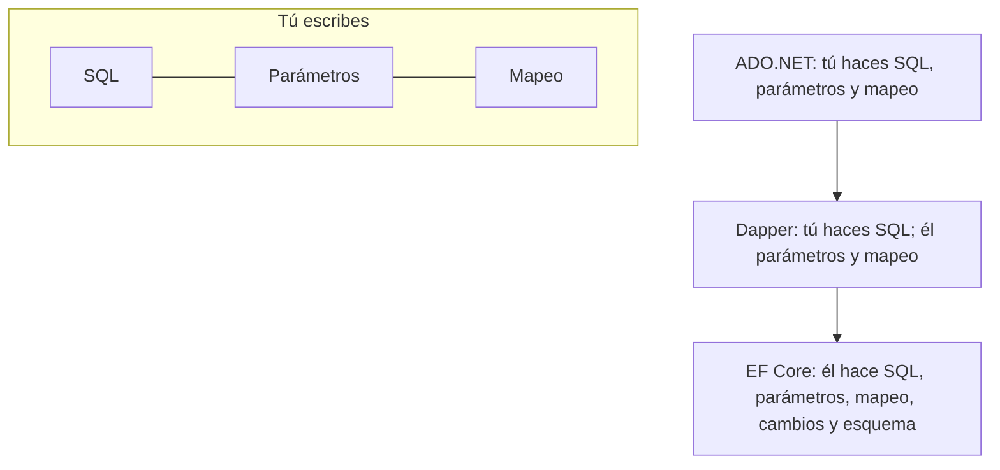

# Dapper vs EF Core vs ADO.NET

Parte de: [[03-CSharp-DotNet/07 Acceso a datos y ORMs/_Índice Acceso a datos y ORMs|Acceso a datos y ORMs]]

> [!info] Cómo avanzar
> `progreso`: **pendiente** → **viendo** (estudiando) → **visto** (contestaste la autoevaluación sin abrir las respuestas) → **dominado** (hiciste el laboratorio o lo aplicaste de verdad).

## Contenido

### Qué es
Son tres niveles de abstracción para acceder a datos relacionales en .NET:

- **[[ADO.NET]]**: la base. Tú escribes el SQL, creas comandos y parámetros y mapeas cada columna a mano.
- **[[Dapper]]**: un *micro-ORM*. Tú escribes el SQL; Dapper crea los parámetros a partir de objetos y mapea los resultados a clases automáticamente.
- **[[Entity Framework Core]]**: un ORM completo. Defines entidades y relaciones, consultas con LINQ, y EF Core genera el SQL, rastrea cambios, maneja migraciones del esquema y la unidad de trabajo.

No es una competencia con un ganador: cada uno resuelve un problema distinto y pueden convivir. Ver también [[Qué es un ORM y cuándo usarlo]].

### Cómo funciona la diferencia


| Criterio | ADO.NET | Dapper | EF Core |
|---|---|---|---|
| Control del SQL | Total | Total | Parcial (LINQ, o SQL crudo) |
| Código repetitivo | Mucho | Poco | Muy poco |
| Rendimiento | Máximo | Casi igual a ADO.NET | Muy bueno; algo de costo por tracking y traducción |
| Change tracking | No | No | Sí |
| Migraciones de esquema | No | No | Sí |
| Procedimientos almacenados | Natural | Natural | Posible, menos cómodo |
| Curva de aprendizaje | SQL + API | SQL | SQL + conceptos de EF (contexto, tracking, carga) |

### Ejemplo: la misma consulta en los tres
```csharp
// ADO.NET
await using var cmd = new SqlCommand("SELECT Id, Nombre FROM dbo.Cliente WHERE Rfc = @Rfc", cn);
cmd.Parameters.Add("@Rfc", SqlDbType.VarChar, 13).Value = rfc;
await using var rd = await cmd.ExecuteReaderAsync(ct);
var c = await rd.ReadAsync(ct) ? new ClienteDto(rd.GetInt32(0), rd.GetString(1)) : null;

// Dapper (SQL en archivo .sql, una interfaz por consulta)
var c2 = await cn.QuerySingleOrDefaultAsync<ClienteDto>(_sql["Clientes.PorRfc"], new { Rfc = rfc });

// EF Core
var c3 = await db.Clientes.AsNoTracking()
    .Where(x => x.Rfc == rfc)
    .Select(x => new ClienteDto(x.Id, x.Nombre))
    .SingleOrDefaultAsync(ct);
```

### Cuándo usar cada uno
- **ADO.NET**: lectura en streaming de grandes volúmenes, `SqlBulkCopy`, código de infraestructura muy caliente o cuando necesitas una función específica del proveedor. Rara vez como opción principal de una API.
- **Dapper**: cuando el equipo domina SQL, la lógica vive en procedimientos almacenados, quieres SQL revisable en archivos `.sql` y control fino del plan de ejecución. Es tu estándar en Itzamna.Dionisio y encaja con vertical slice: cada slice tiene su consulta y su archivo SQL.
- **EF Core**: dominios con muchas entidades y escrituras ricas (agregados con reglas), CRUD extenso, proyectos donde quieres migraciones de esquema en código y productividad sobre control. También es cómodo en Pochteca.Nomisma con Postgres si el modelo es muy relacional.

### Qué pierdes al elegir Dapper
- **Change tracking**: debes escribir cada `UPDATE` y decidir qué columnas cambian.
- **Migraciones de esquema**: necesitas otra herramienta (scripts versionados, DbUp, proyectos SQL/DACPAC).
- **Consultas componibles con LINQ**: filtros dinámicos se arman con SQL condicional o con constructores de SQL.
- **Carga de relaciones**: haces JOINs y [[Dapper - QueryMultiple y multi-mapping|multi-mapping]] tú mismo.
- **Seguridad de tipos en el SQL**: un error de nombre de columna aparece hasta ejecutar; lo mitigas con pruebas de integración (ver [[Testcontainers]]).

### ¿Pueden convivir?
Sí, y es común. Por ejemplo: EF Core para comandos (crear y modificar agregados con migraciones) y Dapper para consultas de lectura complejas y reportes. Comparten la misma cadena de conexión e incluso la misma conexión y transacción: `db.Database.GetDbConnection()` y `db.Database.CurrentTransaction?.GetDbTransaction()` te dan los objetos de ADO.NET para usarlos con Dapper. Lo importante es una regla clara por tipo de operación para que el equipo no mezcle estilos en el mismo slice.

### Errores comunes
- **Elegir por benchmarks ajenos**: la diferencia de microsegundos rara vez importa frente a la latencia de red y a índices mal diseñados.
- **Usar EF Core como si fuera Dapper**: cargar entidades con tracking para solo leer, sin proyecciones.
- **Usar Dapper y reinventar un ORM** con reflexión casera, repositorios genéricos y change tracking propio.
- **Mezclar sin reglas**: la mitad del equipo escribe LINQ y la otra SQL para lo mismo; nadie sabe dónde buscar.

### Para profundizar
- [Documentación de EF Core (Microsoft Learn)](https://learn.microsoft.com/ef/core/)
- [Dapper en GitHub](https://github.com/DapperLib/Dapper)
- [ADO.NET (Microsoft Learn)](https://learn.microsoft.com/dotnet/framework/data/adonet/)

## Autoevaluación

Contesta primero en voz alta o en papel; luego despliega la respuesta.

> [!question]- Resume cuándo usar cada uno.
> ADO.NET: control total o casos muy especiales (bulk, readers por streaming). Dapper: SQL explícito con mapeo automático y casi el mismo rendimiento. EF Core: productividad con LINQ, cambios y migraciones.

> [!question]- ¿Qué pierdes al elegir Dapper?
> Seguimiento de cambios, migraciones y verificación en compilación de las consultas; los errores de columnas aparecen al ejecutar.

> [!question]- ¿Pueden convivir?
> Sí: EF para el CRUD y Dapper para reportes pesados, compartiendo la conexión (`ctx.Database.GetDbConnection()`).

