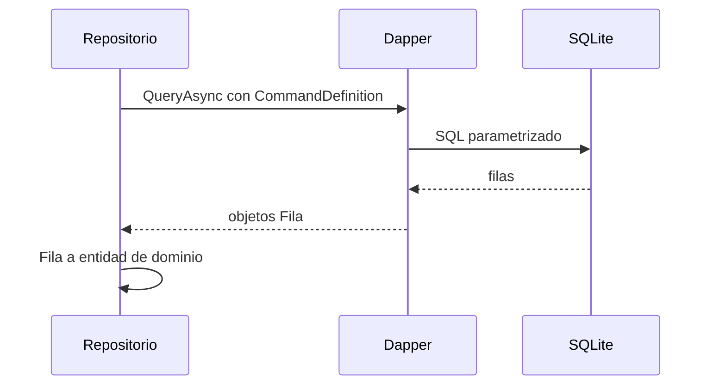

---
proyecto:
  - Ocelotl.Hermes
  - Pochteca.Nomisma
proyectos:
  - "[[Ocelotl.Hermes]]"
  - "[[Pochteca.Nomisma]]"
tipo: tecnologia
nivel: intermedio
estado: completo
tags:
  - conocimiento
  - backend
  - dotnet
  - datos
progreso: pendiente
area: C# y .NET
contenido: completo
---
# Dapper

> Micro-ORM que agrega métodos de extensión a `DbConnection` para ejecutar SQL escrito a mano y mapear filas a objetos; Hermes lo usa (v2.1.79) sobre [[SQLite]].

## Qué es y qué problema resuelve
ADO.NET puro obliga a crear comandos, agregar parámetros uno por uno y leer columnas con un `DataReader`. Dapper reduce eso a una línea: `conexion.QueryAsync<T>(sql, parametros)`. A diferencia de un ORM completo, **no genera SQL ni rastrea cambios**: tú escribes el SQL y Dapper solo mapea entrada (parámetros) y salida (filas → objetos).

## Cómo funciona por dentro

- Son **métodos de extensión** sobre `IDbConnection`/`DbConnection`: `ExecuteAsync`, `QueryAsync<T>`, `QuerySingleOrDefaultAsync<T>`, `ExecuteScalarAsync<T>`.
- **Parámetros**: un objeto anónimo `new { robotId, orden }`; cada propiedad se vuelve `@robotId`, `@orden`. Siempre parametrizado → protege contra inyección SQL.
- **Mapeo de salida**: por nombre de columna = nombre de propiedad (por eso Hermes usa alias `robot_id AS RobotId`). Genera y cachea el código de mapeo por tipo.
- **`CommandDefinition`**: struct que empaqueta SQL, parámetros, `transaction` y `cancellationToken` en una sola llamada.
- **Transacciones**: se pasa el `DbTransaction` en cada comando.



## Cuándo usarla y cuándo no
### Ventajas
- Control total del SQL (upserts `ON CONFLICT`, subconsultas, `LIMIT`), útil con SQLite.
- Muy rápido y con muy poca "magia".
- Sin modelo/contexto que mantener; encaja con repositorios pequeños.
### Desventajas
- SQL en strings: los errores de columnas aparecen en ejecución, no al compilar.
- Sin migraciones ni change tracking: hay que escribir el esquema a mano ([[SQLite]] / `EsquemaBaseDatos`).
- Mapeo de tipos a mano cuando el proveedor devuelve tipos distintos (SQLite devuelve `INTEGER` como `Int64`).

## Alternativas
| Alternativa | En qué se diferencia |
|---|---|
| Entity Framework Core | ORM completo: LINQ, change tracking, migraciones; más abstracción y más peso. |
| ADO.NET puro | Sin dependencias, pero mucho código repetitivo para parámetros y lectura. |
| RepoDB / linq2db | Híbridos entre micro-ORM y ORM con más funciones integradas. |

## Cómo se usó en Ocelotl

En [[Ocelotl.Hermes]], Dapper se usa en **un solo lugar**: las bases de `Infrastructure/Persistence/SentenciasSql.cs`. Desde el 2026-11-08 no hay SQL en C#: cada consulta es un `.sql` incrustado con su propia interfaz ([[SQL en archivos con una interfaz por consulta]]). Los repositorios (`EgresoRepositorio`, `CajaRepositorio`, `OutboxRepositorio`, `LocalIdentityProvider`, `EsquemaBaseDatos`) ya no importan Dapper: llaman a las interfaces y convierten dominio ↔ campos/filas ([[Repository]]).

Las bases envuelven a Dapper con `CommandDefinition`, para pasar el `CancellationToken` y la transacción (`Ocelotl.Hermes/src/Ocelotl.Hermes.Infrastructure/Persistence/SentenciasSql.cs`):
```csharp
public abstract class ConsultaSql<TCampos, TFila>(ConexionSqlite db, string nombre)
    : SentenciaSql(db, nombre), IConsultaSql<TCampos, TFila>
    where TCampos : notnull
{
    public async Task<IReadOnlyList<TFila>> ConsultarAsync(TCampos campos, CancellationToken ct)
    {
        await using var conexion = await Db.AbrirAsync(ct);
        var filas = await conexion.QueryAsync<TFila>(new CommandDefinition(Script, campos, cancellationToken: ct));
        return filas.AsList();
    }
}
```

Los **campos** son un record cuyas propiedades se vuelven parámetros (`@RobotId`, `@Orden`). Las **filas** se llenan por alias `AS`:
```sql
-- Persistence/Sql/Egresos/CajasDeOrden.sql
SELECT caja_guid AS CajaGuid, articulo_id AS ArticuloId, lote AS Lote
FROM egreso_cajas
WHERE robot_id = @RobotId AND orden = @Orden
ORDER BY dispensado_en, caja_guid;
```
```csharp
// EgresoRepositorio.cs
var filas = await cajasDe.ConsultarAsync(new EgresoLlaveCampos(robotId, orden), ct);
return filas.Select(f => new CajaDispensada(Guid.Parse(f.CajaGuid), f.ArticuloId, f.Lote)).ToList();
```

Detalles del uso:
- Las filas (`CajaFila`, `EgresoFila`, `UsuarioFila`…) usan `long` porque SQLite devuelve `INTEGER` como `Int64`. `MensajeOutbox` es un record posicional: Dapper lo llena por constructor.
- Fechas como unix ms, enums como texto, atributos como JSON: lo convierte el repositorio.
- Filtros opcionales con `(@Desde IS NULL OR e.creado_en >= @Desde)` en `Sql/Egresos/Listar.sql`.
- Transacciones: el repositorio abre `tx` y la pasa a cada comando (`EjecutarAsync(campos, tx, ct)`).

> [!tip] Reutilizable
> `SentenciasSql.cs` (bases + `ScriptsSql`) se copia tal cual a otro proyecto con Dapper. El patrón "fila del adaptador con alias `AS` + conversión explícita a la entidad" deja el dominio libre de detalles de la base.


## Cómo se usó en Pochteca.Nomisma
Dapper 2.1 sobre **Npgsql** ([[PostgreSQL]] en Neon). Las mismas bases que Hermes (`ComandoSql`, `ConsultaUnicaSql`, `EscalarSql`), pero cada `.sql` llama a una función del esquema `payment`:

| Base | Uso | Ejemplo |
|---|---|---|
| `EscalarSql<TCampos, long>` | `SELECT payment.sp_x(...)` que regresa el id | `Cargos/Insertar` |
| `EscalarSql<TCampos, bool>` | inbox: ¿evento nuevo? | `WebhookEventosConnect/TryInsertar` |
| `ConsultaUnicaSql<TCampos, TFila>` | `SELECT * FROM payment.sp_x(...)` | `CuentasConectadas/ObtenerPorOrganizador` |
| `ComandoSql<TCampos>` | `CALL payment.sp_x(...)` | `SesionesCheckout/ActualizarEstatus` |

- `SELECT *` + mapeo por nombre (sin distinguir mayúsculas): las columnas de la función empatan con la fila (`CargoFila`…).
- Enums como texto (`estatus.ToString()` / `Enum.Parse`), conversión en el repositorio.
- Una conexión por operación (`ConexionPostgres.AbrirAsync`); Npgsql agrupa las conexiones.

## Errores comunes y buenas prácticas
- Concatenar valores en el SQL en vez de parámetros (inyección SQL). En Hermes no se arma SQL en C#: todo está en archivos `.sql`.
- No pasar el `CancellationToken`: usar `CommandDefinition`.
- Olvidar `transaction: tx` en un comando dentro de una transacción.
- Esperar `int` donde SQLite devuelve `long` → excepción de conversión.
- Abrir una conexión y compartirla entre hilos: Hermes abre una por operación (`ConexionSqlite.AbrirAsync`).

## Qué estudiar después
- [[SQLite]], [[Repository]], [[Patrón Outbox]], [[Idempotencia]] (upserts `ON CONFLICT`)
- [[Arquitectura hexagonal]] (puertos y adaptadores)
- Transacciones y niveles de aislamiento.

## Documentación oficial
- https://github.com/DapperLib/Dapper

## Autoevaluación

Contesta primero en voz alta o en papel; luego despliega la respuesta.

> [!question]- ¿Qué hace Dapper?
> Métodos de extensión sobre `IDbConnection` (`QueryAsync<T>`, `ExecuteAsync`, `QuerySingleOrDefaultAsync`) que ejecutan tu SQL y mapean columnas a propiedades por nombre.

> [!question]- ¿Cómo llamas un stored procedure?
> ```csharp
> var filas = await cn.QueryAsync<EgresoFila>(
>     new CommandDefinition("dbo.Egresos_Listar", new { Desde = desde, Hasta = hasta },
>         commandType: CommandType.StoredProcedure, cancellationToken: ct));
> ```

> [!question]- ¿Qué pasa si una columna se llama `fecha_alta` y la propiedad `FechaAlta`?
> No se mapea (queda en default). Usa alias en el SQL (`fecha_alta AS FechaAlta`) o `DefaultTypeMap.MatchNamesWithUnderscores = true`.

> [!question]- ¿Qué diferencia hay entre `QuerySingle`, `QuerySingleOrDefault` y `QueryFirstOrDefault`?
> `QuerySingle` exige exactamente una fila. `QuerySingleOrDefault` acepta 0 o 1 (lanza si hay más). `QueryFirstOrDefault` toma la primera sin verificar si hay más.

## Práctica

- [[Lab 9 - Dapper con stored procedures y transacción]]

