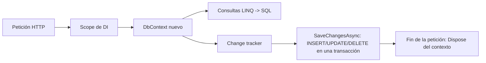

# EF Core - DbContext

Parte de: [[03-CSharp-DotNet/07 Acceso a datos y ORMs/_Índice Acceso a datos y ORMs|Acceso a datos y ORMs]]

> [!info] Cómo avanzar
> `progreso`: **pendiente** → **viendo** (estudiando) → **visto** (contestaste la autoevaluación sin abrir las respuestas) → **dominado** (hiciste el laboratorio o lo aplicaste de verdad).

## Contenido

### Qué es
El `DbContext` es la clase central de [[Entity Framework Core]]. Representa una **sesión de trabajo con la base de datos**: expone las tablas como `DbSet<T>`, traduce tus consultas LINQ a SQL, mantiene el *change tracker* (qué entidades cargaste y qué cambió) y, al llamar `SaveChangesAsync`, guarda todos los cambios en una transacción. En términos de patrones, combina una **unidad de trabajo** y un conjunto de repositorios.

### Cómo funciona


1. Defines una clase que hereda de `DbContext`, con un `DbSet<T>` por entidad raíz y la configuración del modelo en `OnModelCreating` (o en clases `IEntityTypeConfiguration<T>`).
2. La primera vez, EF Core construye el **modelo** (metadatos de entidades, llaves y relaciones) y lo guarda en caché para todo el proceso; crear instancias posteriores es barato.
3. Cada instancia tiene su propio change tracker y su propia conexión (que abre y cierra según la necesite, usando el pool).
4. **No es seguro para uso concurrente**: dos operaciones simultáneas sobre la misma instancia lanzan *"A second operation was started on this context instance before a previous operation completed"*.

### Ciclo de vida
`AddDbContext` lo registra como **Scoped**: una instancia por petición HTTP. Es la elección correcta porque:

- El change tracker acumula entidades; una vida larga (Singleton) crecería sin límite y daría datos viejos.
- No es thread-safe; un Singleton se compartiría entre peticiones concurrentes.
- Scoped permite que varios servicios de la misma petición compartan la unidad de trabajo y guarden juntos.

En un [[BackgroundService]] (que es Singleton), crea un scope por cada unidad de trabajo con `IServiceScopeFactory`, o usa `IDbContextFactory<T>` (`AddDbContextFactory`) para crear contextos cortos. Inyectar el contexto directo en un singleton es una [[Captive dependency]].

### Ejemplo
```csharp
public sealed class NomismaDb(DbContextOptions<NomismaDb> options) : DbContext(options)
{
    public DbSet<Cuenta> Cuentas => Set<Cuenta>();
    public DbSet<Movimiento> Movimientos => Set<Movimiento>();

    protected override void OnModelCreating(ModelBuilder mb)
    {
        mb.ApplyConfigurationsFromAssembly(typeof(NomismaDb).Assembly);
        mb.Entity<Cuenta>().Property(c => c.Nombre).HasMaxLength(100).IsRequired();
    }
}

// Program.cs
builder.Services.AddDbContextPool<NomismaDb>(o =>
    o.UseNpgsql(builder.Configuration.GetConnectionString("Nomisma")));
```

En un controller:

```csharp
[HttpPost("{id:int}/movimientos")]
public async Task<IActionResult> Registrar(int id, NuevoMovimiento dto, NomismaDb db, CancellationToken ct)
{
    var cuenta = await db.Cuentas.FindAsync([id], ct);
    if (cuenta is null) return NotFound();
    cuenta.Registrar(dto.Monto, dto.Concepto);   // la entidad aplica reglas
    await db.SaveChangesAsync(ct);               // una transacción
    return NoContent();
}
```

### AddDbContextPool
`AddDbContextPool` mantiene un **pool de instancias** de contexto ya construidas. Al terminar la petición, en lugar de desecharla, EF Core **resetea su estado** (vacía el tracker) y la devuelve al pool. Ahorra el costo de crear y configurar el objeto en cada petición; es útil en APIs con mucho tráfico. El tamaño máximo por defecto es de 1,024 instancias. Restricciones: el contexto no debe guardar estado propio por petición (campos que cambias, servicios Scoped inyectados en el constructor), porque la instancia se reutiliza. Si lo necesitas, usa `IDbContextFactory` con pool o pasa el dato por otros medios.

### Cuándo usarlo y cuándo no
Usa un contexto por petición para APIs y uno por unidad de trabajo en procesos en segundo plano. Divide en varios contextos solo si hay límites claros (módulos o bases distintas). Si tu slice solo lee datos con SQL complejo, puede ser más directo usar Dapper sobre la misma conexión (ver [[Dapper vs EF Core vs ADO.NET]]).

### Errores comunes
- **Registrarlo como Singleton** o guardarlo en un campo estático: datos viejos, memoria creciente y errores de concurrencia.
- **`Task.WhenAll` sobre el mismo contexto**: lanza la excepción de segunda operación; usa contextos distintos o ejecuta en serie.
- **Contextos gigantes con cientos de `DbSet`**: tiempos de arranque altos. Usa modelos compilados o divide.
- **Llamar `SaveChanges` en cada línea**: pierdes la unidad de trabajo y haces muchos viajes.
- **Estado por petición en un contexto con pool**: se filtra entre peticiones.

### Para profundizar
- [Duración, configuración e inicialización del DbContext (Microsoft Learn)](https://learn.microsoft.com/ef/core/dbcontext-configuration/)
- [DbContext pooling (Microsoft Learn)](https://learn.microsoft.com/ef/core/performance/advanced-performance-topics#dbcontext-pooling)
- Relacionado: [[EF Core - tracking vs no tracking]], [[Ciclos de vida (Singleton, Scoped, Transient)]]

## Autoevaluación

Contesta primero en voz alta o en papel; luego despliega la respuesta.

> [!question]- ¿Qué es el `DbContext`?
> La unidad de trabajo de EF: expone `DbSet<T>`, rastrea los cambios de las entidades cargadas y los guarda con `SaveChangesAsync` en una transacción.

> [!question]- ¿Qué ciclo de vida tiene y por qué?
> Scoped (uno por petición) con `AddDbContext`. No es seguro entre hilos: no lo uses en paralelo ni lo hagas singleton.

> [!question]- ¿Qué es `AddDbContextPool`?
> Reutiliza instancias de `DbContext` para ahorrar el costo de crearlas; el contexto no debe guardar estado propio entre peticiones.

