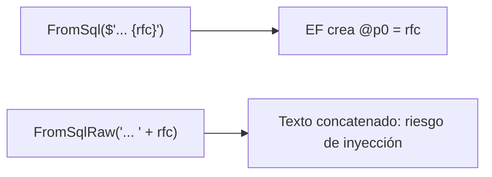

# EF Core - SQL crudo

Parte de: [[03-CSharp-DotNet/07 Acceso a datos y ORMs/_Índice Acceso a datos y ORMs|Acceso a datos y ORMs]]

> [!info] Cómo avanzar
> `progreso`: **pendiente** → **viendo** (estudiando) → **visto** (contestaste la autoevaluación sin abrir las respuestas) → **dominado** (hiciste el laboratorio o lo aplicaste de verdad).

## Contenido

### Qué es
Aunque [[Entity Framework Core]] genera SQL a partir de LINQ, a veces necesitas escribirlo tú: una consulta con funciones específicas del motor, un procedimiento almacenado, una actualización masiva o una consulta de reporte que no corresponde a ninguna entidad. EF Core ofrece varias APIs de **SQL crudo** que siguen usando parámetros seguros y, en el caso de consultas de entidades, permiten componer LINQ encima.

### Cómo funciona
| API | Para qué | Desde |
|---|---|---|
| `DbSet<T>.FromSql($"...")` | Consultar entidades con SQL interpolado **parametrizado** | EF Core 7 |
| `DbSet<T>.FromSqlRaw("...", params)` | Igual, pero con texto plano; tú pasas los parámetros | EF Core 3 |
| `Database.SqlQuery<T>($"...")` | Consultar tipos que **no son entidades** (DTOs o escalares) | EF Core 8 para tipos no mapeados |
| `Database.ExecuteSql($"...")` / `ExecuteSqlRaw` | Ejecutar comandos sin resultados | EF Core 7 / 3 |
| `ExecuteUpdateAsync` / `ExecuteDeleteAsync` | Actualizar o borrar en masa con LINQ, sin cargar entidades | EF Core 7 |

#### FromSql vs FromSqlRaw
`FromSql` recibe un `FormattableString`. Cuando escribes `FromSql($"... WHERE Rfc = {rfc}")`, **no** se concatena el valor: EF Core convierte cada `{expresión}` en un parámetro `@p0`. Es seguro contra inyección por diseño. `FromSqlRaw` recibe un `string` normal; si concatenas valores en él, eres vulnerable. Solo úsalo cuando el texto mismo debe ser dinámico (por ejemplo, un nombre de tabla de una lista blanca) y pasa los valores como parámetros aparte.



### Ejemplo
```csharp
// Entidades con SQL propio y LINQ encima (EF agrega el ORDER BY y el TOP)
var activos = await db.Clientes
    .FromSql($"SELECT * FROM dbo.Cliente WITH (NOLOCK) WHERE Estado = {estado}")
    .AsNoTracking()
    .OrderBy(c => c.Nombre)
    .Take(50)
    .ToListAsync(ct);

// Procedimiento almacenado que devuelve entidades (no se puede componer después)
var top = await db.Clientes
    .FromSql($"EXEC dbo.Cliente_TopCompradores @Anio = {anio}")
    .AsNoTracking()
    .ToListAsync(ct);

// Tipo que no es entidad: un DTO de reporte
public sealed record VentaMensual(int Mes, decimal Total);
var ventas = await db.Database
    .SqlQuery<VentaMensual>($"SELECT MONTH(Fecha) AS Mes, SUM(Total) AS Total FROM dbo.Pedido WHERE YEAR(Fecha) = {anio} GROUP BY MONTH(Fecha)")
    .ToListAsync(ct);

// UPDATE masivo sin cargar entidades: un solo comando SQL
var filas = await db.Pedidos
    .Where(p => p.Estado == EstadoPedido.Pendiente && p.Fecha < limite)
    .ExecuteUpdateAsync(s => s.SetProperty(p => p.Estado, EstadoPedido.Vencido), ct);

// Borrado masivo
await db.Bitacora.Where(b => b.Fecha < hace90Dias).ExecuteDeleteAsync(ct);
```

`ExecuteUpdateAsync` y `ExecuteDeleteAsync` se ejecutan **inmediatamente** contra la base, no pasan por el change tracker ni por `SaveChanges`, y no disparan lógica de entidades cargadas. Si ya tenías entidades en memoria, quedan desactualizadas.

### Cuándo usarlo y cuándo no
- `FromSql` cuando una parte de la consulta no se puede expresar bien en LINQ (hints, funciones de texto completo, CTE recursivas), pero quieres seguir usando entidades.
- `SqlQuery<T>` para reportes y DTOs de lectura, como harías con Dapper.
- `ExecuteUpdate/Delete` para operaciones masivas: cerrar pedidos vencidos, purgar bitácoras.
- No lo uses para todo: si la mayoría de tu acceso es SQL escrito a mano, [[Dapper]] es más natural.

### Errores comunes
- **Usar `FromSqlRaw` con interpolación o concatenación**: `FromSqlRaw($"... {valor}")` compila, pero el valor se pega como texto. Inyección. Ver [[Parametrización y SQL injection]].
- **Componer LINQ sobre un `EXEC`**: los procedimientos no se pueden envolver en una subconsulta; agrega `AsEnumerable()` o filtra en el procedimiento.
- **Columnas que no coinciden**: `FromSql` sobre entidades requiere que el SQL devuelva todas las columnas mapeadas con los nombres correctos.
- **Esperar que `ExecuteUpdate` actualice entidades rastreadas**: no lo hace; recarga si las necesitas.
- **Olvidar la transacción**: si combinas `ExecuteUpdate` con `SaveChanges`, envuélvelos en `Database.BeginTransactionAsync` para que sean atómicos.

### Para profundizar
- [Consultas SQL (Microsoft Learn)](https://learn.microsoft.com/ef/core/querying/sql-queries)
- [ExecuteUpdate y ExecuteDelete (Microsoft Learn)](https://learn.microsoft.com/ef/core/saving/execute-insert-update-delete)
- Relacionado: [[EF Core - tracking vs no tracking]]

## Autoevaluación

Contesta primero en voz alta o en papel; luego despliega la respuesta.

> [!question]- ¿Qué diferencia hay entre `FromSql` y `FromSqlRaw`?
> `FromSql($"... WHERE Id = {id}")` convierte la interpolación en parámetros (seguro). `FromSqlRaw` toma el texto tal cual: si concatenas valores, abres la puerta a inyección.

> [!question]- ¿Cómo ejecutas un UPDATE masivo sin cargar entidades?
> `ExecuteUpdateAsync(s => s.SetProperty(p => p.Estado, "Cerrado"))` o `ExecuteDeleteAsync()` (EF 7+), o `Database.ExecuteSqlAsync($"...")`.

> [!question]- ¿Cómo consultas a un tipo que no es entidad?
> `ctx.Database.SqlQuery<ReporteFila>($"SELECT ...")` (EF 8+).

