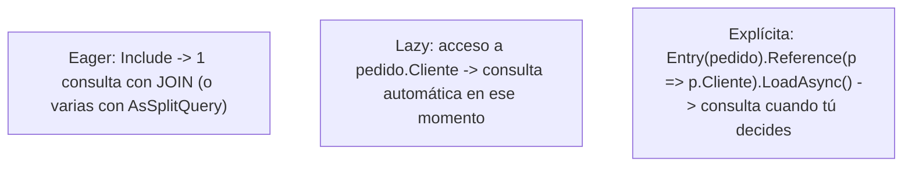

# EF Core - carga eager, lazy y explícita

Parte de: [[03-CSharp-DotNet/07 Acceso a datos y ORMs/_Índice Acceso a datos y ORMs|Acceso a datos y ORMs]]

> [!info] Cómo avanzar
> `progreso`: **pendiente** → **viendo** (estudiando) → **visto** (contestaste la autoevaluación sin abrir las respuestas) → **dominado** (hiciste el laboratorio o lo aplicaste de verdad).

## Contenido

### Qué es
Cuando una entidad tiene relaciones (un `Pedido` con su `Cliente` y sus `Partidas`), [[Entity Framework Core]] no las trae automáticamente. Hay tres estrategias para cargar esas **propiedades de navegación**:

- **Eager loading (ansiosa)**: las pides en la misma consulta con `Include` y `ThenInclude`.
- **Lazy loading (perezosa)**: se cargan solas la primera vez que accedes a la propiedad.
- **Explicit loading (explícita)**: las cargas después, a petición, con `Entry(...).Collection(...).LoadAsync()`.

Elegir bien evita tanto traer datos de más como el [[Problema N+1]].

### Cómo funciona


#### Eager
`Include(p => p.Partidas).ThenInclude(d => d.Producto)` genera un SQL con JOINs. Sabes desde el código exactamente qué se trae.

#### Lazy
Requiere el paquete `Microsoft.EntityFrameworkCore.Proxies`, llamar `UseLazyLoadingProxies()` y declarar las navegaciones como `virtual`. EF Core crea subclases proxy que interceptan el acceso. Cada acceso a una navegación no cargada lanza una consulta.

#### Explícita
Con la entidad ya rastreada, decides cargar una relación concreta, incluso filtrada: `Entry(p).Collection(x => x.Partidas).Query().Where(...).LoadAsync()`.

### Ejemplo
```csharp
// Eager: detalle de pedido para un endpoint
var pedido = await db.Pedidos
    .AsNoTracking()
    .Include(p => p.Cliente)
    .Include(p => p.Partidas).ThenInclude(d => d.Producto)
    .AsSplitQuery()                      // una consulta por colección, sin explosión cartesiana
    .SingleOrDefaultAsync(p => p.Id == id, ct);

// Explícita: solo si la regla lo requiere
var cuenta = await db.Cuentas.FindAsync([id], ct);
if (cuenta!.RequiereAuditoria)
    await db.Entry(cuenta).Collection(c => c.Movimientos)
            .Query().Where(m => m.Fecha >= desde).LoadAsync(ct);

// Lo más eficiente para lectura: proyección (no necesita Include)
var dto = await db.Pedidos.Where(p => p.Id == id)
    .Select(p => new PedidoDto(p.Id, p.Cliente.Nombre, p.Partidas.Sum(d => d.Cantidad * d.Precio)))
    .SingleOrDefaultAsync(ct);
```

### AsSplitQuery y la explosión cartesiana
Si incluyes dos colecciones (partidas y pagos) en una sola consulta, el JOIN multiplica filas: 20 partidas x 10 pagos = 200 filas repitiendo los datos del pedido. Esto se llama **explosión cartesiana** y crece muy rápido. `AsSplitQuery()` hace que EF Core ejecute **una consulta por colección incluida** y luego una los resultados en memoria. Inconvenientes: más viajes a la base, y si no hay una transacción con aislamiento adecuado, los datos podrían cambiar entre consultas. Puedes configurarlo globalmente con `UseQuerySplittingBehavior(QuerySplittingBehavior.SplitQuery)` y volver a una sola con `AsSingleQuery()`.

### Por qué lazy loading es peligroso en una API
- **N+1 invisible**: un `foreach` sobre 50 pedidos que lee `pedido.Cliente.Nombre` dispara 50 consultas sin que el código lo muestre.
- **Serialización**: al convertir la entidad a JSON, el serializador recorre las navegaciones y dispara cargas en cascada, o ciclos.
- **Contexto liberado**: si accedes a la navegación después de que terminó la petición, lanza excepción.
- **Rendimiento impredecible**: el número de consultas depende de los datos, no del código.

Por eso en APIs es preferible devolver DTOs con proyecciones o usar `Include` explícito, y dejar lazy loading desactivado (es el comportamiento por defecto).

### Cuándo usarlo y cuándo no
- **Proyección con `Select`**: primera opción para lecturas.
- **Eager con `Include`**: cuando necesitas la entidad completa con relaciones para modificarla (un agregado).
- **Explícita**: cuando la necesidad de la relación depende de una condición.
- **Lazy**: casi nunca en APIs; puede tener sentido en apps de escritorio con contextos de vida larga y pocos datos.

### Errores comunes
- **Include de todo "por si acaso"**: consultas enormes. Incluye solo lo que usas.
- **Varias colecciones en una sola consulta sin `AsSplitQuery`**: explosión cartesiana.
- **Activar lazy loading y devolver entidades en el JSON**: consultas en cascada y ciclos.
- **Filtrar un Include sin saberlo**: los Include filtrados (`Include(p => p.Partidas.Where(...))`) cambian lo que queda en el tracker; úsalos conscientemente.

### Para profundizar
- [Carga de datos relacionados (Microsoft Learn)](https://learn.microsoft.com/ef/core/querying/related-data/)
- [Consultas simples y divididas (Microsoft Learn)](https://learn.microsoft.com/ef/core/querying/single-split-queries)
- Relacionado: [[EF Core - relaciones]]

## Autoevaluación

Contesta primero en voz alta o en papel; luego despliega la respuesta.

> [!question]- ¿Qué diferencia hay entre las tres?
> Eager: `Include(p => p.Lineas)` en la misma consulta. Lazy: la navegación se carga al acceder (requiere proxies y propiedades `virtual`). Explícita: `await ctx.Entry(p).Collection(x => x.Lineas).LoadAsync()` cuando decides.

> [!question]- ¿Por qué lazy loading es peligroso en una API?
> Genera consultas ocultas (N+1) al recorrer o al serializar la entidad.

> [!question]- ¿Qué es `AsSplitQuery()`?
> Divide un `Include` de varias colecciones en varias consultas para evitar la explosión cartesiana de un JOIN gigante.

