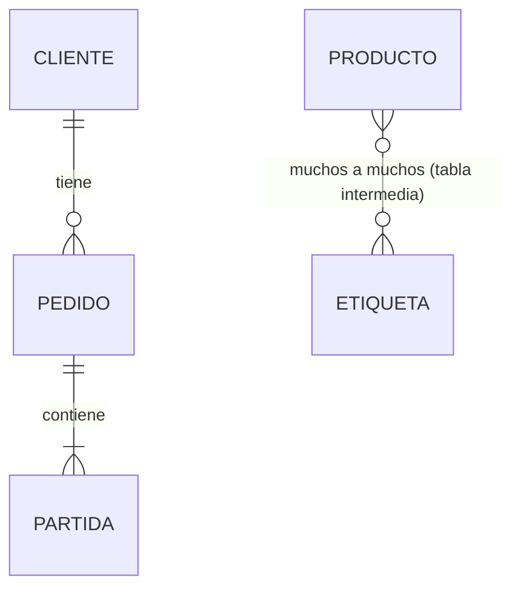

# EF Core - relaciones

Parte de: [[03-CSharp-DotNet/07 Acceso a datos y ORMs/_Índice Acceso a datos y ORMs|Acceso a datos y ORMs]]

> [!info] Cómo avanzar
> `progreso`: **pendiente** → **viendo** (estudiando) → **visto** (contestaste la autoevaluación sin abrir las respuestas) → **dominado** (hiciste el laboratorio o lo aplicaste de verdad).

## Contenido

### Qué es
Una **relación** en [[Entity Framework Core]] conecta dos entidades mediante una llave foránea, igual que en la base de datos, y se representa en el código con **propiedades de navegación**: un `Pedido` tiene un `Cliente` (referencia) y una colección de `Partidas`. EF Core usa esa información para generar JOINs, crear las llaves foráneas en las migraciones y mantener los IDs sincronizados al guardar.

### Cómo funciona
Hay tres tipos: **uno a muchos** (cliente y pedidos), **uno a uno** (usuario y perfil) y **muchos a muchos** (productos y etiquetas). EF Core las descubre por **convenciones**:

- Una propiedad de navegación de colección en un lado y de referencia en el otro indica uno a muchos.
- Una propiedad `ClienteId` (nombre de la navegación + `Id`) se toma como llave foránea.
- Si la FK no es nullable, la relación es **requerida**; si es nullable, **opcional**.

Cuando la convención no basta, usas **Fluent API** en `OnModelCreating` o en una `IEntityTypeConfiguration<T>`: `HasOne`, `WithMany`, `HasForeignKey`, `OnDelete`.



### Ejemplo
```csharp
public class Cliente
{
    public int Id { get; set; }
    public string Nombre { get; set; } = "";
    public List<Pedido> Pedidos { get; } = [];
}

public class Pedido
{
    public int Id { get; set; }
    public int ClienteId { get; set; }          // FK requerida por convención
    public Cliente Cliente { get; set; } = null!;
    public List<Partida> Partidas { get; } = [];
}

public class Producto
{
    public int Id { get; set; }
    public List<Etiqueta> Etiquetas { get; } = []; // muchos a muchos sin clase intermedia
}
public class Etiqueta
{
    public int Id { get; set; }
    public List<Producto> Productos { get; } = [];
}

public sealed class PedidoConfig : IEntityTypeConfiguration<Pedido>
{
    public void Configure(EntityTypeBuilder<Pedido> b)
    {
        b.HasOne(p => p.Cliente)
         .WithMany(c => c.Pedidos)
         .HasForeignKey(p => p.ClienteId)
         .OnDelete(DeleteBehavior.Restrict);   // no borrar pedidos al borrar el cliente

        b.HasMany(p => p.Partidas)
         .WithOne()
         .HasForeignKey("PedidoId")
         .OnDelete(DeleteBehavior.Cascade);    // las partidas sí viven y mueren con el pedido
    }
}
```

### Muchos a muchos en EF Core moderno
Desde EF Core 5 basta con poner una colección en cada lado (`Producto.Etiquetas` y `Etiqueta.Productos`). EF Core crea una **tabla intermedia implícita** (por ejemplo `EtiquetaProducto`) y usa *skip navigations*: navegas directamente de producto a etiquetas sin ver la tabla de unión. Si la tabla intermedia necesita datos propios (fecha de asignación, quién la asignó), configúrala con `UsingEntity<ProductoEtiqueta>(...)` o modélala como entidad explícita con dos relaciones uno a muchos.

### El riesgo del borrado en cascada
Por convención, las relaciones **requeridas** se configuran con `DeleteBehavior.Cascade`: al borrar el principal se borran los dependientes. Esto es correcto para partidas de un pedido, pero peligroso para relaciones de negocio: borrar un cliente podría eliminar en cascada todos sus pedidos y facturas, algo inaceptable con datos fiscales. Además, SQL Server rechaza esquemas con **varias rutas de cascada o ciclos** (error *"may cause cycles or multiple cascade paths"*) y tendrás que cambiar alguna a `Restrict` o `NoAction`. Recomendación: usa cascada solo dentro de un agregado (partes que no existen sin el padre) y `Restrict` entre agregados; para "borrar" clientes, usa borrado lógico (`Activo = false`) con un filtro global de consulta.

### Cuándo usarlo y cuándo no
Modela navegaciones cuando las usas para escribir y validar agregados o para consultas que se benefician de LINQ. No crees navegaciones bidireccionales en todas partes "porque sí": aumentan el acoplamiento y el riesgo de ciclos al serializar. Entre agregados, a veces basta con guardar el ID (`ClienteId`) sin navegación.

### Errores comunes
- **Cascada por defecto sin revisar**: borrados masivos inesperados. Revisa cada `OnDelete` en las migraciones.
- **Devolver entidades con navegaciones en el JSON**: ciclos (cliente, pedidos, cliente...). Devuelve DTOs.
- **Configurar la misma relación dos veces** de forma inconsistente desde ambos lados: EF crea dos FKs. Configúrala en un solo lugar.
- **Inicializar colecciones a `null`**: `NullReferenceException` al agregar; inicialízalas vacías.
- **Agregar hijos sin cargar la colección** y esperar que EF reemplace los existentes: solo agrega; para sincronizar, carga primero.

### Para profundizar
- [Relaciones (Microsoft Learn)](https://learn.microsoft.com/ef/core/modeling/relationships)
- [Relaciones de muchos a muchos (Microsoft Learn)](https://learn.microsoft.com/ef/core/modeling/relationships/many-to-many)
- [Eliminación en cascada (Microsoft Learn)](https://learn.microsoft.com/ef/core/saving/cascade-delete)

## Autoevaluación

Contesta primero en voz alta o en papel; luego despliega la respuesta.

> [!question]- ¿Cómo se definen relaciones?
> Con propiedades de navegación y llaves foráneas por convención (`ClienteId` + `Cliente`), o con la API fluida en `OnModelCreating`: `HasOne(...).WithMany(...).HasForeignKey(...)`.

> [!question]- ¿Qué es una relación muchos a muchos en EF Core moderno?
> Dos colecciones de navegación (`Alumno.Cursos` y `Curso.Alumnos`); EF crea la tabla intermedia automáticamente, o la defines si tiene datos propios.

> [!question]- ¿Qué riesgo tiene el borrado en cascada?
> Borrar un padre elimina hijos sin que lo veas en el código; configúralo de forma explícita (`OnDelete(DeleteBehavior.Restrict)`) cuando no lo quieras.

