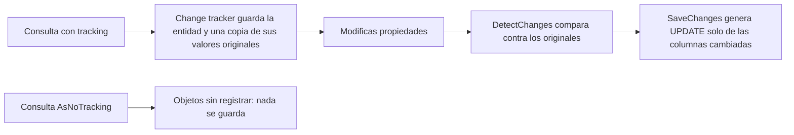

# EF Core - tracking vs no tracking

Parte de: [[03-CSharp-DotNet/07 Acceso a datos y ORMs/_Índice Acceso a datos y ORMs|Acceso a datos y ORMs]]

> [!info] Cómo avanzar
> `progreso`: **pendiente** → **viendo** (estudiando) → **visto** (contestaste la autoevaluación sin abrir las respuestas) → **dominado** (hiciste el laboratorio o lo aplicaste de verdad).

## Contenido

### Qué es
El **change tracking** es el mecanismo con el que [[Entity Framework Core]] recuerda cada entidad que cargó en un `DbContext` y detecta qué cambió en ella. Gracias a eso, al llamar `SaveChangesAsync`, EF sabe qué `UPDATE`, `INSERT` y `DELETE` generar sin que escribas SQL. Las consultas **sin tracking** (`AsNoTracking`) se saltan ese registro: devuelven objetos "sueltos", más rápidos y ligeros, que EF no vigila.

### Cómo funciona


- Cada entidad rastreada tiene un **estado**: `Unchanged`, `Modified`, `Added`, `Deleted` o `Detached`. Lo puedes ver con `db.Entry(entidad).State`.
- EF guarda una **instantánea** de los valores originales; `DetectChanges` (se llama automáticamente antes de guardar y en otras operaciones) compara y marca propiedades modificadas.
- **Resolución de identidad**: si la misma fila aparece dos veces en consultas del mismo contexto, obtienes la misma instancia.
- Con `AsNoTracking`, EF no crea instantáneas ni registra nada; consume menos memoria y CPU. Si la misma fila aparece dos veces, obtienes dos objetos distintos (salvo con `AsNoTrackingWithIdentityResolution`).

### Ejemplo
```csharp
// Lectura para un endpoint GET: sin tracking (o mejor aún, proyección a DTO)
var lista = await db.Cuentas
    .AsNoTracking()
    .Where(c => c.Activa)
    .Select(c => new CuentaDto(c.Id, c.Nombre, c.Saldo))
    .ToListAsync(ct);

// Escritura: con tracking, para que EF detecte el cambio
var cuenta = await db.Cuentas.SingleAsync(c => c.Id == id, ct);
cuenta.Renombrar(dto.Nombre);
await db.SaveChangesAsync(ct);   // UPDATE "Cuenta" SET "Nombre" = @p0 WHERE "Id" = @p1

// Trampa: entidad cargada sin tracking
var suelta = await db.Cuentas.AsNoTracking().SingleAsync(c => c.Id == id, ct);
suelta.Renombrar("Nuevo");
await db.SaveChangesAsync(ct);   // no guarda nada: EF no conoce el objeto

// Si de verdad necesitas guardarla, adjúntala (marca TODAS las columnas como modificadas)
db.Update(suelta);
await db.SaveChangesAsync(ct);
```

Las proyecciones a tipos que no son entidades (`Select(c => new CuentaDto(...))`) nunca se rastrean, así que no necesitan `AsNoTracking`.

Para cambiar el comportamiento por defecto de un contexto que casi solo lee: `o.UseQueryTrackingBehavior(QueryTrackingBehavior.NoTracking)` y activas tracking puntual con `AsTracking()`.

### Cuándo usar `AsNoTracking()`
- Consultas de solo lectura: listados, reportes, búsquedas, endpoints GET.
- Cargas grandes donde el costo de las instantáneas se nota en memoria.
- Datos que vas a mapear a DTOs y devolver.

Usa tracking cuando vas a **modificar y guardar** las entidades en el mismo contexto, o cuando necesitas la resolución de identidad dentro de una operación.

### Qué pasa si modificas una entidad no rastreada y guardas
`SaveChanges` no hace nada con ella: no lanza error ni guarda. Es un error silencioso; la API devuelve 204 y el cambio se pierde. Si la adjuntas con `Update` o `Attach`, ten cuidado: `Update` marca todas las propiedades como modificadas (sobrescribe columnas que otro usuario pudo cambiar) y también se propaga a entidades relacionadas alcanzables. Para escenarios desconectados es más seguro cargar con tracking y aplicar los cambios, o usar `ExecuteUpdateAsync` (ver [[EF Core - SQL crudo]]).

### Cuándo usarlo y cuándo no
Sigue una regla simple por slice: los *queries* usan `AsNoTracking` o proyecciones; los *commands* cargan con tracking lo que van a modificar. Si un slice solo lee con SQL complejo, considera Dapper sobre la misma conexión.

### Errores comunes
- **Tracking en todos los GET**: más memoria y CPU sin beneficio.
- **`AsNoTracking` en el flujo de escritura**: cambios que no se guardan.
- **`db.Update(entidad)` con DTOs mapeados**: sobrescribe columnas no enviadas con valores por defecto.
- **Contextos de vida larga** acumulando miles de entidades rastreadas: `DetectChanges` se vuelve lento. Usa contextos cortos ([[EF Core - DbContext]]).

### Para profundizar
- [Consultas de seguimiento frente a consultas sin seguimiento (Microsoft Learn)](https://learn.microsoft.com/ef/core/querying/tracking)
- [Change tracking en EF Core (Microsoft Learn)](https://learn.microsoft.com/ef/core/change-tracking/)
- [Rendimiento de consultas eficientes (Microsoft Learn)](https://learn.microsoft.com/ef/core/performance/efficient-querying)

## Autoevaluación

Contesta primero en voz alta o en papel; luego despliega la respuesta.

> [!question]- ¿Qué es el *change tracking*?
> EF guarda una copia de las entidades cargadas para detectar cambios y generar los `UPDATE` en `SaveChanges`.

> [!question]- ¿Cuándo usar `AsNoTracking()`?
> En consultas de solo lectura (listados, reportes): consume menos memoria y es más rápido.

> [!question]- ¿Qué pasa si modificas una entidad cargada con `AsNoTracking` y llamas `SaveChanges`?
> Nada: EF no la conoce. Tendrías que adjuntarla (`Update`/`Attach`).

