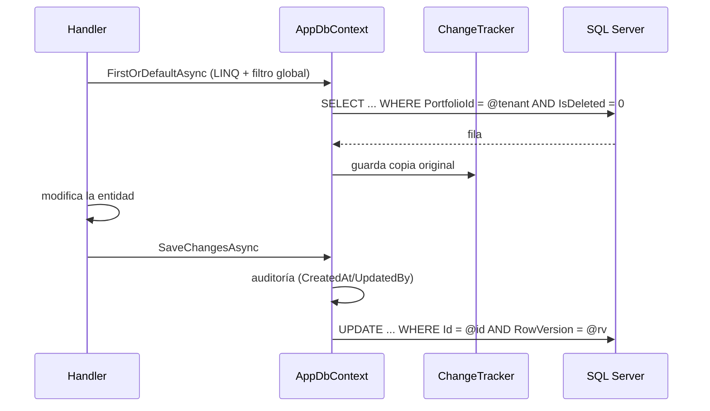

# Entity Framework Core

> ORM oficial de .NET: mapea clases a tablas, traduce LINQ a SQL, rastrea cambios y versiona el esquema con migraciones; [[Itzamna.Dionisio]] usa EF Core 10 sobre [[SQL Server]].

## Qué es y qué problema resuelve
Con ADO.NET o [[Dapper]] escribes el SQL y el mapeo; con EF Core describes el **modelo** (entidades + configuración) y el ORM genera el SQL. Resuelve tres cosas a la vez:
- **Consultas tipadas** con LINQ (`db.Portfolios.Where(p => p.Slug == slug)`): un error de nombre falla al compilar.
- **Unit of work**: el `DbContext` recuerda qué cambiaste y `SaveChangesAsync` lo guarda todo en una transacción.
- **Migraciones**: el esquema evoluciona en clases C# versionadas que se pueden convertir a script SQL.

## Cómo funciona por dentro
- **`DbContext`**: una sesión con la base (en ASP.NET Core, *scoped*: uno por petición). Expone `DbSet<T>`.
- **Modelo**: se arma una vez al arrancar desde convenciones + `IEntityTypeConfiguration<T>` (`ApplyConfigurationsFromAssembly`) + `OnModelCreating`.
- **Change tracker**: guarda una copia de cada entidad cargada; en `SaveChanges` compara y genera `INSERT/UPDATE/DELETE`. `AsNoTracking()` lo apaga para lecturas.
- **Filtros globales** (`HasQueryFilter`): un `WHERE` que se agrega a toda consulta de esa entidad. `IgnoreQueryFilters()` lo quita.
- **Value converters + value comparers**: guardar un tipo complejo en una columna (p. ej. JSON en `nvarchar(max)`).
- **Concurrencia**: una propiedad `IsRowVersion()` va en el `WHERE` del `UPDATE`; si no coincide, lanza `DbUpdateConcurrencyException` ([[Concurrencia optimista]]).
- **Migraciones**: `dotnet ef migrations add` compara el modelo con `ModelSnapshot` y genera `Up/Down`; `migrations script --idempotent` produce un SQL que solo aplica lo pendiente (tabla `__EFMigrationsHistory`).



## Cuándo usarla y cuándo no
### Ventajas
- Productividad: CRUD, relaciones y migraciones sin escribir SQL.
- Reglas transversales en un solo lugar (filtros por tenant, borrado lógico, auditoría).
- LINQ tipado y proyecciones (`Select` a DTO) que solo traen las columnas necesarias.
### Desventajas
- SQL generado menos predecible; hay que revisar consultas pesadas (logs de `Database.Command`).
- "Magia" que sorprende: un filtro global olvidado, un `Include` faltante, tracking innecesario.
- Comparadores de columnas JSON y conversiones tienen costo (serializar para comparar).

## Alternativas
| Alternativa | En qué se diferencia |
|---|---|
| [[Dapper]] | Micro-ORM: tú escribes el SQL; sin tracking ni migraciones. Lo usa [[Ocelotl.Hermes]]. |
| [[SQL en archivos con una interfaz por consulta]] | SQL en `.sql` + interfaz por consulta sobre Dapper; choca con los filtros globales (ver esa nota). |
| ADO.NET puro | Máximo control, mucho código repetitivo. |
| linq2db / RepoDB | LINQ a SQL más ligero, sin unit of work completo. |

## Cómo se usó en Itzamna
En [[Itzamna.Dionisio]] (ver [[Itzamna.Dionisio - Arquitectura]]):

| Pieza | Archivo (`Itzamna.Dionisio/src/Itzamna.Dionisio.Infrastructure/…`) |
|---|---|
| `AppDbContext` (14 `DbSet`, esquema `portfolio`, filtros, auditoría) | `Persistence/AppDbContext.cs` |
| Configuración por entidad (`IEntityTypeConfiguration<T>`) | `Persistence/Configurations/EntityConfigurations.cs` |
| Columnas JSON (`HasJsonConversion`) | `Persistence/JsonColumn.cs` |
| Migraciones (`InitialCreate`, `AddCollaborations`, `AddCollaborationsTable`, `AddCollaborationLogoMonochrome`) | `Persistence/Migrations/` |
| `dotnet ef` sin levantar la API | `Persistence/DesignTimeDbContextFactory.cs` (variable `DIONISIO_CONNECTION`) |
| Migrar + sembrar demo de Jatz en Development | `Persistence/DatabaseInitializer.cs` |

Decisiones observadas:
- **Sin repositorios**: los handlers reciben `IAppDbContext` (interfaz en Application con los `DbSet`) y usan LINQ directo ([[Repository]]).
- **Filtros globales** por portfolio/creador + `!IsDeleted` → [[Multi-tenancy]] y [[Borrado lógico y auditoría]].
- **Auditoría** en `SaveChangesAsync` sobreescrito (rellena `CreatedAt/By`, `UpdatedAt/By` desde `ICurrentUser`).
- **`RowVersion`** en todas las entidades (`EntityDefaults.Base`) → [[Concurrencia optimista]].
- **Módulos 1:1 como JSON**: `Hero`, `About`, `Contact`, `Seo`, `SectionCopy` de `Portfolios`, y `MediaReference` (fotos con alt/foco/recortes) se guardan en `nvarchar(max)`. Ver [[Módulos del portfolio]].
- **Enums como texto** (`HasConversion<string>()`), **ids `Guid.CreateVersion7()`** generados en C# (`ValueGeneratedNever`).
- **Índices filtrados** `HasFilter("[IsDeleted] = 0")` para orden y slug único de categorías.
- **Resiliencia**: `EnableRetryOnFailure(5, 10 s)` y `CommandTimeout(60)` (pensado para Azure SQL serverless que se pausa).

El value comparer compara por JSON para detectar mutaciones del mismo objeto (`Itzamna.Dionisio/src/Itzamna.Dionisio.Infrastructure/Persistence/JsonColumn.cs`):
```csharp
var converter = new ValueConverter<T, string>(
    v => Serialize(v),
    s => Deserialize<T>(s));

// Compara por contenido serializado: detecta cambios aunque se mute el mismo objeto.
var comparer = new ValueComparer<T>(
    (a, b) => Serialize(a) == Serialize(b),
    v => Serialize(v).GetHashCode(),
    v => Deserialize<T>(Serialize(v)));

builder.HasConversion(converter, comparer).HasColumnType("nvarchar(max)");
```

En producción el esquema **no** se migra al arrancar: el pipeline genera `migrations.sql` idempotente y lo aplica antes de desplegar ([[Azure Pipelines]]).

Funcionalidades: todas las del back, en especial [[Multi-tenant y aislamiento]], [[Módulos del portfolio]], [[Publicación y versiones]], [[Biblioteca de medios]].

> [!note] Pendiente de confirmar
> `.ai/03_ROADMAP.md` lista "Migración inicial de EF Core" como pendiente, pero ya existen 4 migraciones (la primera, `20261008053935_InitialCreate`). Parece que el roadmap quedó desactualizado.

> [!tip] Reutilizable
> `JsonColumn.HasJsonConversion()` (converter + comparer) y `DesignTimeDbContextFactory` con un `ICurrentUser`/`ITenantContext` falsos se copian tal cual a otro proyecto con EF Core.

## Errores comunes y buenas prácticas
- Olvidar `AsNoTracking()` en lecturas: más memoria y más trabajo en `SaveChanges`. Dionisio lo usa en consultas de lectura y en la vista previa (para poder modificar sin guardar).
- Columnas JSON sin `ValueComparer`: EF no detecta que mutaste el objeto y no guarda.
- `IgnoreQueryFilters()` fuera de lugar: abre datos de otro tenant. Limitarlo a resolución de tenant y lectura pública.
- `EnsureCreated` en producción: no deja historial de migraciones. Dionisio solo lo usa si no hay migraciones (con advertencia).
- Migrar desde la app al arrancar en varias instancias a la vez: mejor un script en el pipeline.

## Qué estudiar después
- [[SQL Server]], [[Concurrencia optimista]], [[Multi-tenancy]], [[Borrado lógico y auditoría]]
- [[Repository]] (por qué Dionisio no lo usa), [[CQRS y mediador]]
- Consultas compiladas, `Include` vs proyecciones, `ExecuteUpdate/ExecuteDelete`.

## Documentación oficial
- https://learn.microsoft.com/ef/core/
- https://learn.microsoft.com/ef/core/querying/filters
- https://learn.microsoft.com/ef/core/managing-schemas/migrations/
- https://learn.microsoft.com/ef/core/modeling/value-conversions

## Autoevaluación

Contesta primero en voz alta o en papel; luego despliega la respuesta.

> [!question]- ¿Qué te da EF Core?
> Consultas LINQ traducidas a SQL, seguimiento de cambios con `SaveChanges`, relaciones, migraciones y proveedores para varias bases.

> [!question]- ¿Por qué tus proyectos ya no lo usan?
> Prefieres control total del SQL (stored procedures, archivos `.sql`), mapeo a mano y menos "magia"; Dapper + SQL explícito encaja mejor con ese estilo.

> [!question]- ¿Cuándo volverías a considerarlo?
> En proyectos CRUD grandes con un equipo acostumbrado a EF, o donde las migraciones desde código y LINQ ahorren mucho tiempo.

