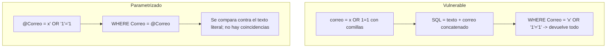

# Parametrización y SQL injection

Parte de: [[03-CSharp-DotNet/07 Acceso a datos y ORMs/_Índice Acceso a datos y ORMs|Acceso a datos y ORMs]]

> [!info] Cómo avanzar
> `progreso`: **pendiente** → **viendo** (estudiando) → **visto** (contestaste la autoevaluación sin abrir las respuestas) → **dominado** (hiciste el laboratorio o lo aplicaste de verdad).

## Contenido

### Qué es
La **inyección SQL** ocurre cuando un dato que controla el usuario se pega dentro del texto de una consulta y termina interpretándose como código SQL. Con eso un atacante puede leer tablas ajenas, saltarse un login, modificar o borrar datos. La defensa principal es la **parametrización**: el texto SQL y los valores viajan por separado, de modo que el servidor nunca interpreta un valor como instrucción. Es un riesgo clásico del OWASP Top 10 (categoría *Injection*).

### Cómo funciona


Con parámetros, SQL Server recibe la consulta ya compilable (`WHERE Correo = @Correo`) y, por separado, el valor tipado. El plan se arma con la estructura fija; el valor solo se usa como dato. Por eso no importa qué caracteres contenga: comillas, `--` o `;` son parte del texto. Además, los parámetros permiten reutilizar planes de ejecución.

### Ejemplo
Corregir una consulta vulnerable con Dapper:

```csharp
// Vulnerable: interpolación dentro del string SQL
var u = await cn.QueryAsync<Usuario>($"SELECT * FROM Usuario WHERE Correo = '{correo}'");

// Correcto: parámetro con nombre y columnas explícitas
var u2 = await cn.QuerySingleOrDefaultAsync<Usuario>(
    "SELECT Id, Correo, Nombre FROM dbo.Usuario WHERE Correo = @Correo",
    new { Correo = new DbString { Value = correo, IsAnsi = false, Length = 256 } });
```

#### Lo que no se puede parametrizar
Los parámetros reemplazan **valores**, no **identificadores** ni palabras clave: nombres de tabla o columna, la columna de `ORDER BY`, la dirección `ASC`/`DESC`, nombres de esquema o de base. Para esas partes usa una **lista blanca**:

```csharp
// Ordenar por columna elegida por el usuario de forma segura
private static readonly Dictionary<string, string> Columnas = new(StringComparer.OrdinalIgnoreCase)
{
    ["nombre"] = "c.Nombre",
    ["fecha"]  = "c.FechaAlta"
};

public string ConstruirOrden(string campo, bool desc)
{
    if (!Columnas.TryGetValue(campo, out var columna))
        throw new ValidacionException("orden", "Campo de orden no permitido"); // o usa un valor por defecto
    return $"ORDER BY {columna} {(desc ? "DESC" : "ASC")}";
}
```

El texto que entra al SQL proviene siempre de tu diccionario, nunca del usuario. Valida el parámetro de orden también con FluentValidation en el request.

### ¿Un procedimiento almacenado te protege siempre?
No. Un procedimiento llamado con parámetros es seguro **si por dentro no construye SQL dinámico concatenando** esos parámetros. Este procedimiento es vulnerable:

```sql
CREATE OR ALTER PROCEDURE dbo.Cliente_Buscar @Orden NVARCHAR(50), @Nombre NVARCHAR(100) AS
BEGIN
    DECLARE @sql NVARCHAR(MAX) = N'SELECT Id, Nombre FROM dbo.Cliente WHERE Nombre LIKE ''%' + @Nombre + '%'' ORDER BY ' + @Orden;
    EXEC (@sql);   -- inyección dentro del procedimiento
END
```

La versión segura usa `sp_executesql` con parámetros para los valores y `QUOTENAME` más lista blanca para identificadores:

```sql
CREATE OR ALTER PROCEDURE dbo.Cliente_Buscar @Orden SYSNAME, @Nombre NVARCHAR(100) AS
BEGIN
    SET NOCOUNT ON;
    IF @Orden NOT IN (N'Nombre', N'FechaAlta') SET @Orden = N'Nombre';
    DECLARE @sql NVARCHAR(MAX) =
        N'SELECT Id, Nombre FROM dbo.Cliente WHERE Nombre LIKE @Patron ORDER BY ' + QUOTENAME(@Orden);
    EXEC sp_executesql @sql, N'@Patron NVARCHAR(102)', @Patron = N'%' + @Nombre + N'%';
END
```

### Cuándo usarlo y cuándo no
Siempre. No hay escenario válido para concatenar datos de usuario en SQL. Las herramientas ayudan: Dapper parametriza objetos anónimos, `FromSql` de EF Core convierte la interpolación en parámetros (ver [[EF Core - SQL crudo]]), y tu patrón de [[SQL en archivos con una interfaz por consulta]] hace que el texto sea fijo y revisable. Como defensa en profundidad: usuario de base con privilegios mínimos (solo `EXECUTE` sobre procedimientos), validación de entrada y no exponer mensajes de error de SQL al cliente (ProblemDetails con `codigo`, sin el detalle).

### Errores comunes
- **Interpolar en Dapper** (`$"... {valor}"`): compila y funciona en pruebas, pero es inyección pura.
- **`FromSqlRaw` con interpolación** en EF Core: mismo problema.
- **"Escapar" comillas a mano** (`Replace("'", "''")`): frágil, falla con otras codificaciones y no cubre identificadores.
- **Confiar en el front de React** para validar: cualquiera llama a la API directamente.
- **SQL dinámico en procedimientos** con `EXEC(@sql)` concatenado.

### Para profundizar
- [OWASP: SQL Injection Prevention Cheat Sheet](https://cheatsheetseries.owasp.org/cheatsheets/SQL_Injection_Prevention_Cheat_Sheet.html)
- [Inyección de código SQL (Microsoft Learn)](https://learn.microsoft.com/sql/relational-databases/security/sql-injection)
- [sp_executesql (Microsoft Learn)](https://learn.microsoft.com/sql/relational-databases/system-stored-procedures/sp-executesql-transact-sql)

## Ejercicios

Resuélvelos en papel o en la herramienta; la solución está plegada.

> [!question]- Corrige: `cn.QueryAsync<U>($"SELECT * FROM Usuario WHERE Correo = '{correo}'")`
> ```csharp
> cn.QueryAsync<U>("SELECT Id, Correo FROM dbo.Usuario WHERE Correo = @Correo", new { Correo = correo })
> ```

> [!question]- Ordenar por columna elegida por el usuario (`nombre` o `fecha`) de forma segura.
> ```csharp
> var col = orden switch { "nombre" => "Nombre", "fecha" => "FechaAlta", _ => "Id" };
> var sql = $"SELECT ... ORDER BY {col}"; // solo valores de la lista blanca
> ```

## Autoevaluación

Contesta primero en voz alta o en papel; luego despliega la respuesta.

> [!question]- ¿Qué es la inyección SQL?
> Cuando un dato del usuario se concatena en el texto SQL y cambia la consulta: `' OR 1=1 --` en un login devuelve todas las filas.

> [!question]- ¿Por qué los parámetros la evitan?
> El valor viaja separado del texto del comando; el motor nunca lo interpreta como SQL. Además reutiliza el plan de ejecución.

> [!question]- ¿Qué parte de una consulta **no** se puede parametrizar?
> Nombres de tabla o columna y la dirección de `ORDER BY`. Usa una lista blanca (`switch` a valores fijos), nunca el texto del usuario.

> [!question]- ¿Un stored procedure te protege siempre?
> Solo si el SP no arma SQL dinámico con concatenación. Dentro del SP usa `sp_executesql` con parámetros.

## Práctica

- [[Lab 9 - Dapper con stored procedures y transacción]]

