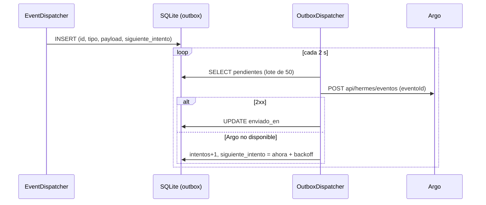

---
proyecto:
  - Ocelotl.Hermes
  - Pochteca.Nomisma
proyectos:
  - "[[Ocelotl.Hermes]]"
  - "[[Pochteca.Nomisma]]"
tipo: patron
nivel: avanzado
estado: completo
tags:
  - conocimiento
  - patron
  - mensajeria
progreso: pendiente
area: C# y .NET
---
# Patrón Outbox

> Guardar primero en la base local los mensajes que hay que mandar a otro sistema, y enviarlos después desde un proceso aparte que reintenta hasta lograrlo.

## Qué es y qué problema resuelve
Cuando una aplicación debe avisar a otro sistema (por HTTP o un bus), llamar "en línea" falla si no hay red, y el evento se pierde. El patrón **Outbox** (*transactional outbox*) escribe el mensaje en una tabla `outbox` de la base local y un despachador en segundo plano lo envía, marcándolo como enviado solo cuando el destino confirma. Así el envío sobrevive a cortes de internet y a reinicios.

## Cómo funciona por dentro
1. **Guardar**: el evento se serializa y se inserta en `outbox` con un id único.
2. **Despachar**: un proceso lee los pendientes en orden, los envía y marca `enviado_en`.
3. **Fallar con elegancia**: si el envío falla, sube `intentos` y calcula `siguiente_intento` con **backoff exponencial**.
4. **Purgar**: borra lo enviado tras un tiempo de retención.

Garantía: **"al menos una vez"**. Si el destino recibió el mensaje pero la confirmación se perdió, se reenviará: el receptor debe **deduplicar por id** (ver [[Idempotencia]]).

En su forma "de libro", el insert en `outbox` va en la **misma transacción** que el cambio de negocio, para que no exista uno sin el otro.



## Cuándo usarla y cuándo no
Úsalo cuando el envío **no puede perderse** y el destino puede no estar disponible (offline, nube). No hace falta si el envío es opcional o si necesitas la respuesta del destino en el momento (ahí es una llamada síncrona con su manejo de error).

### Ventajas
- Funciona sin internet; nada se pierde mientras la base local exista.
- Desacopla el ritmo de la operación (robot) del ritmo del destino (Argo).
- Orden de envío por fecha de creación.

### Desventajas
- Entrega duplicada posible: obliga al receptor a ser idempotente.
- Latencia: el destino se entera segundos (o minutos) después.
- Hay que purgar y vigilar la tabla (cuántos pendientes hay).

## Alternativas
| Alternativa | En qué se diferencia |
|---|---|
| Llamada HTTP directa | Simple, pero si falla el evento se pierde o bloquea la operación. |
| Cola en memoria (`Channel`) | No sobrevive a un reinicio. Hermes la usa *antes* del outbox, solo para no bloquear al SDK. |
| Broker de mensajes (RabbitMQ, Azure Service Bus) | Infraestructura externa; en una PC de farmacia sin red no está disponible. |
| Change Data Capture | Lee el log de la base; no aplica a SQLite embebida. |

## Cómo se usó en Ocelotl
En [[Ocelotl.Hermes]] lleva a [[Argo]] todos los eventos del robot (ver [[Eventos de dominio y reacciones]]) — parte de [[Sincronización con Argo]], [[Dispensar]] (`EgresoSolicitado`), [[Ingresos]] y [[Trazabilidad por caja]].

Piezas (`Ocelotl.Hermes/src/Ocelotl.Hermes.Infrastructure/Eventos/Outbox/`):
- `OutboxRepositorio`: `GuardarAsync`, `PendientesAsync`, `MarcarEnviadoAsync`, `MarcarFallidoAsync`, `PurgarEnviadosAsync`, `ContarPendientesAsync` (con [[Dapper]]).
- `OutboxDispatcher`: [[BackgroundService]] que cada 2 s manda lotes de 50; si Argo no está disponible corta el lote; purga cada hora lo enviado hace más de 7 días.
- Destino: `IArgoEventSink` → `ArgoHttpEventSink` (`POST api/hermes/eventos`) o `ArgoSimuladoEventSink` en desarrollo (los marca como enviados sin salir de la PC).

Tabla en `Ocelotl.Hermes/src/Ocelotl.Hermes.Infrastructure/Persistence/Sql/Esquema/Base.sql` (las consultas del outbox, en `Sql/Outbox/*.sql`):

```sql
CREATE TABLE IF NOT EXISTS outbox (
    id                 TEXT    NOT NULL PRIMARY KEY,  -- id del evento (Argo deduplica con él)
    tipo               TEXT    NOT NULL,
    robot_id           TEXT    NOT NULL,
    payload            TEXT    NOT NULL,              -- JSON del evento
    creado_en          INTEGER NOT NULL,              -- unix ms
    intentos           INTEGER NOT NULL DEFAULT 0,
    siguiente_intento  INTEGER NOT NULL,              -- unix ms
    enviado_en         INTEGER NULL,                  -- unix ms
    ultimo_error       TEXT    NULL
);
```

Backoff en `OutboxRepositorio.MarcarFallidoAsync`:

```csharp
// Backoff exponencial: 2, 4, 8 ... hasta 5 minutos entre intentos.
var espera = TimeSpan.FromSeconds(Math.Min(300, Math.Pow(2, Math.Min(intentos + 1, 9))));
```

El `id` es `Guid.CreateVersion7()` y viaja como `EventoId` en `EventoArgoDto`. Argo debe deduplicar por `eventoId` (README de Hermes, "al menos una vez").

Clasificación de fallos en `OutboxDispatcher.DespacharAsync`: `ArgoNoDisponibleException` (red, timeout, 5xx) corta el lote; cualquier otro error (p. ej. 4xx) marca ese mensaje como fallido y sigue con el resto.

**Diferencia con el outbox "de libro"**: en Hermes el insert en `outbox` lo hace `EventDispatcher` después de sacar el evento del `Channel` en memoria, **no** en la misma transacción que los cambios de negocio (p. ej. `Dispensar` registra el egreso y luego publica `EgresoSolicitado` por separado). Si Hermes se cae entre la publicación en el `Channel` y el insert, ese evento se perdería. Pendiente de confirmar si es un riesgo aceptado.

Pruebas: `tests/Ocelotl.Hermes.Integration.Tests/OutboxTests.cs` (`Guarda_y_manda_a_Argo_en_orden`, `Sin_internet_no_pierde_nada_y_reintenta_despues`).


## Cómo se usó en Pochteca.Nomisma (retirado)
[[Pochteca.Nomisma]] tenía un outbox (`payment.IntegrationOutbox`) para avisar a otro sistema (RaceCore) de cada pago de Stripe Connect: el webhook encolaba, y un `BackgroundService` lo entregaba con firma HMAC, reintentos con backoff exponencial, `FOR UPDATE SKIP LOCKED` para varias instancias y dead-letter tras 8 intentos.

**Se quitó el 2026-11-09** junto con la integración con RaceCore. Si se vuelve a necesitar avisar a otro sistema, el diseño de ese outbox es buena referencia: no bloquear el 2xx al proveedor del webhook por una caída del sistema destino.

## Errores comunes y buenas prácticas
- **Olvidar que es "al menos una vez"**: el receptor tiene que deduplicar.
- **Reintentar sin backoff**: satura la red y el destino. Usar exponencial con techo (aquí 5 min).
- **Tratar igual todos los errores**: un 4xx no se arregla reintentando rápido; un corte de red sí afecta a todo el lote.
- **No purgar**: la tabla crece sin fin. Retener lo enviado solo lo necesario para diagnóstico.
- Indexar por los campos del `WHERE` de pendientes (`ix_outbox_pendientes (enviado_en, siguiente_intento)`).
- Truncar el error guardado (aquí a 1000 caracteres).

## Qué estudiar después
- [[Idempotencia]]
- [[Eventos de dominio y reacciones]]
- [[BackgroundService]] y [[System.Threading.Channels]]
- [[SQLite]] (transacciones, índices)
- Patrón Inbox (el lado receptor que deduplica)

## Documentación oficial
- https://microservices.io/patterns/data/transactional-outbox.html

## Autoevaluación

Contesta primero en voz alta o en papel; luego despliega la respuesta.

> [!question]- ¿Qué problema resuelve el Outbox?
> Guardar un cambio y publicar su evento de forma consistente: si guardas en la BD y luego publicas, puedes fallar entre ambos y perder el evento (o publicar algo que no se guardó).

> [!question]- ¿Cómo funciona?
> En la **misma transacción** del cambio insertas el evento en una tabla outbox; un proceso en segundo plano lee los pendientes, los publica y los marca como enviados.

> [!question]- ¿Qué garantía de entrega da y qué exige del consumidor?
> *At-least-once*: un evento puede publicarse más de una vez (si falla al marcarlo). El consumidor debe ser idempotente.

