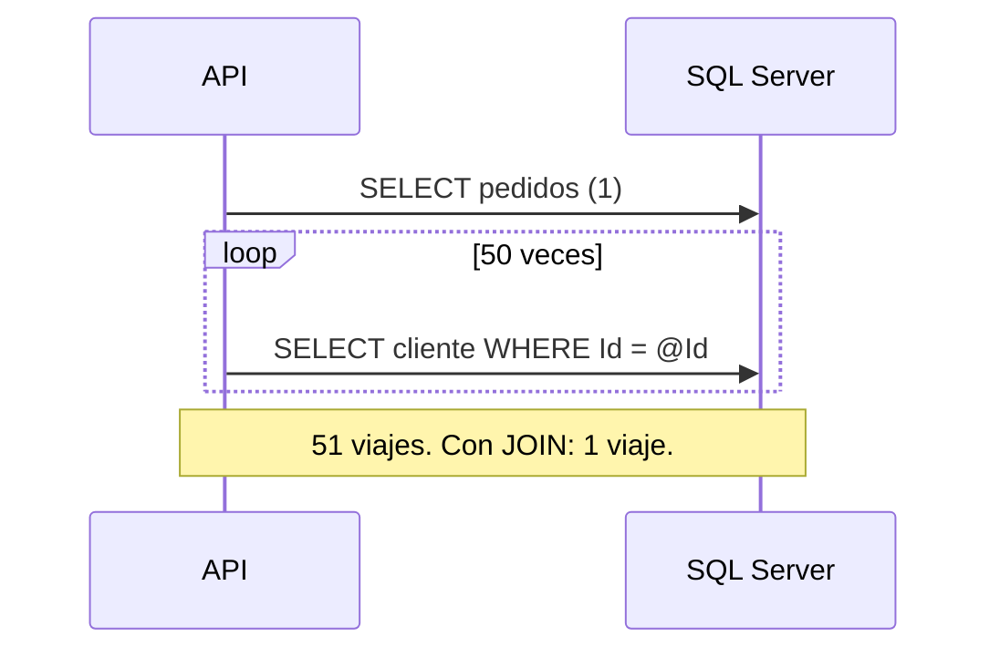

# Problema N+1

Parte de: [[03-CSharp-DotNet/07 Acceso a datos y ORMs/_Índice Acceso a datos y ORMs|Acceso a datos y ORMs]]

> [!info] Cómo avanzar
> `progreso`: **pendiente** → **viendo** (estudiando) → **visto** (contestaste la autoevaluación sin abrir las respuestas) → **dominado** (hiciste el laboratorio o lo aplicaste de verdad).

## Contenido

### Qué es
El **problema N+1** ocurre cuando, para mostrar una lista de N elementos, haces **1 consulta** para traer la lista y luego **N consultas** adicionales, una por elemento, para traer datos relacionados. El código parece inocente, funciona en desarrollo con 5 registros, y en producción con 500 se vuelve lento porque cada consulta paga la latencia de red y el costo de ejecución. Es uno de los problemas de rendimiento más comunes en acceso a datos.

### Cómo funciona
Ejemplo de conteo: una pantalla de Itzamna.Clio lista 50 pedidos y por cada uno consulta su cliente.

- Con el patrón N+1: 1 consulta de pedidos + 50 de clientes = **51 consultas**.
- Con un JOIN: **1 consulta**.
- Con dos consultas (pedidos y luego todos sus clientes con `IN` o un TVP): **2 consultas**.

Si cada viaje a la base cuesta 2 ms de red, el N+1 suma al menos 100 ms solo en latencia, sin contar el trabajo del servidor ni el uso del [[Connection pooling|pool]].



### Cómo aparece con Dapper
No necesitas un ORM para caer en N+1. Con [[Dapper]] aparece cuando llamas consultas dentro de un bucle:

```csharp
// N+1 con Dapper
var pedidos = (await cn.QueryAsync<PedidoDto>(_sql["Pedidos.DelDia"], new { Fecha = hoy })).AsList();
foreach (var p in pedidos)
{
    p.Cliente = await cn.QuerySingleAsync<ClienteDto>(
        _sql["Clientes.PorId"], new { Id = p.ClienteId });   // una consulta por pedido
}
```

En un diseño de una interfaz por consulta es fácil que un handler reutilice `IObtenerCliente` dentro de un `foreach`; la reutilización es buena, pero no en un bucle.

Con EF Core aparece con **lazy loading** (ver [[EF Core - carga eager, lazy y explícita]]) o al consultar dentro de un `foreach`.

### Cómo lo resuelves
```csharp
// Opción 1: un JOIN con multi-mapping
var pedidos = await cn.QueryAsync<PedidoDto, ClienteDto, PedidoDto>(
    _sql["Pedidos.DelDiaConCliente"],
    (p, c) => { p.Cliente = c; return p; },
    new { Fecha = hoy }, splitOn: "ClienteId");

// Opción 2: dos consultas, una para la lista y otra para todos los relacionados
var lista = (await cn.QueryAsync<PedidoDto>(_sql["Pedidos.DelDia"], new { Fecha = hoy })).AsList();
var ids = lista.Select(p => p.ClienteId).Distinct();
var clientes = (await cn.QueryAsync<ClienteDto>(
        "dbo.Cliente_ObtenerVarios", new { Ids = ids.ComoListaEnteros() }, commandType: CommandType.StoredProcedure))
    .ToDictionary(c => c.ClienteId);
foreach (var p in lista) p.Cliente = clientes[p.ClienteId];
```

- **JOIN + multi-mapping** cuando la relación es uno a uno o pocos ([[Dapper - QueryMultiple y multi-mapping]]).
- **Dos consultas** con [[Dapper - table-valued parameters|TVP]] o `QueryMultiple` cuando hay colecciones grandes o quieres evitar repetir datos.
- En EF Core: `Include`, o mejor una **proyección** con `Select` que traiga solo lo necesario.
- **Diseñar el endpoint** para que entregue lo que la pantalla necesita, en lugar de que el front de React llame 50 veces a `/clientes/{id}` (el N+1 también ocurre entre front y API).

### Cómo lo detectas
- **Logs de SQL**: EF Core registra cada comando (`Microsoft.EntityFrameworkCore.Database.Command`); ves la misma consulta repetida con distintos parámetros.
- **SQL Server**: *Extended Events* o el *XEvent Profiler* de SSMS muestran ráfagas de la misma consulta; Query Store muestra consultas con conteo de ejecuciones muy alto.
- **Trazas distribuidas**: en Application Insights u [[OpenTelemetry]], una petición con decenas de dependencias SQL idénticas es la firma del N+1.
- **Pruebas**: una prueba de integración que cuente comandos ejecutados (con un `DbCommandInterceptor` en EF Core o un contador en tu `SesionSql`) y falle si pasan de un límite.

### Cuándo usarlo y cuándo no
Siempre busca evitarlo en listados. Una excepción razonable: cuando N es pequeño y acotado (máximo 3 elementos) y la consulta relacionada ya está en caché; aun así, mide.

### Errores comunes
- **Probar solo con datos mínimos**: el problema no se nota con 3 registros. Usa volúmenes realistas.
- **Arreglarlo con `Task.WhenAll`** de las N consultas: sigue habiendo N consultas, ahora en paralelo, agotando el pool.
- **Corregirlo con un JOIN que multiplica filas** sin necesidad: trae colecciones grandes con consultas separadas.
- **Ignorar el N+1 entre el front y la API**.

### Para profundizar
- [Consultas eficientes en EF Core (Microsoft Learn)](https://learn.microsoft.com/ef/core/performance/efficient-querying)
- [Registro de EF Core (Microsoft Learn)](https://learn.microsoft.com/ef/core/logging-events-diagnostics/)
- [Extended Events en SQL Server (Microsoft Learn)](https://learn.microsoft.com/sql/relational-databases/extended-events/extended-events)

## Ejercicios

Resuélvelos en papel o en la herramienta; la solución está plegada.

> [!question]- Una pantalla lista 50 pedidos y por cada uno consulta su cliente. ¿Cuántas consultas son? ¿Y con un JOIN?
> 51 consultas; con JOIN, 1.

## Autoevaluación

Contesta primero en voz alta o en papel; luego despliega la respuesta.

> [!question]- ¿Qué es el problema N+1?
> Una consulta para traer N elementos y luego **una consulta por cada uno** para sus datos relacionados: N+1 idas a la base.

> [!question]- ¿Cómo aparece con Dapper aunque no haya ORM?
> Al llamar en un `foreach` una consulta por id (`ObtenerLineas(pedido.Id)`).

> [!question]- ¿Cómo lo resuelves?
> Una sola consulta con JOIN y multi-mapping, `QueryMultiple` (cabeceras y líneas) y agrupar en memoria, o un TVP / `IN` con todos los ids. En EF: `Include` o proyección con `Select`.

> [!question]- ¿Cómo lo detectas?
> Muchas consultas iguales en el log o en SQL Profiler / Extended Events para una sola petición; en Sentry se ve en las trazas de rendimiento.

## Práctica

- [[Lab 9 - Dapper con stored procedures y transacción]]

