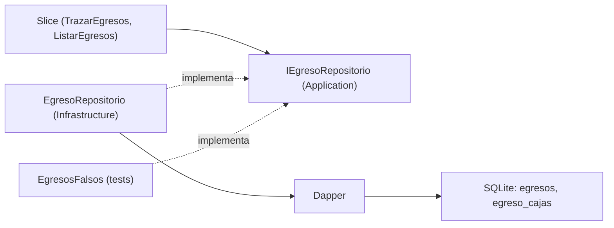

---
proyecto:
  - Ocelotl.Hermes
  - Itzamna.Dionisio
proyectos:
  - "[[Ocelotl.Hermes]]"
  - "[[Itzamna.Dionisio]]"
tipo: patron
nivel: intermedio
estado: completo
tags:
  - conocimiento
  - patron
  - persistencia
progreso: pendiente
area: C# y .NET
contenido: completo
---
# Repository

> Una interfaz con el lenguaje del negocio ("registra este egreso", "dame la caja con este GUID") que esconde cómo y dónde se guardan los datos.

## Qué es y qué problema resuelve
El patrón **Repository** (Martin Fowler, *Patterns of Enterprise Application Architecture*) pone entre la lógica y la base de datos una colección "en memoria" aparente. La lógica pide y guarda objetos del dominio; el repositorio traduce a SQL. Resuelve que los casos de uso estén llenos de SQL y que no se puedan probar sin base de datos.

## Cómo funciona por dentro
- La **interfaz** vive con la aplicación y usa tipos del dominio (`Egreso`, `Caja`, `CajaDispensada`).
- La **implementación** vive en infraestructura y conoce la conexión, el SQL y el mapeo filas ↔ objetos.
- Métodos con intención (`ConfirmarAlmacenadaAsync`), no genéricos (`Update<T>`).
- En pruebas se sustituye por un fake en memoria.



## Cuándo usarla y cuándo no
Úsalo cuando varios casos de uso leen/escriben las mismas entidades y quieres probarlos sin base de datos. Evítalo como capa genérica encima de un ORM que ya es un repositorio (p. ej. `DbContext` de EF Core) si solo reenvía llamadas.

### Ventajas
- SQL en un solo lugar, cerca de la tabla.
- Casos de uso probables con fakes.
- Cambiar de motor solo toca la implementación.

### Desventajas
- Riesgo de "repositorio genérico" que no aporta nada.
- Consultas de reporte complejas a veces encajan mal en una interfaz de colección.
- Transacciones que abarcan varios repositorios requieren otra pieza (unit of work).

## Alternativas
| Alternativa | En qué se diferencia |
|---|---|
| SQL directo en el handler | Menos indirección; no se prueba sin base de datos. |
| EF Core `DbContext` | ORM completo con seguimiento de cambios; ya actúa como repositorio + unit of work. |
| Query objects / CQRS de lectura | Consultas específicas por pantalla, separadas de las escrituras. |
| Active Record | El objeto se guarda solo (`caja.Save()`); mezcla dominio y persistencia. |

## Cómo se usó en Ocelotl
En [[Ocelotl.Hermes]] hay dos repositorios de negocio, ambos puertos de `Application/Abstractions` con adaptadores [[Dapper]] + [[SQLite]] en `Infrastructure/Persistence` (ver [[Arquitectura hexagonal]]):

| Interfaz | Implementación | Tablas | Lo usan |
|---|---|---|---|
| `ICajaRepositorio` | `CajaRepositorio` | `cajas` | `TrazarCajas`, `ObtenerCaja` → [[Trazabilidad por caja]], [[Ingresos]] |
| `IEgresoRepositorio` | `EgresoRepositorio` | `egresos`, `egreso_cajas` | `Dispensar`, `TrazarEgresos`, `ListarEgresos`, `ObtenerEgreso` → [[Dispensar]], [[Historial de salidas]] |

Las interfaces documentan reglas de negocio en sus comentarios (p. ej. "Si una caja ya estaba ligada a otra orden, gana la última"). Desde el 2026-11-08 el repositorio **no tiene SQL**: recibe una interfaz por consulta y solo convierte dominio ↔ campos/filas. El SQL está en `Persistence/Sql/Egresos/*.sql` ([[SQL en archivos con una interfaz por consulta]]). Ejemplo, `Ocelotl.Hermes/src/Ocelotl.Hermes.Infrastructure/Persistence/EgresoRepositorio.cs`:

```csharp
public sealed class EgresoRepositorio(
    ConexionSqlite db,
    TimeProvider reloj,
    IRegistrarEgresoSql registrar,
    IRegistrarCajaEgresoSql registrarCaja,
    /* … una interfaz por consulta … */
    IListarEgresosSql listar) : IEgresoRepositorio
{
    public Task RegistrarAsync(Egreso egreso, CancellationToken ct) =>
        registrar.EjecutarAsync(new RegistrarEgresoCampos(
            egreso.RobotId,
            egreso.Orden,
            egreso.Receta,
            egreso.Origen.ToString(),
            egreso.Estado.ToString(),
            egreso.CreadoEn.ToUnixTimeMilliseconds()), ct);
```
```sql
-- Sql/Egresos/Registrar.sql
INSERT INTO egresos (robot_id, orden, receta, origen, estado_validacion, creado_en, actualizado_en)
VALUES (@RobotId, @Orden, @Receta, @Origen, @Estado, @CreadoEn, @CreadoEn)
ON CONFLICT (robot_id, orden) DO UPDATE SET
    receta = COALESCE(egresos.receta, excluded.receta),
    actualizado_en = excluded.actualizado_en;
```

Detalles:
- Se registran como **singleton** (`services.AddSingleton<IEgresoRepositorio, EgresoRepositorio>()`); cada método abre su propia conexión con `ConexionSqlite.AbrirAsync`.
- `RegistrarCajasAsync` usa una transacción local para insertar varias cajas y limpiar egresos `Robot` vacíos.
- Las escrituras usan `ON CONFLICT ... DO UPDATE` (upsert), lo que las hace [[Idempotencia|idempotentes]].
- `ListarAsync` recibe un `FiltroEgresos` (record con nulos que "no filtran") y devuelve `EgresoConCajas`.
- Fakes: `EgresosFalsos : IEgresoRepositorio` en `tests/Ocelotl.Hermes.Application.Tests/Fakes.cs`; integración con SQLite real en `tests/Ocelotl.Hermes.Integration.Tests/TrazabilidadTests.cs`.
- `OutboxRepositorio` (en `Infrastructure/Eventos/Outbox`) sigue el mismo estilo (sus consultas en `OutboxSql.cs`), pero el repositorio en sí no tiene interfaz de puerto: es un detalle interno de infraestructura (ver [[Patrón Outbox]]).


## Cómo se usó en Itzamna
[[Itzamna.Dionisio]] **no usa repositorios**: aplica lo que dice "Cuándo usarla y cuándo no" de esta nota ("evítalo como capa genérica encima de un ORM que ya es un repositorio"). Los handlers reciben `IAppDbContext`, una interfaz en Application que expone los `DbSet<T>` y `SaveChangesAsync`; `AppDbContext` ([[Entity Framework Core]]) la implementa en Infrastructure.

`Itzamna.Dionisio/src/Itzamna.Dionisio.Application/Abstractions/IAppDbContext.cs` (recortado):
```csharp
/// <summary>
/// Acceso a datos para los handlers. Las entidades del creador ya vienen filtradas por tenant y
/// borrado lógico (filtros globales); IgnoreQueryFilters solo se usa en resolución de tenant y lectura pública.
/// </summary>
public interface IAppDbContext
{
    DbSet<Creator> Creators { get; }
    DbSet<Portfolio> Portfolios { get; }
    DbSet<SocialProfile> SocialProfiles { get; }
    DbSet<MediaAsset> MediaAssets { get; }
    DbSet<PortfolioSnapshot> PortfolioSnapshots { get; }
    // ... 9 DbSet más
    Task<int> SaveChangesAsync(CancellationToken cancellationToken = default);
}
```

Cómo se cubre lo que daría un repositorio:
| Necesidad | En Hermes (repositorio) | En Dionisio |
|---|---|---|
| Consultas con intención | `IEgresoRepositorio.ListarAsync` | LINQ en el handler + extensiones: `CurrentPortfolioAsync`, `CurrentCreatorAsync` (`Common/TenantExtensions.cs`), `NextOrderAsync`, `ReorderAsync`, `TouchPortfolioAsync` |
| Cargar un agregado completo | métodos del repositorio | `PortfolioData.LoadAsync(db, portfolioId, ct)` (`Application/Publishing/PortfolioData.cs`) |
| Unit of work | transacción manual | `SaveChangesAsync` (una transacción por llamada) |
| Reglas transversales | en cada SQL | filtros globales de tenant y borrado lógico, auditoría ([[Multi-tenancy]], [[Borrado lógico y auditoría]]) |
| Probar sin base | fakes del repositorio | **no hay** pruebas de handlers todavía ([[xUnit]]) |

Consecuencias: menos código y LINQ tipado, pero Application depende del paquete EF Core ([[Clean Architecture]]) y para probar handlers haría falta una base real o un proveedor en memoria.

Funcionalidades: todas las del back de [[Itzamna.Dionisio]].

## Errores comunes y buenas prácticas
- **Repositorio genérico `IRepository<T>`** con `GetAll/Add/Update`: pierde la intención. Hermes usa métodos de negocio.
- **Devolver tipos de la base** (`DataRow`, filas Dapper) fuera del repositorio: mapear a records del dominio.
- **SQL concatenado con datos**: usar parámetros (`@RobotId`). En Hermes el SQL vive en archivos `.sql` y no se arma en C#.
- **Conexiones compartidas entre hilos** en SQLite: abrir/cerrar por operación, como aquí.
- Documentar en la interfaz las reglas no obvias (qué pasa en un duplicado).

## Qué estudiar después
- [[Dapper]] y [[SQLite]]
- [[Idempotencia]] (upserts)
- [[Arquitectura hexagonal]] y [[Clean Architecture]]
- Unit of Work
- [[xUnit]] (fakes vs pruebas de integración)

## Documentación oficial
- https://martinfowler.com/eaaCatalog/repository.html
- https://learn.microsoft.com/en-us/dotnet/architecture/microservices/microservice-ddd-cqrs-patterns/infrastructure-persistence-layer-design

## Autoevaluación

Contesta primero en voz alta o en papel; luego despliega la respuesta.

> [!question]- ¿Qué responsabilidad tiene un repositorio en tu arquitectura?
> Convertir dominio ↔ campos y filas y orquestar transacciones; el SQL vive en los archivos y las sentencias.

> [!question]- ¿Qué es Unit of Work y cómo se relaciona?
> Agrupa varias operaciones de uno o más repositorios en una sola transacción que se confirma o se revierte junta. Con Dapper suele ser la `SesionSql` Scoped; en EF el `DbContext` ya lo es.

> [!question]- ¿Por qué un repositorio genérico `IRepository<T>` sobre EF suele ser mala idea?
> Duplica lo que ya ofrece `DbSet` y oculta capacidades (Include, proyecciones), o filtra `IQueryable` y no aísla nada.

## Práctica

- [[Lab 9 - Dapper con stored procedures y transacción]]

