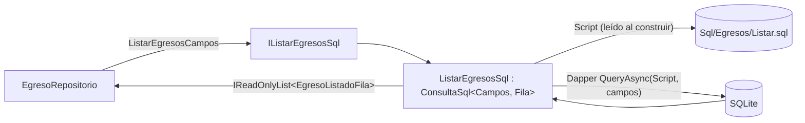

---
proyecto:
  - Ocelotl.Hermes
  - Itzamna.Dionisio
  - Pochteca.Nomisma
proyectos:
  - "[[Ocelotl.Hermes]]"
  - "[[Itzamna.Dionisio]]"
  - "[[Pochteca.Nomisma]]"
tipo: patron
nivel: intermedio
estado: completo
tags:
  - conocimiento
  - patron
  - backend
  - dotnet
  - sql
  - datos
progreso: pendiente
area: C# y .NET
contenido: completo
---
# SQL en archivos con una interfaz por consulta

> Regla de [[Ocelotl.Hermes]] desde el 2026-11-08: no hay SQL escrito en C#. Cada consulta es un archivo `.sql` incrustado en el ensamblado y tiene su propia interfaz: se le mandan sus campos y regresa su respuesta. Ver [[Reglas Back - .NET]].

## Qué es y qué problema resuelve
Con SQL dentro de strings de C#, las consultas quedan mezcladas con la conversión de datos, cuesta revisarlas y no se pueden abrir en un editor de SQL. Este patrón separa tres cosas:

| Pieza | Responsabilidad |
|---|---|
| `Sql/<Área>/<Nombre>.sql` | **Qué** se le pide a la base |
| Record `…Campos` + interfaz `I…Sql` | El **contrato**: qué entra y qué sale |
| Repositorio | Convertir **dominio ↔ campos y filas**, y orquestar transacciones |

## Cómo funciona por dentro

- **`ScriptsSql`** (`Persistence/SentenciasSql.cs`) indexa los recursos incrustados (`Sql/…/*.sql`) y normaliza `\` a `/`, porque en Windows `RecursiveDir` usa diagonal invertida.
- **Bases** (todas leen su `.sql` en el constructor):

| Base | Para | Regresa |
|---|---|---|
| `ComandoSql<TCampos>` | INSERT / UPDATE / DELETE / DDL | filas afectadas; acepta transacción |
| `ConsultaSql<TCampos, TFila>` | SELECT de varias filas | `IReadOnlyList<TFila>` |
| `ConsultaUnicaSql<TCampos, TFila>` | SELECT de una o ninguna | `TFila?` |
| `EscalarSql<TCampos, TValor>` | COUNT / un valor | `TValor`; acepta transacción |

- **Registro:** `AddSentenciasSql()` busca por reflexión toda clase que implemente `ISentenciaSql` y la registra como singleton, por su clase y por su interfaz propia.
- **Fail-fast:** `InicializarInfraestructuraAsync` construye todas las sentencias al arrancar. Si falta un `.sql`, Hermes no arranca.
- **[[Dapper]]** hace el resto: las propiedades del record se vuelven `@Parámetros` y los alias `AS` llenan la fila.

## Cuándo usarlo y cuándo no
### Ventajas
- El SQL se lee, se prueba y se revisa en su archivo, con resaltado.
- Cada consulta tiene un contrato tipado; se puede crear un fake por consulta.
- El repositorio queda en mapeo puro; no hay SQL armado concatenando strings.
- Las pruebas garantizan que no queden `.sql` huérfanos ni sentencias sin archivo.
### Desventajas
- Más archivos: por consulta, un `.sql`, un record, una interfaz y una clase.
- Un nombre de columna o de parámetro equivocado se descubre al **ejecutar**, no al compilar.
- Los filtros dinámicos se resuelven con `(@X IS NULL OR …)` en lugar de armar el SQL.

## Alternativas
| Alternativa | En qué se diferencia |
|---|---|
| SQL en strings de C# (lo que había antes) | Sin archivos extra, pero mezcla SQL con mapeo |
| Una interfaz genérica `IBaseDatos.ConsultarAsync<T>(nombre, campos)` | Menos clases, pero sin un contrato por consulta |
| EF Core | Sin SQL (LINQ), con migraciones; más peso y menos control del SQL |
| Stored procedures | Muy usados en SQL Server; SQLite no los tiene |

## Cómo se usó en Ocelotl
En [[Ocelotl.Hermes]] hay 24 archivos en `src/Ocelotl.Hermes.Infrastructure/Persistence/Sql/`:

| Carpeta | Archivos |
|---|---|
| `Esquema/` | `Base.sql`, `V4_DatosCaja.sql`, `TieneVersion.sql` |
| `Cajas/` | 5 archivos |
| `Egresos/` | 7 archivos |
| `Outbox/` | 6 archivos |
| `Usuarios/` | 3 archivos |

Sentencias por área: `EsquemaSql.cs`, `CajasSql.cs`, `EgresosSql.cs`, `Eventos/Outbox/OutboxSql.cs` e `Identity/UsuariosSql.cs`.

```sql
-- Sql/Cajas/AlmacenarPendientePorCodigo.sql
UPDATE cajas
SET caja_guid = @CajaGuid, estado = 'Almacenada', almacenada_en = @AlmacenadaEn
WHERE rowid = (SELECT rowid FROM cajas
               WHERE robot_id = @RobotId AND codigo = @Codigo AND estado = 'Autorizada'
               ORDER BY autorizada_en, rowid
               LIMIT 1);
```
```csharp
// Persistence/CajasSql.cs
public sealed record AlmacenarCajaPendienteCampos(string CajaGuid, long AlmacenadaEn, string RobotId, string Codigo);

public interface IAlmacenarCajaPendienteSql : IComandoSql<AlmacenarCajaPendienteCampos> { }

public sealed class AlmacenarCajaPendienteSql(ConexionSqlite db)
    : ComandoSql<AlmacenarCajaPendienteCampos>(db, "Cajas/AlmacenarPendientePorCodigo"), IAlmacenarCajaPendienteSql { }

// Persistence/CajaRepositorio.cs (dentro de una transacción)
filas = await almacenarPendiente.EjecutarAsync(new AlmacenarCajaPendienteCampos(guid, ms, robotId, codigo), tx, ct);
```

**Pruebas:**
- `BaseTemporal.Crear<T>()` arma los repositorios con las sentencias reales (`ActivatorUtilities`).
- `BaseTemporal.Sql<T>()` da una sentencia por su interfaz; así las pruebas tampoco escriben SQL.
- `SentenciasSqlTests` verifica los dos sentidos: cada sentencia tiene su `.sql` y no hay `.sql` sin sentencia.

> [!tip] Reutilizable
> `SentenciasSql.cs` no depende de Hermes, salvo `ConexionSqlite`: se copia tal cual a otro proyecto (con SQL Server basta cambiar la conexión). Ver [[Reglas Back - .NET]].


## Cómo se usó en Itzamna
**No se usa.** [[Itzamna.Dionisio]] no tiene archivos `.sql` ni [[Dapper]]: todo el acceso a datos es LINQ sobre [[Entity Framework Core]] (`IAppDbContext`). Esta sección solo **describe** dónde chocaría la regla de [[Reglas Back - .NET]] con lo que hoy hace EF Core en Dionisio; no decide nada.

| Lo que hoy hace EF Core por Dionisio | Con SQL en archivos habría que… |
|---|---|
| **Filtros globales de tenant** (`HasQueryFilter(x => x.PortfolioId == TenantPortfolioId)`) en 13 entidades; "Sin tenant (Guid.Empty) no se ve nada" ([[Multi-tenancy]]) | escribir `WHERE PortfolioId = @PortfolioId` (o `CreatorId`) en **cada** `.sql` y pasar el tenant en cada record de campos. Un olvido expone datos de otro creador; la red de seguridad dejaría de ser automática (salvo Row-Level Security en [[SQL Server]]). |
| **Borrado lógico** (`!x.IsDeleted` en el mismo filtro) ([[Borrado lógico y auditoría]]) | repetir `AND IsDeleted = 0` en cada consulta, y el `UPDATE ... SET IsDeleted = 1, DeletedAt = @...` en cada borrado. |
| **`IgnoreQueryFilters()`** en el middleware de tenant, `EnsureCreator`, lectura pública, cuota global y seed | serían simplemente consultas sin ese `WHERE`; aquí el patrón sería **más explícito** que hoy. |
| **Auditoría en `SaveChangesAsync`** (`CreatedAt/By`, `UpdatedAt/By` desde `ICurrentUser`) | incluir esas columnas y parámetros en cada `INSERT`/`UPDATE`, o moverlas a la base (defaults/triggers) perdiendo el `sub` del token salvo que se pase por `SESSION_CONTEXT`. |
| **`RowVersion` / concurrencia** (EF agrega `AND RowVersion = @original` y lanza `DbUpdateConcurrencyException` → 409) ([[Concurrencia optimista]]) | escribir la condición en cada `UPDATE`, revisar filas afectadas y lanzar el conflicto a mano. |
| **Columnas JSON** (`HasJsonConversion`: módulos `Hero/About/Contact/Seo/SectionCopy`, `MediaReference`, `Variants`, tema) con value comparer | serializar/deserializar en el repositorio o en el record de campos (`nvarchar(max)` como `string`); el SQL no cambia, pero la conversión se vuelve código explícito. |
| **Change tracking + unit of work** (cargar, mutar la entidad con métodos de dominio como `MarkPublished`, un `SaveChangesAsync`) | decidir qué columnas actualiza cada sentencia y abrir transacciones a mano cuando un comando toca varias tablas (publicar: `INSERT` snapshot + `UPDATE` portfolio). |
| **Migraciones** (`Migrations/`, script `--idempotent` en el pipeline) | mantener los scripts de esquema por separado (en Hermes, `Sql/Esquema/`), y el pipeline aplicaría otra cosa. |
| **Proyecciones LINQ** (`Select(s => new VersionDto(...))`, `Join` con `SlugRedirects`) | escribirlas en SQL con alias `AS`; aquí el patrón **gana** legibilidad para consultas como la del portfolio público. |

Puntos donde el patrón encajaría sin fricción: lecturas anónimas y de solo lectura que ya ignoran filtros (`GetPublicPortfolioHandler`, resolución de tenant) y reportes/sumas (cuotas de medios).

> [!note] Pendiente de confirmar
> No hay decisión documentada sobre si la regla "SQL en archivos" aplica a Dionisio, que nació con EF Core. Esta tabla es descriptiva; cualquier cambio requiere decidirlo en [[Reglas Back - .NET]] y en [[Itzamna.Dionisio - Arquitectura]].


## Cómo se usó en Pochteca.Nomisma
Primer proyecto con la regla sobre **[[PostgreSQL]] con funciones**. Antes el SQL vivía en strings (`const string sql = "SELECT * FROM payment.sp_..."`); el 2026-11-09 se pasó a 16 archivos:

```text
Pochteca.Nomisma.Infrastructure/Persistence/
├─ Sql/Cargos/{Insertar, ActualizarEstatus, ObtenerPorIdExterno, ObtenerPorOrdenId}.sql
├─ Sql/CuentasConectadas/{ObtenerPorOrganizador, ObtenerPorStripeAccount, Upsert, MarcarDesconectada}.sql
├─ Sql/SesionesCheckout/{ObtenerUltimoIntento, ObtenerPorCheckoutSessionId, SiguienteNumeroIntento, Insertar, ActualizarEstatus}.sql
├─ Sql/WebhookEventosConnect/{TryInsertar, MarcarProcesado, MarcarFallido}.sql
├─ SentenciasSql.cs · ConexionPostgres.cs
└─ CargosSql.cs · CuentasConectadasSql.cs · SesionesCheckoutSql.cs · WebhookEventosConnectSql.cs
```

```csharp
// Pochteca.Nomisma.Infrastructure/Persistence/CargosSql.cs
public sealed record ObtenerCargoPorIdExternoCampos(string IdExterno);

public interface IObtenerCargoPorIdExternoSql : IConsultaUnicaSql<ObtenerCargoPorIdExternoCampos, CargoFila> { }

public sealed class ObtenerCargoPorIdExternoSql(ConexionPostgres db)
    : ConsultaUnicaSql<ObtenerCargoPorIdExternoCampos, CargoFila>(db, "Cargos/ObtenerPorIdExterno"), IObtenerCargoPorIdExternoSql { }
```

- Con funciones, cada `.sql` es una línea; la regla igual aporta el contrato por consulta y "cero SQL en C#" (lo revisa una prueba que busca `"SELECT`/`"CALL` en los `.cs`).
- Esto define el caso que las reglas dejaban *pendiente*: **con stored procedures o funciones, un `.sql` que las llama + la misma interfaz por consulta**.
- `SentenciasSqlTests` (4 pruebas como Hermes, más la de los `.cs`) no necesita base.

## Errores comunes y buenas prácticas
- **Nombre del parámetro distinto de la propiedad** (`@robotId` vs `RobotId`): úsalos idénticos.
- **Olvidar el `EmbeddedResource` en el .csproj:** la app no arranca (mejor que fallar a media operación).
- **Leer `int` donde SQLite devuelve `long`:** usa `long` en las filas.
- **Pasar la transacción a un comando y no a otro** dentro del mismo paso: todos llevan `tx`.
- **Armar SQL con interpolación:** prohibido. Usa filtros opcionales con `IS NULL`.

## Qué estudiar después
- [[Dapper]], [[SQLite]], [[Repository]], [[Inyección de dependencias]]
- Migraciones de esquema versionadas (DbUp, Flyway) como evolución de `Sql/Esquema/`.

## Documentación oficial
- https://github.com/DapperLib/Dapper
- https://learn.microsoft.com/dotnet/core/extensions/resources (recursos incrustados)

## Autoevaluación

Contesta primero en voz alta o en papel; luego despliega la respuesta.

> [!question]- ¿Qué piezas tiene cada consulta en tu patrón?
> Un `.sql` embebido, un record `…Campos` (entrada), una fila de salida, una interfaz `I…Sql` y una clase que hereda de `ConsultaSql`/`ComandoSql` y apunta al archivo.

> [!question]- ¿Cómo garantizas que no falten ni sobren archivos?
> Al arrancar se construyen todas las sentencias (si falta un `.sql`, no arranca) y `SentenciasSqlTests` verifica los dos sentidos: cada sentencia tiene archivo y no hay archivos sin sentencia.

> [!question]- ¿Qué desventaja tiene frente a SQL en strings o EF Core?
> Más archivos por consulta, y un nombre de columna o parámetro equivocado se descubre al **ejecutar**; por eso las pruebas de integración contra una base real son obligatorias.

> [!question]- ¿Cómo resuelves filtros opcionales sin armar SQL dinámico?
> Con `(@Codigo IS NULL OR codigo = @Codigo)` en el archivo; si el plan sufre, `OPTION (RECOMPILE)` en SQL Server o un SP con ramas.

## Práctica

- [[Lab 9 - Dapper con stored procedures y transacción]]

