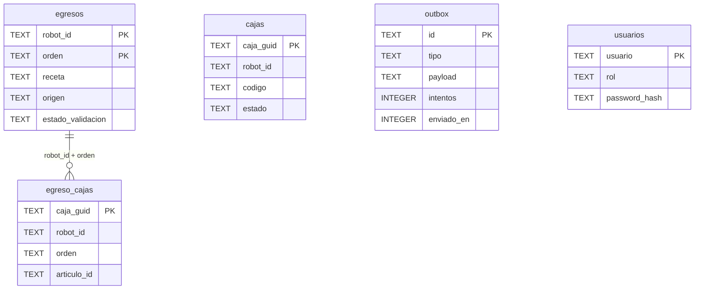

# SQLite

> Base de datos SQL embebida en un solo archivo; es la base local de [[Ocelotl.Hermes]] (`hermes.db`), accedida con System.Data.SQLite 1.0.113.1 y [[Dapper]].

## Qué es y qué problema resuelve
SQLite es un motor SQL que corre **dentro del proceso** (no hay servidor) y guarda todo en un archivo. Resuelve la necesidad de persistir datos de forma transaccional en una aplicación de escritorio o en un dispositivo, sin instalar ni administrar un servidor de base de datos.

Para Hermes es clave porque debe **funcionar sin internet**: los eventos para [[Argo]] esperan en SQLite, y el historial y la trazabilidad se consultan localmente.

## Cómo funciona por dentro
- **Archivo único** con páginas B-tree; transacciones ACID.
- **Journal mode WAL** (Write-Ahead Logging): las escrituras van a un archivo `-wal` y los lectores no bloquean al escritor (un escritor a la vez).
- **BusyTimeout**: cuánto espera una conexión si la base está bloqueada antes de fallar.
- **Tipado dinámico** (afinidad de tipos): `INTEGER`, `TEXT`, `REAL`, `BLOB`, `NULL`. No hay tipo fecha nativo: se guardan como texto o número.
- **Foreign keys** desactivadas por defecto; se activan por conexión.
- `ON CONFLICT ... DO UPDATE` (upsert), `INSERT OR IGNORE`, `rowid` implícito.
- Limitación: no existe `ALTER TABLE ... ADD COLUMN IF NOT EXISTS`.


(La relación `egresos`–`egreso_cajas` es lógica; el esquema no declara `FOREIGN KEY`.)

## Cuándo usarla y cuándo no
### Ventajas
- Cero instalación: el archivo se crea solo en `%LOCALAPPDATA%\Ocelotl\Hermes\hermes.db`.
- Transacciones reales y SQL completo, ideal para un outbox local.
- Fácil de probar: cada prueba crea una base temporal.
### Desventajas
- Un solo escritor a la vez; no sirve para muchos clientes concurrentes en red.
- Migraciones manuales y `ALTER TABLE` limitado.
- Tipado laxo: hay que ser disciplinado con formatos (unix ms, `yyyy-MM-dd`).

## Alternativas
| Alternativa | En qué se diferencia |
|---|---|
| Microsoft.Data.Sqlite | Otro proveedor ADO.NET para SQLite (de Microsoft); Hermes usa System.Data.SQLite. |
| LiteDB | Base embebida documental (NoSQL) para .NET. |
| SQL Server LocalDB / Express | Servidor real, requiere instalación. |
| PostgreSQL | Servidor cliente-servidor; adecuado para [[Argo]] en la nube, no para la PC local. |

## Cómo se usó en Ocelotl
En [[Ocelotl.Hermes]], `ConexionSqlite` construye la cadena de conexión una vez (WAL, `BusyTimeout = 5000`, pooling, foreign keys) y abre **una conexión por operación** (`Ocelotl.Hermes/src/Ocelotl.Hermes.Infrastructure/Persistence/ConexionSqlite.cs`):
```csharp
_cadena = new SQLiteConnectionStringBuilder
{
    DataSource = ruta,
    Version = 3,
    JournalMode = SQLiteJournalModeEnum.Wal,
    BusyTimeout = 5000,
    Pooling = true,
    ForeignKeys = true,
}.ToString();
```

La ruta sale de la sección `Persistencia:RutaBaseDatos` ([[Options pattern]]); vacía = `%LOCALAPPDATA%\Ocelotl\Hermes\hermes.db`.

**Esquema y migraciones** (`EsquemaBaseDatos.AsegurarAsync`, se llama al arrancar desde `InicializarInfraestructuraAsync`). Tabla `version_esquema` con una fila por versión:
- **v1**: `outbox` (eventos pendientes para Argo, con `intentos`, `siguiente_intento`, `enviado_en`, `ultimo_error`; índice `ix_outbox_pendientes`) y `usuarios` (locales, temporales hasta [[Hecate]]).
- **v2**: `egresos` (PK `robot_id + orden`, `origen` Argo|Iris|Robot, `estado_validacion`) y `egreso_cajas` (PK `caja_guid`).
- **v3**: `cajas` (por GUID del robot, estado `Autorizada`|`Almacenada`, datos de Argo).
- **v4**: `ALTER TABLE cajas ADD COLUMN ...` (nombre, forma farmacéutica, presentación, refrigeración, serie, etc.). Como SQLite no tiene `ADD COLUMN IF NOT EXISTS`, se aplica solo si falta la fila 4, dentro de una transacción.

v1–v3 son idempotentes (`CREATE TABLE IF NOT EXISTS` + `INSERT OR IGNORE`); v4 se protege así. El SQL está en `Persistence/Sql/Esquema/` (`Base.sql`, `V4_DatosCaja.sql`, `TieneVersion.sql`) y `EsquemaBaseDatos.cs` solo lo orquesta (`Ocelotl.Hermes/src/Ocelotl.Hermes.Infrastructure/Persistence/EsquemaBaseDatos.cs`):
```csharp
await esquemaBase.EjecutarAsync(SinCampos.Valor, ct);

// SQLite no tiene "ADD COLUMN IF NOT EXISTS": la v4 corre una sola vez.
if (await tieneVersion.ObtenerAsync(new VersionEsquemaCampos(4), ct) == 0)
{
    await using var conexion = await db.AbrirAsync(ct);
    await using var tx = await conexion.BeginTransactionAsync(ct);
    await migracionV4.EjecutarAsync(SinCampos.Valor, tx, ct);
    await tx.CommitAsync(ct);
}
```
Ver [[SQL en archivos con una interfaz por consulta]].

Funcionalidades que dependen de SQLite: [[Sincronización con Argo]] (outbox, ver [[Patrón Outbox]]), [[Historial de salidas]], [[Trazabilidad por caja]], [[Sesión y roles]] (usuarios locales), [[Dispensar]] (egreso pendiente de validar).

> [!tip] Reutilizable
> La combinación "script idempotente + tabla `version_esquema` + migraciones no idempotentes protegidas por versión" es una forma mínima de migrar SQLite sin herramientas externas.

## Errores comunes y buenas prácticas
- Compartir una `SQLiteConnection` entre hilos: abrir una por operación y dejar que el pool reutilice.
- Olvidar WAL y `BusyTimeout` → errores `database is locked` con lecturas y escrituras simultáneas.
- Guardar fechas en formatos mezclados: Hermes usa unix ms en `INTEGER` y `yyyy-MM-dd` para caducidad.
- `ALTER TABLE ADD COLUMN` repetido falla: proteger con versión.
- En pruebas, llamar `SQLiteConnection.ClearAllPools()` antes de borrar el archivo (ver `BaseTemporal` en [[xUnit]]).

## Qué estudiar después
- [[Dapper]], [[Patrón Outbox]], [[Idempotencia]], [[Repository]]
- Modo WAL y bloqueo en SQLite; índices y `EXPLAIN QUERY PLAN`.

## Documentación oficial
- https://www.sqlite.org/docs.html
- https://www.sqlite.org/wal.html
- https://www.sqlite.org/lang_upsert.html
- https://system.data.sqlite.org/

## Autoevaluación

Contesta primero en voz alta o en papel; luego despliega la respuesta.

> [!question]- ¿Cuándo SQLite es buena opción?
> Apps locales o embebidas (como Hermes en el equipo), pruebas o herramientas: un solo archivo, sin servidor.

> [!question]- ¿Qué limitación de concurrencia tiene?
> Un solo escritor a la vez. El modo WAL (`PRAGMA journal_mode=WAL`) permite leer mientras se escribe; `busy_timeout` evita errores de "database is locked".

> [!question]- ¿Por qué no sustituye a SQL Server en pruebas de integración?
> Tiene otro dialecto y tipos (no hay stored procedures, `datetimeoffset`, etc.); las pruebas pasarían con SQL que falla en producción. Usa Testcontainers con SQL Server.

