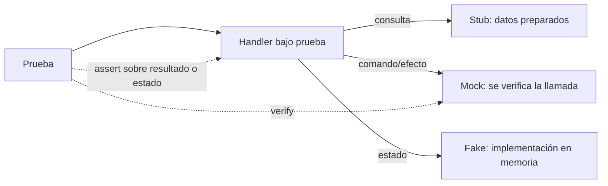

# Mocks, stubs y fakes

Parte de: [[03-CSharp-DotNet/08 Pruebas en .NET/_Índice Pruebas en .NET|Pruebas en .NET]]

> [!info] Cómo avanzar
> `progreso`: **pendiente** → **viendo** (estudiando) → **visto** (contestaste la autoevaluación sin abrir las respuestas) → **dominado** (hiciste el laboratorio o lo aplicaste de verdad).

## Contenido

### Qué es
Cuando pruebas una clase de forma aislada, reemplazas sus dependencias (base de datos, reloj, correo, API externa) por **dobles de prueba** (*test doubles*). El término viene de los "dobles" de cine. Gerard Meszaros los clasificó en cinco tipos; los tres que más usarás son:

- **Stub**: devuelve respuestas preparadas. Sirve para **alimentar** al código bajo prueba ("cuando pidan el cliente 5, regresa este").
- **Mock**: además registra las llamadas y la prueba **verifica** que ocurrieron ("se envió exactamente un correo a esta dirección").
- **Fake**: una **implementación funcional simplificada**, con lógica real pero atajos (un repositorio en memoria con un `Dictionary`, un reloj controlable).

Los otros dos son **dummy** (objeto que solo rellena un parámetro y no se usa) y **spy** (registra llamadas para revisarlas después, parecido a un mock).

### Cómo funciona


La pregunta clave es **qué verificas**:

- **Verificación de estado**: revisas el resultado devuelto o el estado final (por ejemplo, el fake contiene el pedido guardado). Es la forma preferida porque no depende de *cómo* se hizo.
- **Verificación de comportamiento**: revisas que se llamó cierto método con ciertos argumentos. Úsala para **efectos hacia afuera** que no tienen otro modo de observarse: enviar un correo, publicar un mensaje, llamar a un API de pagos.

### Ejemplo
Tu patrón de [[SQL en archivos con una interfaz por consulta]] facilita mucho los dobles: cada interfaz tiene uno o dos métodos, así que un fake es una clase de pocas líneas sin framework.

```csharp
public interface IObtenerCliente { Task<ClienteDto?> EjecutarAsync(int id, CancellationToken ct); }
public interface IGuardarPedido  { Task<int> EjecutarAsync(NuevoPedido p, CancellationToken ct); }
public interface INotificador    { Task EnviarAsync(string correo, string asunto, CancellationToken ct); }

// Stub escrito a mano
sealed class ClienteStub(ClienteDto? cliente) : IObtenerCliente
{
    public Task<ClienteDto?> EjecutarAsync(int id, CancellationToken ct) => Task.FromResult(cliente);
}

// Fake con estado en memoria
sealed class GuardarPedidoFake : IGuardarPedido
{
    public List<NuevoPedido> Guardados { get; } = [];
    public Task<int> EjecutarAsync(NuevoPedido p, CancellationToken ct) { Guardados.Add(p); return Task.FromResult(Guardados.Count); }
}

// Spy/mock manual para el efecto externo
sealed class NotificadorSpy : INotificador
{
    public List<(string Correo, string Asunto)> Enviados { get; } = [];
    public Task EnviarAsync(string correo, string asunto, CancellationToken ct) { Enviados.Add((correo, asunto)); return Task.CompletedTask; }
}

[Fact]
public async Task Crear_pedido_guarda_y_notifica_al_cliente()
{
    var guardar = new GuardarPedidoFake();
    var notif = new NotificadorSpy();
    var handler = new CrearPedidoHandler(new ClienteStub(new(5, "Ana", "ana@correo.mx")), guardar, notif);

    var r = await handler.Handle(new CrearPedido(5, 1200m), CancellationToken.None);

    Assert.True(r.Exito);
    Assert.Single(guardar.Guardados);                          // estado
    Assert.Equal("ana@correo.mx", Assert.Single(notif.Enviados).Correo); // efecto externo
}
```

Con una interfaz grande y genérica (`IRepositorio<T>` con 15 métodos) cada fake sería enorme; con interfaces pequeñas, el doble manual suele ser más claro que configurar una biblioteca. Cuando prefieras una biblioteca, ve [[Moq y NSubstitute]].

### Cuándo usarlo y cuándo no
Usa dobles para dependencias **lentas, no deterministas o con efectos externos**: base de datos en pruebas unitarias, reloj ([[TimeProvider para probar fechas]]), red, correo. No dobles tus propios objetos de valor ni lógica pura: úsalos reales. Para verificar el SQL y el mapeo de verdad, un doble no sirve: necesitas pruebas de integración con una base real ([[Testcontainers]], [[Pruebas de integración con WebApplicationFactory]]).

### Errores comunes
- **Verificar cada llamada interna con mocks**: la prueba queda acoplada a la implementación; cualquier refactor (cambiar el orden, combinar dos consultas) la rompe aunque el comportamiento sea correcto. Pruebas frágiles que el equipo termina ignorando.
- **Mockear lo que no es tuyo** (por ejemplo `HttpClient` o `DbConnection` directamente): envuelve la dependencia externa en una interfaz propia y dobla esa.
- **Stubs que devuelven siempre lo mismo** sin importar los argumentos: la prueba pasa aunque el código pida el cliente equivocado.
- **Fakes con lógica tan compleja** que necesitan sus propias pruebas.
- **Confundir los términos** en el equipo: acuerden vocabulario para revisar pruebas con claridad.

### Para profundizar
- [Martin Fowler: Mocks Aren't Stubs](https://martinfowler.com/articles/mocksArentStubs.html)
- [Martin Fowler: Test Double](https://martinfowler.com/bliki/TestDouble.html)
- [Buenas prácticas de pruebas unitarias en .NET (Microsoft Learn)](https://learn.microsoft.com/dotnet/core/testing/unit-testing-best-practices)

## Autoevaluación

Contesta primero en voz alta o en papel; luego despliega la respuesta.

> [!question]- ¿Qué diferencia hay entre stub, mock y fake?
> Stub: regresa respuestas fijas para que la prueba avance. Mock: además verifica que se le llamó de cierta forma. Fake: una implementación simple y funcional (un repositorio en memoria, `FakeTimeProvider`).

> [!question]- ¿Por qué tu patrón de una interfaz por consulta facilita los fakes?
> Cada consulta es pequeña: un fake de `IListarEgresosSql` es una clase de tres líneas que regresa la lista que necesitas, sin librería de mocks.

> [!question]- Error común: verificar cada llamada interna con mocks. ¿Qué problema trae?
> Pruebas frágiles que se rompen al refactorizar aunque el comportamiento no cambie. Verifica resultados y solo las interacciones que importan (ej. que se cobró una vez).

## Práctica

- [[Lab 10 - Pruebas con xUnit y WebApplicationFactory]]

