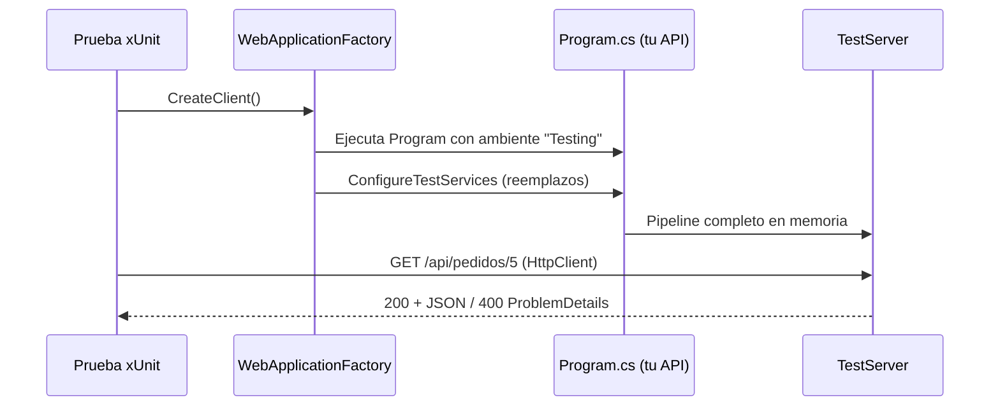

# Pruebas de integración con WebApplicationFactory

Parte de: [[03-CSharp-DotNet/08 Pruebas en .NET/_Índice Pruebas en .NET|Pruebas en .NET]]

> [!info] Cómo avanzar
> `progreso`: **pendiente** → **viendo** (estudiando) → **visto** (contestaste la autoevaluación sin abrir las respuestas) → **dominado** (hiciste el laboratorio o lo aplicaste de verdad).

## Contenido

### Qué es
`WebApplicationFactory<TEntryPoint>` (paquete `Microsoft.AspNetCore.Mvc.Testing`) levanta **tu API completa en memoria** dentro del proceso de pruebas, con el mismo `Program.cs`, middleware, routing, filtros, validación y serialización que en producción, pero usando un servidor de prueba (`TestServer`) en lugar de Kestrel. Te da un `HttpClient` para hacer peticiones reales a tus endpoints sin abrir puertos. Es la herramienta estándar para [[Pruebas de integración]] de ASP.NET Core.

### Cómo funciona


1. La fábrica localiza tu proyecto de API por el tipo `Program`, establece la raíz de contenido y ejecuta tu código de arranque.
2. Te permite **sobrescribir configuración y servicios** antes de que se construya el host: `ConfigureAppConfiguration`, `ConfigureTestServices`, `UseEnvironment`.
3. `CreateClient()` devuelve un `HttpClient` conectado al `TestServer`; las peticiones recorren todo el pipeline.
4. Se comparte entre pruebas con `IClassFixture<T>` para no arrancar la app en cada una.

#### El requisito de `Program`
Con *top-level statements*, el compilador genera una clase `Program` **interna**, y el proyecto de pruebas no puede usarla como tipo genérico. Tradicionalmente se agrega al final de `Program.cs`:

```csharp
public partial class Program { }
```

Desde ASP.NET Core 10, el SDK incluye un generador de código que declara `Program` como pública automáticamente en proyectos web, así que la línea ya no es necesaria (si la tienes, no estorba). Si tu proyecto apunta a una versión anterior, agrégala o usa `InternalsVisibleTo`.

### Ejemplo
```csharp
public sealed class DionisioFactory : WebApplicationFactory<Program>
{
    protected override void ConfigureWebHost(IWebHostBuilder builder)
    {
        builder.UseEnvironment("Testing");
        builder.ConfigureAppConfiguration((_, cfg) => cfg.AddInMemoryCollection(new Dictionary<string, string?>
        {
            ["ConnectionStrings:Dionisio"] = "Server=localhost,14333;Database=DionisioTest;User Id=sa;Password=Prueba_123;TrustServerCertificate=True"
        }));
        builder.ConfigureTestServices(services =>
        {
            // Reemplaza solo lo externo: correo y reloj
            services.RemoveAll<INotificador>();
            services.AddSingleton<INotificador, NotificadorSpy>();
            services.AddSingleton<TimeProvider>(new FakeTimeProvider(new DateTimeOffset(2026, 1, 15, 10, 0, 0, TimeSpan.Zero)));
            // Autenticación de prueba en lugar de JWT reales de Xolotl.Hecate
            services.AddAuthentication("Prueba").AddScheme<AuthenticationSchemeOptions, AutenticacionPrueba>("Prueba", _ => { });
        });
    }
}

public sealed class PedidosApiTests(DionisioFactory f) : IClassFixture<DionisioFactory>
{
    [Fact]
    public async Task Post_con_total_negativo_devuelve_400_con_codigo()
    {
        var client = f.CreateClient();
        var resp = await client.PostAsJsonAsync("/api/pedidos", new { clienteId = 5, total = -10 });

        Assert.Equal(HttpStatusCode.BadRequest, resp.StatusCode);
        var pd = await resp.Content.ReadFromJsonAsync<JsonElement>();
        Assert.Equal("VALIDACION", pd.GetProperty("codigo").GetString());
    }
}
```

Para la base de datos, lo más fiel es una base real desechable con [[Testcontainers]]; la fábrica recibe su cadena de conexión.

### Qué compruebas que no ves en una unitaria
- **Routing y verbos**: que `POST /api/pedidos` llegue al action correcto.
- **Model binding y validación**: que FluentValidation se ejecute y devuelva ProblemDetails con `codigo`.
- **Serialización JSON**: nombres en camelCase, enums, fechas.
- **Middleware y filtros**: manejo global de errores, autenticación, autorización por policies, CORS.
- **Registro de DI**: que todo se pueda resolver (una dependencia faltante explota aquí).
- **SQL real** si conectas una base: que tus archivos `.sql` y procedimientos funcionen.

### Cuándo usarlo y cuándo no
Úsalo para los flujos principales de cada endpoint (caso feliz, validación, no encontrado, no autorizado). No intentes cubrir cada rama de negocio aquí: eso es más rápido en [[Pruebas unitarias]]. Para el front de React con el navegador, ve [[Pruebas end-to-end (Playwright y Cypress)]].

### Errores comunes
- **Reemplazar demasiados servicios**: terminas probando un sistema que no existe en producción. Reemplaza solo lo externo.
- **Compartir datos entre pruebas** que corren en paralelo: resultados intermitentes. Usa datos únicos por prueba o limpia (Respawn).
- **Leer secretos reales** de User Secrets o variables del equipo en las pruebas: fija la configuración de prueba explícitamente.
- **Crear una fábrica por prueba**: arrancar la app es costoso; usa fixtures.
- **Olvidar el ambiente**: sin `UseEnvironment("Testing")` puede correr código de `Development` (Swagger, seeds).

### Para profundizar
- [Pruebas de integración en ASP.NET Core (Microsoft Learn)](https://learn.microsoft.com/aspnet/core/test/integration-tests)
- [Novedades de ASP.NET Core 10 (Microsoft Learn)](https://learn.microsoft.com/aspnet/core/release-notes/aspnetcore-10.0)
- Práctica: [[Lab 10 - Pruebas con xUnit y WebApplicationFactory]]

## Autoevaluación

Contesta primero en voz alta o en papel; luego despliega la respuesta.

> [!question]- ¿Qué hace `WebApplicationFactory<Program>`?
> Levanta tu API en memoria con su `Program` real (DI, middleware, filtros, controllers) y te da un `HttpClient` (`factory.CreateClient()`) sin abrir puertos.

> [!question]- ¿Cómo reemplazas servicios para la prueba?
> ```csharp
> factory.WithWebHostBuilder(b => b.ConfigureTestServices(s => {
>     s.RemoveAll<IPasarela>();
>     s.AddSingleton<IPasarela, PasarelaFalsa>();
> }));
> ```

> [!question]- ¿Qué requisito tiene `Program` con top-level statements?
> Que la prueba pueda verlo: se agrega `public partial class Program { }` al final de `Program.cs` (en .NET 10 un generador lo haría público automáticamente; Pendiente de confirmar).

> [!question]- ¿Qué compruebas con estas pruebas que no ves en una unitaria?
> Rutas, binding, filtros (FluentValidation), serialización, ProblemDetails con `codigo`, autenticación y que `ValidateOnStart` no tumba la app.

## Práctica

- [[Lab 10 - Pruebas con xUnit y WebApplicationFactory]]

