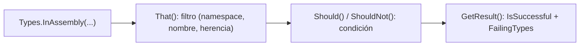

# Pruebas de reglas de arquitectura (NetArchTest)

Parte de: [[03-CSharp-DotNet/08 Pruebas en .NET/_Índice Pruebas en .NET|Pruebas en .NET]]

> [!info] Cómo avanzar
> `progreso`: **pendiente** → **viendo** (estudiando) → **visto** (contestaste la autoevaluación sin abrir las respuestas) → **dominado** (hiciste el laboratorio o lo aplicaste de verdad).

## Contenido

### Qué es
Una **prueba de arquitectura** verifica de forma automática que el código respeta las reglas de diseño acordadas: qué capas pueden depender de cuáles, cómo se nombran las clases, qué deben implementar, qué no deben usar. En lugar de confiar en que todos recuerden la regla en cada revisión de código, la conviertes en una prueba que falla en el pipeline de Azure DevOps. **NetArchTest** es una biblioteca para .NET que permite escribir esas reglas con una API fluida.

### Cómo funciona
NetArchTest carga los ensamblados compilados y analiza sus tipos y referencias (usa Mono.Cecil para leer el IL). Con la API `Types` filtras un conjunto de tipos y expresas una condición:



- **Filtros**: `ResideInNamespace`, `HaveNameEndingWith`, `Inherit`, `ImplementInterface`, `AreClasses`, `ArePublic`.
- **Condiciones**: `HaveDependencyOn`, `HaveDependencyOnAny`, `BeSealed`, `HaveNameEndingWith`, `NotBePublic`.
- El resultado indica si pasó y la lista de tipos que violan la regla, para que el mensaje de error sea útil.

El paquete original es `NetArchTest.Rules`. Existe además un fork mantenido por la comunidad, `NetArchTest.eNhancedEdition`, con más reglas y mensajes; y una alternativa más completa inspirada en Java, **ArchUnitNET**. Revisa la actividad de cada repositorio antes de elegir (Pendiente de confirmar el estado de mantenimiento actual del paquete original).

### Ejemplo
Reglas para Itzamna.Dionisio con xUnit:

```csharp
using NetArchTest.Rules;

public sealed class ArquitecturaTests
{
    private static readonly System.Reflection.Assembly Api = typeof(Program).Assembly;
    private static readonly System.Reflection.Assembly Dominio = typeof(Itzamna.Dionisio.Domain.Pedido).Assembly;

    [Fact]
    public void Domain_no_depende_de_Infrastructure()
    {
        var r = Types.InAssembly(Dominio)
            .That().ResideInNamespace("Itzamna.Dionisio.Domain")
            .ShouldNot().HaveDependencyOnAny("Itzamna.Dionisio.Infrastructure", "Dapper", "Microsoft.Data.SqlClient")
            .GetResult();

        Assert.True(r.IsSuccessful, "Tipos que violan la regla: " + string.Join(", ", r.FailingTypeNames ?? []));
    }

    [Fact]
    public void Controllers_terminan_en_Controller_y_no_usan_Dapper()
    {
        var r = Types.InAssembly(Api)
            .That().Inherit(typeof(Microsoft.AspNetCore.Mvc.ControllerBase))
            .Should().HaveNameEndingWith("Controller")
            .And().NotHaveDependencyOn("Dapper")
            .GetResult();
        Assert.True(r.IsSuccessful);
    }

    [Fact]
    public void Validadores_son_sealed()
    {
        var r = Types.InAssembly(Api)
            .That().Inherit(typeof(FluentValidation.AbstractValidator<>))
            .Should().BeSealed()
            .GetResult();
        Assert.True(r.IsSuccessful);
    }
}
```

En vertical slice también puedes exigir que un slice no use tipos internos de otro (`Features.Pedidos` no depende de `Features.Facturas`), salvo por contratos compartidos.

### Relación con `SentenciasSqlTests`
Tu prueba `SentenciasSqlTests` (del [[Lab 4 - Registro automático de sentencias SQL por reflexión]]) recorre por reflexión las interfaces de consulta y comprueba que cada una tenga su archivo `.sql` como recurso embebido y registrado. Se parece a una prueba de arquitectura porque **no prueba comportamiento de negocio sino una convención estructural** del código, usando metadatos de los ensamblados, y falla en CI cuando alguien rompe la convención (agrega una consulta sin su SQL). NetArchTest te da una API lista para las convenciones de dependencias y nombres; para reglas muy propias, la reflexión directa como en `SentenciasSqlTests` sigue siendo válida.

### Cuándo usarlo y cuándo no
Úsalo cuando el proyecto tiene reglas de capas o módulos que se han roto antes, equipos que crecen, o arquitectura que quieres proteger a largo plazo (Clean Architecture, vertical slice con límites claros). No lo uses para reglas que el compilador ya garantiza (si `Domain` no referencia el proyecto `Infrastructure`, la dependencia es imposible), ni conviertas cada preferencia de estilo en prueba: para formato y nombres simples existen los analizadores de Roslyn y `.editorconfig` ([[Analizadores de Roslyn y warnings como errores]]).

### Errores comunes
- **Reglas con namespaces mal escritos**: el filtro no encuentra tipos y la prueba pasa vacía. Comprueba que el filtro devuelva algo (`GetTypes().Any()`).
- **Mensajes sin los tipos que fallan**: el desarrollador no sabe qué arreglar. Incluye `FailingTypeNames`.
- **Reglas que nadie entiende**: documenta en el nombre de la prueba el porqué.
- **Demasiadas reglas rígidas**: frenan cambios legítimos; revisa las reglas cuando cambie la arquitectura.

### Para profundizar
- [NetArchTest en GitHub](https://github.com/BenMorris/NetArchTest)
- [ArchUnitNET en GitHub](https://github.com/TNG/ArchUnitNET)
- Relacionado: [[Reflexión]]

## Autoevaluación

Contesta primero en voz alta o en papel; luego despliega la respuesta.

> [!question]- ¿Qué verifica una prueba de arquitectura?
> Reglas sobre el código compilado: dependencias entre capas, nombres, que las clases sean `sealed`, etc. Fallan en CI si alguien rompe la regla.

> [!question]- Escribe la regla "Domain no depende de Infrastructure".
> ```csharp
> var r = Types.InAssembly(typeof(Egreso).Assembly)
>     .ShouldNot().HaveDependencyOn("Mi.Infrastructure")
>     .GetResult();
> Assert.True(r.IsSuccessful);
> ```

> [!question]- ¿En qué se parece a `SentenciasSqlTests`?
> Ambas son pruebas de reglas: `SentenciasSqlTests` usa reflexión y los recursos embebidos para exigir que cada sentencia tenga su `.sql` y viceversa.

## Práctica

- [[Lab 10 - Pruebas con xUnit y WebApplicationFactory]]

