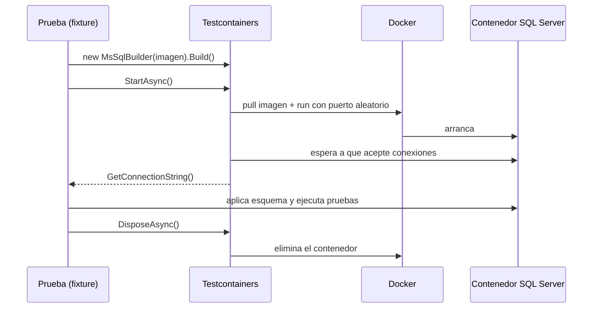

# Testcontainers

Parte de: [[03-CSharp-DotNet/08 Pruebas en .NET/_Índice Pruebas en .NET|Pruebas en .NET]]

> [!info] Cómo avanzar
> `progreso`: **pendiente** → **viendo** (estudiando) → **visto** (contestaste la autoevaluación sin abrir las respuestas) → **dominado** (hiciste el laboratorio o lo aplicaste de verdad).

## Contenido

### Qué es
**Testcontainers** es una biblioteca (con versión para .NET) que levanta **contenedores Docker desechables** desde el código de tus pruebas: una instancia real de SQL Server, Postgres, Redis o RabbitMQ que se crea al iniciar la prueba y se destruye al terminar. Así tus [[Pruebas de integración]] corren contra el mismo motor que producción, con tus procedimientos y archivos `.sql` reales, sin depender de una base compartida ni de instalar nada a mano.

### Cómo funciona


1. Defines el contenedor con un *builder* del módulo correspondiente (`Testcontainers.MsSql`, `Testcontainers.PostgreSql`...).
2. Al iniciar, se descarga la imagen si hace falta, se crea el contenedor con un **puerto aleatorio** del host y se espera a que esté listo (estrategia de espera).
3. Obtienes la cadena de conexión ya armada.
4. Un contenedor auxiliar (Ryuk) limpia los contenedores aunque el proceso de pruebas termine mal.

### Ejemplo
Fixture compartida con xUnit para Itzamna.Dionisio:

```csharp
using Testcontainers.MsSql;
using Microsoft.Data.SqlClient;

public sealed class SqlServerFixture : IAsyncLifetime
{
    // Fija una etiqueta concreta de imagen para que las pruebas sean reproducibles
    private readonly MsSqlContainer _sql =
        new MsSqlBuilder("mcr.microsoft.com/mssql/server:2022-CU14-ubuntu-22.04").Build();

    public string Cadena => _sql.GetConnectionString();

    public async ValueTask InitializeAsync()       // xUnit v3 usa ValueTask
    {
        await _sql.StartAsync();
        await using var cn = new SqlConnection(Cadena);
        await cn.OpenAsync();
        // Aplica tus scripts de esquema y procedimientos en orden
        foreach (var archivo in Directory.GetFiles("Sql/Esquema", "*.sql").Order())
            foreach (var lote in File.ReadAllText(archivo).Split("\nGO", StringSplitOptions.RemoveEmptyEntries))
                await new SqlCommand(lote, cn).ExecuteNonQueryAsync();
    }

    public async ValueTask DisposeAsync() => await _sql.DisposeAsync();
}

public sealed class PedidosSqlTests(SqlServerFixture db) : IClassFixture<SqlServerFixture>
{
    [Fact]
    public async Task Guardar_y_leer_pedido_con_procedimiento()
    {
        await using var cn = new SqlConnection(db.Cadena);
        var id = await cn.ExecuteScalarAsync<int>("dbo.Pedido_Insertar",
            new { ClienteId = 1, Total = 150.50m }, commandType: System.Data.CommandType.StoredProcedure);
        var p = await cn.QuerySingleAsync<PedidoDto>("dbo.Pedido_Obtener", new { Id = id },
            commandType: System.Data.CommandType.StoredProcedure);
        Assert.Equal(150.50m, p.Total);
    }
}
```

Combínalo con [[Pruebas de integración con WebApplicationFactory]] pasando `db.Cadena` a la configuración de la fábrica. Para limpiar datos entre pruebas sin recrear el contenedor, herramientas como Respawn borran las tablas rápidamente.

### Requisitos en tu PC y en CI
- **Docker** disponible: en Windows, Docker Desktop (con WSL 2 y contenedores Linux) u otro motor compatible; en Linux, Docker Engine. La imagen de SQL Server para contenedores es de **Linux x64**; en equipos ARM puede no funcionar o requerir emulación.
- **Recursos**: SQL Server pide al menos unos 2 GB de RAM para el contenedor; la primera descarga de la imagen tarda.
- **CI en Azure DevOps**: los agentes hospedados por Microsoft con Ubuntu traen Docker; en agentes Windows hospedados los contenedores Linux no están disponibles de forma estándar, así que usa `ubuntu-latest` para estas pruebas. En agentes propios, instala Docker y da permisos al usuario del agente.
- Licencia: la edición Developer de SQL Server dentro del contenedor es gratuita para desarrollo y pruebas.

### Cuándo usarlo y cuándo no
Úsalo para probar SQL real: procedimientos, TVP, transacciones, mapeos de Dapper, migraciones de EF Core, y cualquier integración con infraestructura (colas, caché). No lo uses para [[Pruebas unitarias]] de reglas de negocio: tardan segundos en arrancar y hacen lenta la retroalimentación. Las bases "en memoria" (EF InMemory, SQLite en lugar de SQL Server) son más rápidas pero no se comportan igual: tipos, collation, procedimientos y bloqueos difieren.

### Errores comunes
- **Usar `latest`** en la imagen: un cambio de versión rompe pruebas sin que toques código. Fija la etiqueta.
- **Un contenedor por prueba**: muy lento. Comparte por clase o colección con fixtures.
- **Datos que se pisan** entre pruebas paralelas: usa datos únicos o limpia antes de cada prueba.
- **Puertos fijos**: chocan con tu SQL local; deja que Testcontainers asigne el puerto.
- **Olvidar que Docker no está corriendo**: el error inicial parece de conexión; revisa el motor primero.

### Para profundizar
- [Testcontainers para .NET](https://dotnet.testcontainers.org/)
- [Módulo de SQL Server (Testcontainers .NET)](https://dotnet.testcontainers.org/modules/mssql)
- [Guía de Docker: Testcontainers con ASP.NET Core](https://docs.docker.com/guides/testcontainers-dotnet-aspnet-core/)

## Autoevaluación

Contesta primero en voz alta o en papel; luego despliega la respuesta.

> [!question]- ¿Qué es Testcontainers?
> Una librería que levanta contenedores Docker desde las pruebas (SQL Server, Redis) y los destruye al terminar.

> [!question]- ¿Cómo levantas SQL Server?
> ```csharp
> private readonly MsSqlContainer _db = new MsSqlBuilder().Build();
> public Task InitializeAsync() => _db.StartAsync();
> // _db.GetConnectionString()
> ```
> en un fixture con `IAsyncLifetime`.

> [!question]- ¿Qué requisito tiene en tu PC o en CI?
> Docker disponible (Docker Desktop en Windows o un agente de CI con Docker).

## Práctica

- [[Lab 10 - Pruebas con xUnit y WebApplicationFactory]]

