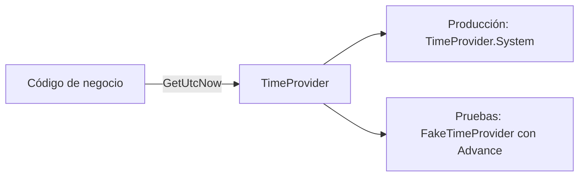

# TimeProvider para probar fechas

Parte de: [[03-CSharp-DotNet/08 Pruebas en .NET/_Índice Pruebas en .NET|Pruebas en .NET]]

> [!info] Cómo avanzar
> `progreso`: **pendiente** → **viendo** (estudiando) → **visto** (contestaste la autoevaluación sin abrir las respuestas) → **dominado** (hiciste el laboratorio o lo aplicaste de verdad).

## Contenido

### Qué es
`TimeProvider` es una clase abstracta incluida en .NET desde la versión 8 (`System.TimeProvider`) que representa **el reloj del sistema** como una dependencia. En lugar de llamar `DateTime.Now` o `DateTimeOffset.UtcNow` directamente, tu código pide la hora a un `TimeProvider` inyectado. En producción usas `TimeProvider.System`; en pruebas usas un reloj falso que controlas. Así puedes probar reglas como "un token caduca a los 15 minutos" o "un pedido pendiente se vence a las 48 horas" sin esperar y sin pruebas que fallan según la hora del día.

### Cómo funciona
`TimeProvider` expone, entre otros:

- `GetUtcNow()`: un `DateTimeOffset` en UTC.
- `GetLocalNow()`: la hora local según `LocalTimeZone`.
- `LocalTimeZone`: la zona horaria que usa el proveedor.
- `GetTimestamp()` y `GetElapsedTime(...)`: para medir duraciones (como `Stopwatch`).
- `CreateTimer(...)`: crea temporizadores que respetan el reloj del proveedor.

Varias APIs de .NET aceptan un `TimeProvider`: por ejemplo `Task.Delay(TimeSpan, TimeProvider)`, `CancellationTokenSource(TimeSpan, TimeProvider)` y la caché híbrida o la limitación de tasa en versiones recientes.

Para pruebas existe **`FakeTimeProvider`** en el paquete `Microsoft.Extensions.TimeProvider.Testing`. Empieza en una fecha que tú eliges y solo avanza cuando llamas `Advance(TimeSpan)` o `SetUtcNow(...)`. Los temporizadores y `Task.Delay` creados con él se disparan al avanzar el reloj, sin esperar tiempo real.



### Ejemplo
Regla de Itzamna.Dionisio: un pedido pendiente vence a las 48 horas.

```csharp
public sealed class VencimientoPedidos(TimeProvider reloj)
{
    public bool EstaVencido(Pedido p) =>
        p.Estado == EstadoPedido.Pendiente &&
        reloj.GetUtcNow() - p.CreadoEnUtc >= TimeSpan.FromHours(48);
}

// Program.cs: registro (una sola instancia, es sin estado)
builder.Services.AddSingleton(TimeProvider.System);
builder.Services.AddScoped<VencimientoPedidos>();
```

Pruebas con xUnit:

```csharp
using Microsoft.Extensions.Time.Testing;

public sealed class VencimientoPedidosTests
{
    private static readonly DateTimeOffset Inicio = new(2026, 3, 1, 12, 0, 0, TimeSpan.Zero);

    [Fact]
    public void No_vence_un_minuto_antes_de_48_horas()
    {
        var reloj = new FakeTimeProvider(Inicio);
        var pedido = Pedido.Nuevo(clienteId: 5, creadoEnUtc: reloj.GetUtcNow());
        reloj.Advance(TimeSpan.FromHours(48) - TimeSpan.FromMinutes(1));

        Assert.False(new VencimientoPedidos(reloj).EstaVencido(pedido));
    }

    [Fact]
    public void Vence_exactamente_a_las_48_horas()
    {
        var reloj = new FakeTimeProvider(Inicio);
        var pedido = Pedido.Nuevo(5, reloj.GetUtcNow());
        reloj.Advance(TimeSpan.FromHours(48));

        Assert.True(new VencimientoPedidos(reloj).EstaVencido(pedido));
    }
}
```

En pruebas de integración lo reemplazas en `ConfigureTestServices` con `services.AddSingleton<TimeProvider>(new FakeTimeProvider(...))` (ver [[Pruebas de integración con WebApplicationFactory]]). Para zonas horarias de México, `FakeTimeProvider.SetLocalTimeZone(...)` permite probar el cálculo de "fin del día" local.

### Cuándo usarlo y cuándo no
Úsalo en cualquier lógica que dependa de la hora: expiraciones (tokens de Xolotl.Hecate, códigos de verificación), reportes por periodo de Wee.Reporteria, reintentos con espera, trabajos programados en un [[BackgroundService]]. Antes de .NET 8 la gente creaba su propia interfaz `IReloj`; hoy conviene usar `TimeProvider` porque las bibliotecas del framework lo entienden. No hace falta para registrar marcas de tiempo puramente informativas que nunca se prueban, aunque mantener una sola fuente de hora sigue siendo buena práctica.

### Errores comunes
- **Mezclar `DateTime.Now` con `TimeProvider`**: una parte del código usa el reloj falso y otra el real; pruebas intermitentes. Busca `DateTime.Now`/`UtcNow` en el código y elimínalos.
- **Usar hora local para reglas de negocio**: cambios de horario y zonas producen errores. Guarda y compara en UTC (`DateTimeOffset`), convierte solo para mostrar ([[DateTime vs DateTimeOffset]]).
- **Registrar el fake en producción** por error: valida el ambiente o regístralo solo en pruebas.
- **Esperar que `FakeTimeProvider` avance solo**: no avanza con el tiempo real; llama `Advance` (o configura `AutoAdvanceAmount`).
- **Usar `Task.Delay(ms)` sin el proveedor**: la prueba espera de verdad. Usa la sobrecarga que recibe `TimeProvider`.

### Para profundizar
- [Clase TimeProvider (Microsoft Learn)](https://learn.microsoft.com/dotnet/api/system.timeprovider)
- [¿Qué es TimeProvider? (Microsoft Learn)](https://learn.microsoft.com/dotnet/standard/datetime/timeprovider-overview)
- [FakeTimeProvider (Microsoft Learn)](https://learn.microsoft.com/dotnet/api/microsoft.extensions.time.testing.faketimeprovider)

## Autoevaluación

Contesta primero en voz alta o en papel; luego despliega la respuesta.

> [!question]- ¿Qué es `TimeProvider`?
> Una abstracción del reloj (.NET 8): `TimeProvider.System` en producción y `GetUtcNow()`, `GetLocalNow()`, `CreateTimer()` en tu código.

> [!question]- ¿Cómo controlas el tiempo en pruebas?
> Con `FakeTimeProvider` (paquete `Microsoft.Extensions.TimeProvider.Testing`): `var t = new FakeTimeProvider(inicio); t.Advance(TimeSpan.FromHours(25));`.

> [!question]- ¿Cómo lo registras?
> `builder.Services.AddSingleton(TimeProvider.System);` y lo recibes por constructor.

## Práctica

- [[Lab 10 - Pruebas con xUnit y WebApplicationFactory]]

