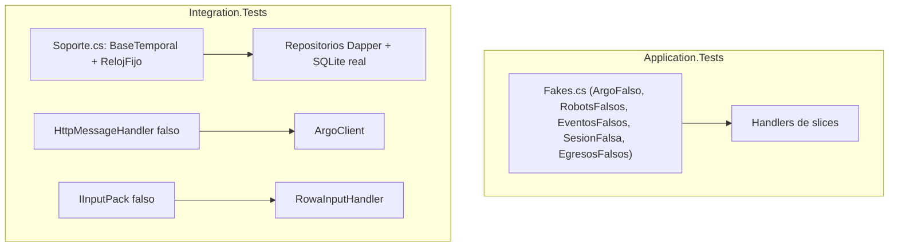

---
proyecto:
  - Ocelotl.Hermes
  - Itzamna.Dionisio
  - ReporteriaAzure
proyectos:
  - "[[Ocelotl.Hermes]]"
  - "[[Itzamna.Dionisio]]"
  - "[[ReporteriaAzure]]"
tipo: tecnologia
nivel: basico
estado: completo
tags:
  - conocimiento
  - backend
  - dotnet
  - testing
progreso: pendiente
area: C# y .NET
---
# xUnit

> Framework de pruebas para .NET (xunit 2.9.3); [[Ocelotl.Hermes]] lo usa en dos proyectos: lógica de slices con fakes y pruebas de integración con SQLite real temporal.

## Qué es y qué problema resuelve
xUnit permite escribir pruebas automatizadas como métodos de C# marcados con atributos, ejecutarlas con `dotnet test` y verificar resultados con `Assert`. Resuelve la necesidad de comprobar reglas de negocio (p. ej. "la caja 21 de 20 se rechaza") sin robot físico ni [[Argo]] real, y de evitar regresiones.

## Cómo funciona por dentro
- **`[Fact]`**: una prueba sin parámetros.
- **`[Theory]` + `[InlineData(...)]`**: la misma prueba con varios juegos de datos.
- **Una instancia de la clase por prueba**: el constructor es el *setup* y `IDisposable`/`IAsyncDisposable` el *teardown*; no se comparte estado entre pruebas salvo con fixtures (`IClassFixture`, `ICollectionFixture`).
- **Pruebas async**: métodos `async Task`.
- **Asserts**: `Assert.Equal`, `Assert.Contains`, `Assert.Empty`, `Assert.ThrowsAsync<T>`, etc.
- Ejecución con `Microsoft.NET.Test.Sdk` + `xunit.runner.visualstudio`; por defecto, clases de prueba distintas pueden correr en paralelo.



## Cuándo usarla y cuándo no
### Ventajas
- Estándar de facto en .NET moderno; buena integración con `dotnet test` e IDEs.
- Aislamiento por diseño (instancia nueva por prueba).
- `[Theory]` reduce duplicación en validaciones.
### Desventajas
- No trae mocks: hay que escribir fakes o añadir una librería (Hermes escribe fakes a mano).
- Fixtures compartidos requieren entender su ciclo de vida.
- Pruebas que dependen de DLLs nativas o de Windows (simuladores de Rowa) no corren en todos los sistemas.

## Alternativas
| Alternativa | En qué se diferencia |
|---|---|
| NUnit | `[Test]`/`[TestCase]`, `[SetUp]`/`[TearDown]` explícitos; instancia compartida por defecto. |
| MSTest | Framework de Microsoft, `[TestMethod]`/`[DataRow]`. |
| TUnit | Framework más nuevo basado en source generators. |
| Moq / NSubstitute | Librerías de mocks (complemento), en vez de fakes escritos a mano. |

## Cómo se usó en Ocelotl
En [[Ocelotl.Hermes]] hay dos proyectos en `tests/` (ambos con `<Using Include="Xunit" />` global):

**1. `Ocelotl.Hermes.Application.Tests`** — prueba los `Handler` de los slices sin infraestructura, con fakes de los puertos en `Fakes.cs` (`ArgoFalso`, `EventosFalsos`, `SesionFalsa`, `RobotsFalsos`, `EgresosFalsos`). Clases: `ConectarTests`, `DispensarTests`, `RegistrarIngresoTests`, `ResolverPackEntranteTests`, `ListarEgresosTests`, `ObtenerEgresoTests`, `ReaccionesTests`, `DependencyInjectionTests` (verifica el registro automático de handlers, ver [[Inyección de dependencias]]). Ejemplo (`Ocelotl.Hermes/tests/Ocelotl.Hermes.Application.Tests/SlicesTests.cs`):
```csharp
[Fact]
public async Task Usa_el_puerto_6050_si_no_se_indica()
{
    var robots = new RobotsFalsos();
    var r = await new Conectar.Handler(robots).Handle(new("192.168.1.10", null), default);

    Assert.Equal(("192.168.1.10", (ushort)6050), robots.UltimaConexion);
    Assert.Equal("Listo", r.Estado);
}

[Theory]
[InlineData("")]
[InlineData("robot-1")]
[InlineData("999.1.1.1")]
public async Task Rechaza_IP_invalida(string ip) =>
    await Assert.ThrowsAsync<ValidacionException>(() => new Conectar.Handler(new RobotsFalsos()).Handle(new(ip, 6050), default));
```

**2. `Ocelotl.Hermes.Integration.Tests`** — repositorios con [[SQLite]] real, outbox, identidad, `ArgoClient` con un `HttpMessageHandler` falso (`ServidorFalso`), Argo simulado, catálogo y `RowaInputHandler` con `IInputPack` falsos. `Soporte.cs` aporta `RelojFijo` (un `TimeProvider` controlable) y `BaseTemporal`, una base SQLite por prueba que se borra al terminar (`Ocelotl.Hermes/tests/Ocelotl.Hermes.Integration.Tests/Soporte.cs`):
```csharp
public static async Task<BaseTemporal> CrearAsync()
{
    var b = new BaseTemporal();   // registra las sentencias SQL (AddSentenciasSql)
    await b.Crear<EsquemaBaseDatos>().AsegurarAsync(default);
    return b;
}

/// <summary>Crea T con las sentencias registradas; los argumentos (reloj, opciones...) ganan.</summary>
public T Crear<T>(params object[] argumentos) => ActivatorUtilities.CreateInstance<T>(_servicios, argumentos);

public ValueTask DisposeAsync()
{
    System.Data.SQLite.SQLiteConnection.ClearAllPools();
    try { Directory.Delete(_carpeta, recursive: true); } catch { /* el archivo puede seguir abierto un instante */ }
    return ValueTask.CompletedTask;
}
```
Uso: `await using var b = await BaseTemporal.CrearAsync();` al inicio de cada prueba (p. ej. `OutboxTests`, `TrazabilidadTests`).

Notas:
- `InternalsVisibleTo` en Application e Infrastructure deja a las pruebas usar miembros `internal` (p. ej. `DependencyInjection.Handlers()`, `RowaInputHandler.AtenderAsync`).
- `OutboxDispatcher.DespacharAsync` es público para probar "un pase" sin arrancar el [[BackgroundService]].
- Los simuladores de Rowa (`StorageSystem.Simulators.Core`, `ItSystem.Simulator`) solo se referencian en Windows (`Condition="'$(OS)' == 'Windows_NT'"`). No se encontraron pruebas que los usen en esta copia (Pendiente de confirmar).
- El README menciona `tests/Ocelotl.Hermes.EndToEnd.Tests/Assets/...` (catálogo del emulador), pero ese proyecto no está en esta copia (Pendiente de confirmar).
- Conteo aproximado por búsqueda: ~65 `[Fact]` y 6 `[Theory]`.

Funcionalidades cubiertas: [[Ingresos]], [[Dispensar]], [[Historial de salidas]], [[Trazabilidad por caja]], [[Sincronización con Argo]], [[Sesión y roles]], [[Conexión de robots]].

> [!tip] Reutilizable
> `BaseTemporal` (base SQLite efímera con el esquema real) y `RelojFijo` (`TimeProvider` manual) son piezas que se pueden copiar a cualquier proyecto con SQLite y lógica dependiente del tiempo.


## Cómo se usó en Itzamna
En [[Itzamna.Dionisio]] la cobertura es **mínima**: un solo proyecto, `tests/Itzamna.Dionisio.Core.Tests` (xunit 2.9.*, `xunit.runner.visualstudio` 3.*, `<Using Include="Xunit" />` global), que solo referencia `Itzamna.Dionisio.Core`. Tiene 2 clases y 4 pruebas (2 `[Fact]` y 2 `[Theory]` con 13 `[InlineData]` en total):

| Clase | Qué prueba | Funcionalidad |
|---|---|---|
| `SlugTests` | `Slug.IsValid` (largo, guiones, mayúsculas, palabras reservadas como `api`) y `Slug.From` (acentos y `ñ`) | [[Slug y dirección pública]] |
| `MetricFormatterTests` | formato compacto (`909600` → `"909K+"`, `1329` → `"1.3K+"`) y completo (`"909,600"`) | [[Redes sociales y métricas]] |

`Itzamna.Dionisio/tests/Itzamna.Dionisio.Core.Tests/MetricFormatterTests.cs`:
```csharp
[Theory]
[InlineData(909600, "909K+")]
[InlineData(406400, "406K+")]
[InlineData(190700, "190K+")]
[InlineData(1329, "1.3K+")]
[InlineData(601, "601")]
[InlineData(2500000, "2.5M+")]
public void Compact_matches_the_portfolio_style(decimal value, string expected) =>
    Assert.Equal(expected, MetricFormatter.Format(value, DisplayFormat.Compact));
```
Estas pruebas importan porque `MetricFormatter` (C#) y `format.ts` (front) **deben dar el mismo texto**; las pruebas fijan el comportamiento del lado del back.

En el CI ([[Azure Pipelines]]) `dotnet test` corre antes de publicar y `PublishTestResults@2` con `failTaskOnFailedTests: true` detiene el despliegue si una falla. [[Itzamna.Clio]] no tiene pruebas unitarias (su única validación en CI es `pnpm typecheck`).

Lo que **no** está probado: handlers del mediador, validadores, filtros de tenant, auditoría, publicación/restauración, subida de medios, endpoints HTTP. `Program.cs` termina con `public partial class Program { }`, lo que deja listo usar `WebApplicationFactory<Program>`, pero no hay proyecto de pruebas de integración. El roadmap (`.ai/03_ROADMAP.md`) lo lista como pendiente: "pruebas de integración de la API".

> [!note] Pendiente de confirmar
> Cómo se probarían los filtros globales de EF ([[Multi-tenancy]]): con SQL Server real (Testcontainers) o con SQLite en memoria (que no soporta `rowversion` ni el esquema `portfolio` igual). No hay decisión en el repo.


## Cómo se usó en ReporteriaAzure
`tests/Application.Tests` ([[ReporteriaAzure]]) prueba el slice sin red, con un **falso a mano** de `IAzureDevOpsClient` (`AzureFalso`) que cuenta llamadas y guarda lo que recibió. No usa librerías de mocks.

- `[Fact]` para el mapeo: todos los campos, sin campos y tipos inesperados.
- `[Theory]` + `[InlineData(null)]`, `("")`, `("   ")` para el nombre vacío: además de la excepción, revisa que **no se llamó** a Azure.

```csharp
// ReporteriaAzure/tests/Application.Tests/ConsultarTableroTests.cs
var ex = await Assert.ThrowsAsync<ValidacionException>(() =>
    new Handler(azure).Handle(new Query(nombre), CancellationToken.None));

Assert.Equal("validacion", ex.Codigo);
Assert.Equal(0, azure.Llamadas);
```

Las fechas esperadas se calculan con la misma conversión (`Mapeo.ZonaReporte`, Centro de México), y una prueba fija `10:30Z` → `04:30`; si el equipo no tiene la zona instalada, esa prueba termina sin comprobar nada.

## Errores comunes y buenas prácticas
- Compartir una base entre pruebas: genera dependencias de orden; usar una por prueba.
- Usar `DateTime.Now` en el código: impide probar backoff y fechas; inyectar `TimeProvider`.
- No liberar el pool de SQLite antes de borrar el archivo (Windows lo mantiene abierto).
- Nombrar pruebas como frases (`Sin_internet_no_pierde_nada_y_reintenta_despues`): documentan la regla.
- `async void` en pruebas: siempre `async Task`.

## Qué estudiar después
- [[Inyección de dependencias]] (fakes por constructor), [[SQLite]], [[Dapper]]
- [[Arquitectura hexagonal]] (probar contra puertos)
- `WebApplicationFactory` para pruebas HTTP de extremo a extremo.

## Documentación oficial
- https://xunit.net/
- https://learn.microsoft.com/dotnet/core/testing/unit-testing-with-dotnet-test

## Autoevaluación

Contesta primero en voz alta o en papel; luego despliega la respuesta.

> [!question]- ¿Qué diferencia hay entre `[Fact]` y `[Theory]`?
> `[Fact]` es una prueba sin parámetros. `[Theory]` se ejecuta una vez por cada conjunto de datos (`[InlineData]`, `[MemberData]`, `[ClassData]`).

> [!question]- ¿Cómo comparte xUnit una base o un servidor entre pruebas?
> Una instancia nueva de la clase por prueba (aislamiento). Para compartir: `IClassFixture<T>` (por clase) o `ICollectionFixture<T>` con `[Collection]` (entre clases). `IAsyncLifetime` para inicializar async.

> [!question]- ¿Corren las pruebas en paralelo?
> Las clases de distintas colecciones sí; las de una misma clase o colección corren en serie. Si comparten una BD, ponlas en la misma colección.

> [!question]- ¿Cómo pruebas que un handler regresa un error de validación?
> ```csharp
> var r = await handler.Handle(new Crear.Command(Codigo: ""), CancellationToken.None);
> Assert.False(r.Exito);
> Assert.Equal("validacion", r.Error!.Codigo);
> ```

## Práctica

- [[Lab 10 - Pruebas con xUnit y WebApplicationFactory]]

