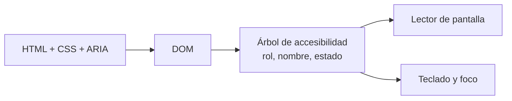

# Accesibilidad web

Parte de: [[04-JavaScript-Web/01 HTML y CSS/_Índice HTML y CSS|HTML y CSS]]

> [!info] Cómo avanzar
> `progreso`: **pendiente** → **viendo** (estudiando) → **visto** (contestaste la autoevaluación sin abrir las respuestas) → **dominado** (hiciste el laboratorio o lo aplicaste de verdad).

## Contenido

### Qué es
La accesibilidad web (a11y) es la práctica de construir páginas que cualquier persona pueda usar: quien navega solo con teclado, quien usa un lector de pantalla, quien tiene baja visión o daltonismo, quien tiene temblor en las manos o quien está en el sol con el brillo bajo. No es un "extra": en muchos países es requisito legal para sitios de gobierno y empresas grandes, y casi siempre mejora la experiencia de todos (un botón bien etiquetado también ayuda a las pruebas automatizadas y al SEO).

El estándar de referencia son las **WCAG** (*Web Content Accessibility Guidelines*), publicadas por el W3C. La versión vigente como Recomendación es la 2.2 (octubre de 2023). Se organizan en cuatro principios, conocidos como **POUR**:

- **Perceptible**: la información se puede percibir (texto alternativo, contraste, subtítulos).
- **Operable**: se puede usar con distintos medios (teclado, sin límites de tiempo imposibles).
- **Comprensible**: el contenido y los formularios se entienden (etiquetas, mensajes de error claros).
- **Robusto**: funciona con tecnologías de asistencia actuales y futuras (HTML válido, roles correctos).

Cada criterio tiene un **nivel de conformidad**: **A** (lo mínimo; si falla, hay personas que no pueden usar el sitio), **AA** (el objetivo habitual en contratos y leyes) y **AAA** (el más estricto; no se exige para sitios completos porque algunos criterios no aplican a todo contenido).

### Cómo funciona
El navegador construye, además del DOM, un **árbol de accesibilidad**: por cada elemento calcula su *rol* (botón, enlace, encabezado), su *nombre accesible* (el texto que se anuncia), su *estado* (marcado, expandido, deshabilitado) y su descripción. Los lectores de pantalla (NVDA, JAWS, VoiceOver, TalkBack) leen ese árbol, no los píxeles.



Por eso la base de todo es el [[HTML semántico]]: un `<button>` ya trae rol, foco y activación con Enter/Espacio. Sobre esa base se trabajan tres frentes, cada uno con su nota:

- [[Roles y atributos ARIA]]: cómo completar el árbol cuando el HTML nativo no alcanza (componentes como pestañas o combos). La **primera regla de ARIA** dice: si existe un elemento o atributo HTML nativo con la semántica y el comportamiento que necesitas, úsalo en vez de reinventarlo con ARIA.
- [[Navegación con teclado y foco]]: que todo se pueda operar sin mouse y que el foco se vea y se mueva de forma lógica.
- [[Contraste y texto alternativo]]: lo perceptible, es decir, colores legibles y alternativas para imágenes.

### Ejemplo
En Itzamna.Clio (React) un botón de "eliminar" hecho con un ícono suele quedar así:

```html
<!-- Mal: no se enfoca, no tiene nombre, no responde a Enter -->
<div class="icono-basura" onclick="eliminar()"></div>

<!-- Bien: nativo, enfocable y con nombre accesible -->
<button type="button" class="btn-icono" aria-label="Eliminar pedido 1024">
  <svg aria-hidden="true" focusable="false">...</svg>
</button>
```

### Revisión rápida de una pantalla (10 minutos)
1. **Teclado**: desconecta el mouse y recorre con Tab y Shift+Tab. ¿Llegas a todo? ¿Se ve dónde estás? ¿El orden tiene sentido?
2. **Herramienta automática**: Lighthouse (pestaña de DevTools) o la extensión axe DevTools. Detectan contraste, etiquetas faltantes, `alt` ausente. Encuentran aproximadamente una parte de los problemas, no todos.
3. **Zoom al 200 %** y ancho de 320 px: el contenido no debe cortarse.
4. **Lector de pantalla**: NVDA es gratuito en Windows; VoiceOver viene en tu iPhone 15 Pro y en macOS. Escucha cómo se anuncian botones y formularios.
5. **Panel de accesibilidad** de DevTools: revisa rol y nombre de los elementos clave.

### Cuándo usarlo y cuándo no
Siempre; no hay escenario donde la accesibilidad estorbe. Lo que sí cambia es el nivel: para un sistema interno puedes apuntar a AA en las pantallas críticas primero. Las bibliotecas de componentes accesibles (Radix, React Aria) son buena alternativa a construir widgets complejos desde cero.

### Errores comunes
- **Confiar solo en el validador automático**: no detecta orden de foco ilógico ni textos alternativos sin sentido. Combínalo con prueba manual.
- **Llenar todo de ARIA**: ARIA mal puesto empeora la experiencia; primero HTML nativo.
- **Dejarlo para el final**: corregir un diseño sin contraste o un componente sin teclado al final cuesta mucho más. Inclúyelo en la definición de terminado de cada historia en Azure DevOps.
- **Quitar el contorno de foco** por estética sin dar reemplazo visible.

### Para profundizar
- [WCAG 2.2 (W3C)](https://www.w3.org/TR/WCAG22/)
- [Referencia rápida "How to Meet WCAG"](https://www.w3.org/WAI/WCAG22/quickref/)
- [Accesibilidad en MDN](https://developer.mozilla.org/en-US/docs/Web/Accessibility)
- [ARIA Authoring Practices Guide](https://www.w3.org/WAI/ARIA/apg/)

## Subtemas

- [[Roles y atributos ARIA]]
- [[Navegación con teclado y foco]]
- [[Contraste y texto alternativo]]

## Autoevaluación

Contesta primero en voz alta o en papel; luego despliega la respuesta.

> [!question]- ¿Qué significan las siglas WCAG y los niveles A, AA, AAA?
> Web Content Accessibility Guidelines: criterios verificables de accesibilidad. A es lo mínimo, **AA** es el objetivo habitual (y el que suelen pedir leyes y contratos), AAA es el más estricto.

> [!question]- ¿Cuál es la "primera regla de ARIA"?
> Si existe un elemento HTML nativo con la semántica y el comportamiento que necesitas, úsalo en vez de añadir `role`/`aria-*` a un `div`. ARIA solo cambia lo que se anuncia, no agrega comportamiento de teclado.

> [!question]- ¿Cómo verificarías rápido la accesibilidad de una pantalla?
> 1) Recorrerla solo con teclado (Tab, Shift+Tab, Enter, Esc). 2) Auditoría de Lighthouse o axe DevTools. 3) Revisar contraste y textos alternativos. 4) Probar con un lector de pantalla (NVDA en Windows, gratis).

## Práctica

- [[Lab 1 - Página de registro accesible y responsiva]]

## Progreso de los subtemas

```base
filters:
  and:
    - file.inFolder("04-JavaScript-Web/01 HTML y CSS/Accesibilidad web")
    - file.name != "Accesibilidad web"
views:
  - type: table
    name: Progreso
    order:
      - file.name
      - progreso
      - nivel
```
