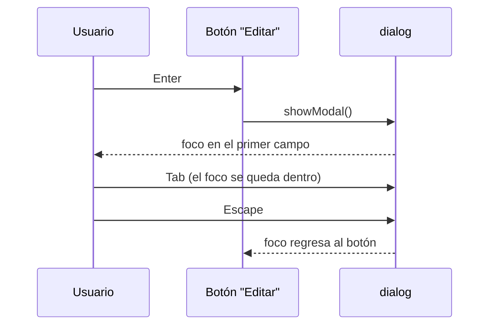

# Navegación con teclado y foco

Parte de: [[Accesibilidad web]]

> [!info] Cómo avanzar
> `progreso`: **pendiente** → **viendo** (estudiando) → **visto** (contestaste la autoevaluación sin abrir las respuestas) → **dominado** (hiciste el laboratorio o lo aplicaste de verdad).

## Contenido

### Qué es
Es el requisito de que **todo lo que se puede hacer con el mouse se pueda hacer con el teclado**, y de que en todo momento se vea qué elemento tiene el **foco** (el que recibe las teclas). Lo necesitan personas con discapacidad motora, usuarios de lectores de pantalla (que navegan por teclado) y usuarios avanzados que trabajan rápido sin mouse.

### Cómo funciona
El navegador mantiene un **orden de tabulación**: con Tab avanzas y con Shift+Tab retrocedes por los elementos enfocables. Por defecto son enfocables los elementos interactivos nativos: `<a href>`, `<button>`, `<input>`, `<select>`, `<textarea>`, `<summary>`, y los que tengan `tabindex`. El orden sigue el orden del **DOM**, no la posición visual (si reordenas con CSS `order` o grid, el foco puede saltar de forma rara).

El atributo `tabindex` controla esto:

| Valor | Efecto |
|---|---|
| `tabindex="0"` | El elemento entra al orden de Tab en su posición natural del DOM. Útil para un widget personalizado. |
| `tabindex="-1"` | No entra al orden de Tab, pero se puede enfocar por código con `el.focus()`. Útil para el título de una página o un contenedor al que mueves el foco. |
| `tabindex="1"` o mayor | Fuerza un orden manual que rompe el natural. Evítalo. |

Las teclas esperadas: **Tab** para moverse entre controles, **Enter** para activar enlaces y botones, **Espacio** para botones y casillas, **flechas** dentro de grupos (radios, menús, pestañas) y **Escape** para cerrar diálogos y menús.

### El foco en un modal
Un diálogo modal debe:
1. **Mover el foco dentro** al abrir (al primer control o al título).
2. **Atrapar el foco**: Tab no debe salir al contenido de atrás.
3. **Cerrar con Escape**.
4. **Regresar el foco** al botón que lo abrió al cerrar, para que el usuario no pierda su lugar.

El [[Elemento dialog]] con `showModal()` hace casi todo esto por ti: mueve el foco, vuelve inerte el resto de la página y cierra con Escape; al cerrarse, los navegadores modernos regresan el foco al elemento que lo tenía antes.



### Ejemplo
```html
<a class="saltar" href="#principal">Saltar al contenido</a>
<nav>...</nav>
<main id="principal" tabindex="-1">...</main>
```

```css
/* Enlace "saltar" visible solo al recibir foco */
.saltar { position: absolute; left: -9999px; }
.saltar:focus { left: 1rem; top: 1rem; }

/* Foco visible y con buen contraste, solo para teclado */
:focus-visible {
  outline: 3px solid #1a73e8;
  outline-offset: 2px;
}
```

```js
// Al cambiar de vista en una SPA, mueve el foco al nuevo encabezado
function mostrarVista(titulo) {
  const h1 = document.querySelector('h1');
  h1.textContent = titulo;
  h1.setAttribute('tabindex', '-1');
  h1.focus();
}
```

`:focus-visible` aplica el estilo cuando el navegador considera que el foco debe mostrarse (normalmente al usar teclado), así que no molesta a quien hace clic con el mouse.

### Por qué no `outline: none`
El contorno es la única pista visual de dónde está el usuario. Quitarlo sin reemplazo hace que navegar con teclado sea como mover un cursor invisible, y falla el criterio WCAG 2.4.7 (*Foco visible*, nivel AA). Si al diseño no le gusta el contorno por defecto, **cámbialo** (color, grosor, `box-shadow`), no lo borres.

### Cuándo usarlo y cuándo no
Siempre que construyas algo interactivo. Si un `<div>` necesita ser clicable, la respuesta casi siempre es usar `<button>` o `<a>` en lugar de agregar `tabindex="0"` más manejadores de teclado a mano. Para widgets complejos (pestañas, menús, árboles) sigue los patrones de teclado de la ARIA Authoring Practices Guide, revisados también en [[Roles y atributos ARIA]].

### Errores comunes
- **`outline: none` global** en un reset CSS. Bórralo o pon un `:focus-visible` propio.
- **`tabindex` positivos**: crean un orden imposible de mantener.
- **Elementos clicables que no son enfocables** (`<div onclick>`, `<span>`): el teclado no llega.
- **Contenido oculto que sigue enfocable**: un menú colapsado con `opacity: 0` sigue recibiendo Tab. Usa `hidden`, `display: none` o el atributo `inert`.
- **Modales sin regresar el foco**: el usuario queda al inicio de la página.

### Para profundizar
- [Entender 2.4.7 Foco visible (W3C)](https://www.w3.org/WAI/WCAG22/Understanding/focus-visible.html)
- [`tabindex` en MDN](https://developer.mozilla.org/en-US/docs/Web/HTML/Global_attributes/tabindex)
- [Patrón de diálogo modal (APG)](https://www.w3.org/WAI/ARIA/apg/patterns/dialog-modal/)

## Autoevaluación

Contesta primero en voz alta o en papel; luego despliega la respuesta.

> [!question]- ¿Qué hacen `tabindex="0"` y `tabindex="-1"`?
> `0`: el elemento entra al orden natural de Tab. `-1`: no entra al orden de Tab pero se puede enfocar por código con `el.focus()`. Valores positivos rompen el orden natural; evítalos.

> [!question]- ¿Qué debe pasar con el foco al abrir y cerrar un modal?
> Al abrir, mover el foco dentro del modal (primer control o el título) y mantenerlo ahí; al cerrar, devolverlo al elemento que lo abrió. `<dialog>` con `showModal()` hace la mayor parte.

> [!question]- ¿Por qué no debes quitar el contorno con `outline: none` sin reemplazo?
> Los usuarios de teclado pierden la referencia de dónde están. Si te molesta en clic, usa `:focus-visible` para mostrar un estilo de foco solo cuando se navega con teclado.

## Práctica

- [[Lab 1 - Página de registro accesible y responsiva]]

