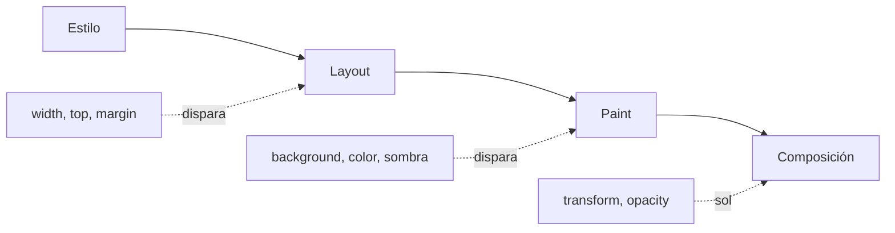

# CSS - animaciones y transiciones

Parte de: [[04-JavaScript-Web/01 HTML y CSS/_Índice HTML y CSS|HTML y CSS]]

> [!info] Cómo avanzar
> `progreso`: **pendiente** → **viendo** (estudiando) → **visto** (contestaste la autoevaluación sin abrir las respuestas) → **dominado** (hiciste el laboratorio o lo aplicaste de verdad).

## Contenido

### Qué es
CSS ofrece dos herramientas para movimiento sin JavaScript:

- **Transiciones** (`transition`): animan el cambio de una propiedad **entre dos estados** cuando algo la cambia (un `:hover`, una clase agregada por JS). Solo inicio y fin.
- **Animaciones** (`@keyframes` + `animation`): definen una secuencia con pasos intermedios, que puede arrancar sola, repetirse, alternar o pausarse.

Sirven para retroalimentación (un botón que reacciona), continuidad (un panel que se despliega en lugar de aparecer de golpe) e indicadores (un *spinner*).

### Cómo funciona
**Transición**: declaras qué propiedad, cuánto dura, con qué curva y con qué retraso.

```css
.boton {
  background: #1a73e8;
  transition: background-color 150ms ease-out, transform 150ms ease-out;
}
.boton:hover { background: #1558b0; transform: translateY(-2px); }
```

**Animación**: nombras una secuencia de *keyframes* y la aplicas con `animation` (nombre, duración, curva, retraso, repeticiones, dirección, modo de relleno).

```css
@keyframes girar {
  from { transform: rotate(0deg); }
  to   { transform: rotate(360deg); }
}
.spinner { animation: girar 800ms linear infinite; }

@keyframes entrar {
  0%   { opacity: 0; transform: translateY(8px); }
  100% { opacity: 1; transform: none; }
}
.toast { animation: entrar 200ms ease-out both; }
```

`animation-fill-mode: both` (o `forwards`) mantiene los estilos del último frame al terminar.

**Regla práctica**: si el movimiento responde a un cambio de estado A→B, usa `transition`. Si necesitas pasos intermedios, que se repita o que arranque al cargar sin cambio de estado, usa `@keyframes`.

### Rendimiento: qué propiedades animar
El navegador pinta cada frame pasando por etapas: **estilo → layout (geometría) → paint (pintar píxeles) → composición (juntar capas)**. El detalle está en [[Pipeline de renderizado del navegador]].



- Animar `width`, `height`, `top`, `left` o `margin` obliga a recalcular layout en cada frame: caro, puede dar tirones.
- Animar `background-color` o `box-shadow` repinta: medio.
- **`transform` y `opacity`** normalmente solo afectan la composición y el navegador puede hacerlo en la GPU: son las más baratas. Para mover usa `translate`, para crecer `scale`.

`will-change: transform` le avisa al navegador que prepare una capa; úsalo con moderación y solo en elementos que de verdad se animan, porque cada capa consume memoria.

### Movimiento reducido
Algunas personas tienen trastornos vestibulares y las animaciones grandes (paralaje, zoom, desplazamientos) les causan mareo. Los sistemas operativos tienen la opción "reducir movimiento" (en iOS: Accesibilidad → Movimiento), que CSS expone con `prefers-reduced-motion`:

```css
@media (prefers-reduced-motion: reduce) {
  *, *::before, *::after {
    animation-duration: 0.01ms !important;
    animation-iteration-count: 1 !important;
    transition-duration: 0.01ms !important;
    scroll-behavior: auto !important;
  }
}
```

Una variante más fina es diseñar sin animación y agregarla solo dentro de `@media (prefers-reduced-motion: no-preference)`. En JS: `matchMedia('(prefers-reduced-motion: reduce)').matches`.

### Cuándo usarlo y cuándo no
Usa CSS para la mayoría de microinteracciones: es declarativo y el navegador lo optimiza. Recurre a JavaScript (Web Animations API con `el.animate()`, o una biblioteca) cuando la animación depende de datos, necesitas encadenar con lógica o sincronizar con el scroll de forma compleja. Evita animaciones largas (más de ~300 ms en interacciones) que hacen sentir lenta la interfaz, y nunca condiciones información a que el usuario vea una animación.

### Errores comunes
- **`transition: all`**: anima propiedades que no esperabas (incluso las de layout) y complica depurar. Lista las propiedades.
- **Animar `height: auto`**: no se interpola. Usa `transform: scaleY`, `grid-template-rows: 0fr → 1fr` o `max-height` con cuidado.
- **Animar `top`/`left`** en lugar de `transform`: tirones en móviles.
- **Ignorar `prefers-reduced-motion`**.
- **Transiciones que no arrancan** porque el elemento pasa de `display: none` a visible en el mismo frame; el navegador no tiene estado inicial que interpolar.

### Para profundizar
- [Usar transiciones CSS (MDN)](https://developer.mozilla.org/en-US/docs/Web/CSS/CSS_transitions/Using_CSS_transitions)
- [Usar animaciones CSS (MDN)](https://developer.mozilla.org/en-US/docs/Web/CSS/CSS_animations/Using_CSS_animations)
- [`prefers-reduced-motion` (MDN)](https://developer.mozilla.org/en-US/docs/Web/CSS/@media/prefers-reduced-motion)

## Autoevaluación

Contesta primero en voz alta o en papel; luego despliega la respuesta.

> [!question]- ¿Cuándo usar `transition` y cuándo `@keyframes`?
> `transition`: animar el cambio entre dos estados (hover, clase añadida). `@keyframes` + `animation`: secuencias con varios pasos, repeticiones o que arrancan solas.

> [!question]- ¿Qué propiedades son baratas de animar y por qué?
> `transform` y `opacity`: el navegador las resuelve en la etapa de composición sin recalcular layout ni repintar. Animar `width`, `top` o `margin` provoca layout en cada cuadro.

> [!question]- ¿Cómo respetas a usuarios sensibles al movimiento?
> Con `@media (prefers-reduced-motion: reduce)` desactivas o reduces animaciones grandes.

