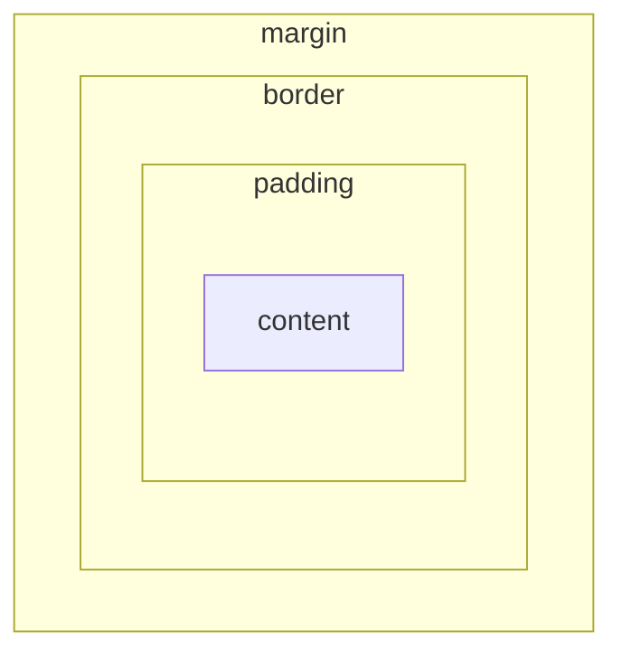

# CSS - box model

Parte de: [[04-JavaScript-Web/01 HTML y CSS/_Índice HTML y CSS|HTML y CSS]]

> [!info] Cómo avanzar
> `progreso`: **pendiente** → **viendo** (estudiando) → **visto** (contestaste la autoevaluación sin abrir las respuestas) → **dominado** (hiciste el laboratorio o lo aplicaste de verdad).

## Contenido

### Qué es
El **box model** es la regla con la que CSS dibuja cada elemento: todo es una caja rectangular formada por cuatro capas concéntricas. Entenderlo explica por qué un elemento "mide más de lo que le dijiste", por qué dos márgenes no se suman o por qué un botón no se alinea.

### Cómo funciona
De adentro hacia afuera:

1. **Contenido** (*content*): el texto o la imagen; su tamaño lo dan `width` y `height`.
2. **Relleno** (*padding*): espacio interno entre el contenido y el borde. Toma el color de fondo del elemento.
3. **Borde** (*border*): la línea que rodea el relleno.
4. **Margen** (*margin*): espacio externo, transparente, que separa la caja de sus vecinas.



### `box-sizing`
Define a qué capa se refiere `width`:

- **`content-box`** (valor por defecto): `width` es solo el contenido. El ancho visible es `width + padding izq. + padding der. + borde izq. + borde der.`
- **`border-box`**: `width` incluye contenido, relleno y borde. El contenido se encoge para que todo quepa en el ancho declarado.

Con `width: 200px; padding: 10px; border: 2px solid;`:

| | Ancho total visible | Área de contenido |
|---|---|---|
| `content-box` | 200 + 10·2 + 2·2 = **224 px** | 200 px |
| `border-box` | **200 px** | 200 − 20 − 4 = **176 px** |

Casi todos los proyectos usan `border-box` en todo, porque hace los cálculos predecibles (un `width: 50%` con relleno sigue ocupando la mitad):

```css
*, *::before, *::after { box-sizing: border-box; }
```

### Colapso de márgenes
En el flujo normal de bloques, los **márgenes verticales** (arriba/abajo) entre elementos adyacentes **no se suman**: se fusionan y queda el **mayor**. Un párrafo con `margin-bottom: 20px` seguido de otro con `margin-top: 30px` quedan separados **30 px**, no 50. También colapsa el margen superior de un primer hijo con el de su padre si el padre no tiene borde, relleno ni contenido en medio (por eso a veces "el margen del hijo empuja al padre").

El colapso **no** ocurre:
- con márgenes horizontales,
- dentro de contenedores **flex** o **grid** (sus hijos nunca colapsan),
- si hay borde o padding entre ellos,
- en elementos flotantes o con posición absoluta,
- en un padre que crea un nuevo contexto de formato de bloque (`display: flow-root`, `overflow` distinto de `visible`).

Por eso, en layouts modernos con [[CSS - flexbox]] o [[CSS - grid]] es común separar con `gap` en lugar de márgenes.

### Ejemplo
Una tarjeta de pedido en Itzamna.Clio:

```css
.tarjeta {
  box-sizing: border-box;
  width: 320px;          /* mide 320 px en total, pase lo que pase */
  padding: 16px;
  border: 1px solid #d0d7de;
  margin-block-end: 24px; /* separación con la siguiente tarjeta */
}
.tarjeta h3 { margin-block-start: 0; } /* evita que el margen del título "escape" */
```

En DevTools (pestaña *Elements → Computed*) verás el diagrama de cajas con los valores de cada capa; pasar el cursor por el elemento las resalta en colores distintos. Es la forma más rápida de diagnosticar "de dónde salió ese espacio".

Las propiedades lógicas (`margin-block`, `padding-inline`) equivalen a arriba/abajo e izquierda/derecha en idiomas que se escriben de izquierda a derecha, y se adaptan solas a escritura vertical o de derecha a izquierda.

### Cuándo usarlo y cuándo no
Siempre está presente; lo que decides es `box-sizing` (pon `border-box` global) y si separas con `margin` o con `gap`. Usa `margin` para separar bloques en flujo de documento (artículos, párrafos) y `gap` dentro de contenedores flex o grid. `outline` y `box-shadow` no ocupan espacio en el box model: sirven para resaltar sin mover el layout.

### Errores comunes
- **Olvidar el padding en `content-box`**: dos columnas al 50 % con relleno ya no caben y una baja de renglón.
- **Sorprenderse por el colapso de márgenes**: no es un bug; usa `gap`, padding o `display: flow-root`.
- **Márgenes negativos para "acomodar"**: tapan el problema real.
- **Elementos en línea** (`<span>`, `<a>`): ignoran `width`/`height` y sus márgenes verticales no empujan líneas. Usa `display: inline-block` o `block`.

### Para profundizar
- [Introducción al box model (MDN)](https://developer.mozilla.org/en-US/docs/Web/CSS/CSS_box_model/Introduction_to_the_CSS_box_model)
- [Colapso de márgenes (MDN)](https://developer.mozilla.org/en-US/docs/Web/CSS/CSS_box_model/Mastering_margin_collapsing)
- [`box-sizing` (MDN)](https://developer.mozilla.org/en-US/docs/Web/CSS/box-sizing)

## Ejercicios

Resuélvelos en papel o en la herramienta; la solución está plegada.

> [!question]- `width: 200px; padding: 10px; border: 2px solid;` con `content-box`. ¿Cuánto mide el ancho total?
> 200 + 10·2 + 2·2 = **224px**.

> [!question]- Lo mismo con `border-box`. ¿Cuánto mide el área de contenido?
> Total 200px; contenido = 200 − 20 − 4 = **176px**.

> [!question]- Un párrafo con `margin-bottom: 20px` va seguido de otro con `margin-top: 30px`. ¿Qué separación queda?
> **30px** (colapsan; queda el mayor).

## Autoevaluación

Contesta primero en voz alta o en papel; luego despliega la respuesta.

> [!question]- ¿Qué capas tiene el box model?
> De adentro hacia afuera: contenido, `padding`, `border` y `margin`.

> [!question]- ¿Qué cambia `box-sizing: border-box`?
> `width`/`height` incluyen padding y borde, así el ancho total es el que declaras. Con `content-box` (por defecto) el padding y el borde se suman al ancho.

> [!question]- ¿Qué es el colapso de márgenes?
> Los márgenes **verticales** de bloques adyacentes (o de un padre con su primer/último hijo sin padding ni borde) se fusionan y queda el mayor, no la suma. No pasa en flex ni grid.

