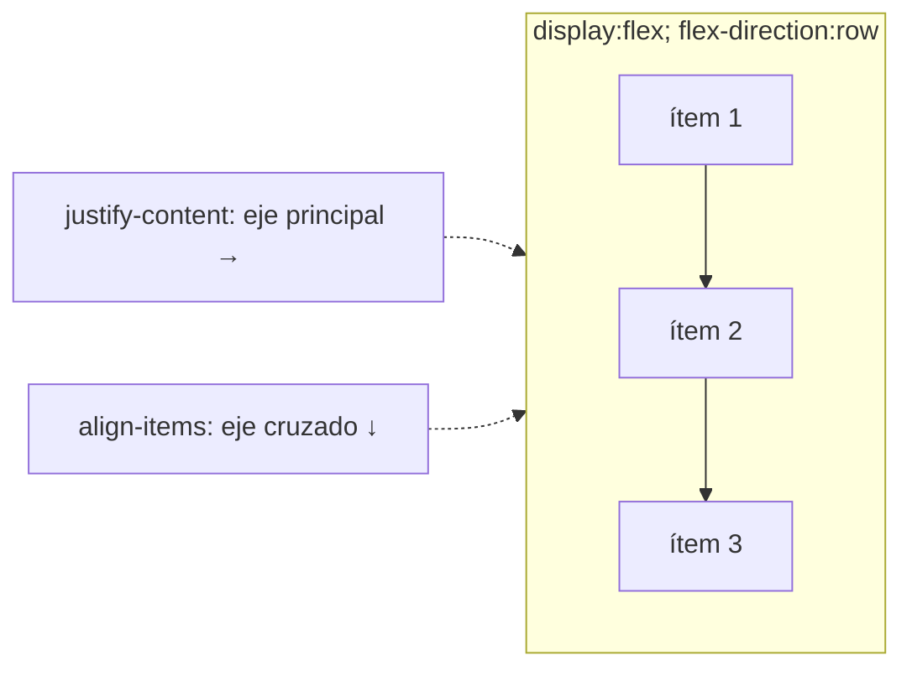

# CSS - flexbox

Parte de: [[04-JavaScript-Web/01 HTML y CSS/_Índice HTML y CSS|HTML y CSS]]

> [!info] Cómo avanzar
> `progreso`: **pendiente** → **viendo** (estudiando) → **visto** (contestaste la autoevaluación sin abrir las respuestas) → **dominado** (hiciste el laboratorio o lo aplicaste de verdad).

## Contenido

### Qué es
**Flexbox** es un modelo de layout de **una dimensión**: acomoda los hijos de un contenedor en una fila o en una columna, reparte el espacio sobrante y los alinea. Es la herramienta para barras de navegación, filas de botones, centrar algo o una tarjeta con ícono y texto.

### Cómo funciona
Al poner `display: flex` en un contenedor, sus hijos directos se vuelven **ítems flex**. Hay dos ejes:

- **Eje principal** (*main axis*): lo define `flex-direction` (`row` por defecto = horizontal; `column` = vertical).
- **Eje cruzado** (*cross axis*): el perpendicular.



**Propiedades del contenedor**
- `justify-content`: reparte los ítems **en el eje principal** (`flex-start`, `center`, `space-between`, `space-around`, `space-evenly`).
- `align-items`: alinea los ítems **en el eje cruzado** (`stretch` por defecto, `center`, `flex-start`, `baseline`).
- `flex-wrap: wrap`: permite que bajen a otra línea; `align-content` reparte esas líneas.
- `gap`: espacio entre ítems sin márgenes.

Si cambias a `flex-direction: column`, los ejes giran: `justify-content` pasa a ser vertical.

**Propiedades de los ítems**: `flex-grow` (cuánto crece con espacio sobrante), `flex-shrink` (cuánto se encoge si falta), `flex-basis` (tamaño de partida). El atajo `flex`:

| Atajo | Equivale | Uso |
|---|---|---|
| `flex: 1` | `1 1 0%` | Ítems iguales que reparten todo el espacio |
| `flex: auto` | `1 1 auto` | Crece desde su tamaño de contenido |
| `flex: none` | `0 0 auto` | Tamaño fijo, no crece ni se encoge |

`align-self` sobrescribe la alineación de un ítem; `order` cambia el orden visual (sin cambiar el orden del DOM ni del foco).

### El problema del texto que desborda
Los ítems flex tienen por defecto `min-width: auto`, que significa "no me encojas por debajo del ancho de mi contenido". Un texto largo sin espacios (una URL, un folio) o un hijo con `white-space: nowrap` impone un mínimo enorme, y aunque pongas `flex: 1` el ítem desborda. La solución es permitir que se encoja:

```css
.fila { display: flex; gap: .5rem; }
.fila .texto {
  flex: 1;
  min-width: 0;            /* clave: deja encoger por debajo del contenido */
  overflow: hidden;
  text-overflow: ellipsis;
  white-space: nowrap;
}
```

En una columna (`flex-direction: column`) el equivalente es `min-height: 0`.

### Ejemplo
Barra superior de Itzamna.Clio y centrado perfecto:

```html
<header class="barra">
  <a class="logo" href="/">Clio</a>
  <nav class="menu"><a href="/pedidos">Pedidos</a><a href="/clientes">Clientes</a></nav>
  <button type="button">Salir</button>
</header>
```

```css
.barra { display: flex; align-items: center; gap: 1rem; padding: .5rem 1rem; }
.menu  { display: flex; gap: 1rem; margin-inline-start: auto; } /* empuja a la derecha */

.centro { display: flex; justify-content: center; align-items: center; min-height: 100dvh; }
```

`margin-inline-start: auto` en un ítem flex absorbe el espacio libre: truco muy útil para empujar elementos a un lado.

### Flexbox o grid
- **Flexbox**: el tamaño lo decide el **contenido** y piensas en una sola dirección (una fila de etiquetas que se envuelven, botones de distinto largo, alinear un ícono con su texto).
- **[[CSS - grid]]**: el layout lo decide el **contenedor** y piensas en filas y columnas a la vez (un tablero, la estructura de la página, tarjetas alineadas en columnas exactas).

Se combinan todo el tiempo: grid para la página, flex dentro de cada componente.

### Errores comunes
- **Confundir los ejes** al cambiar a `column`.
- **No poner `min-width: 0`** y culpar a `flex: 1` del desbordamiento.
- **Usar márgenes para separar** en vez de `gap`.
- **Usar `order` para reordenar contenido importante**: el lector de pantalla y el Tab siguen el DOM.
- **Esperar que `flex-wrap` alinee columnas** entre líneas: cada línea es independiente; para columnas alineadas usa grid.

### Para profundizar
- [Conceptos básicos de flexbox (MDN)](https://developer.mozilla.org/en-US/docs/Web/CSS/CSS_flexible_box_layout/Basic_concepts_of_flexbox)
- [CSS Flexible Box Layout (W3C)](https://www.w3.org/TR/css-flexbox-1/)
- [Controlar proporciones de los ítems (MDN)](https://developer.mozilla.org/en-US/docs/Web/CSS/CSS_flexible_box_layout/Controlling_ratios_of_flex_items_along_the_main_axis)

## Autoevaluación

Contesta primero en voz alta o en papel; luego despliega la respuesta.

> [!question]- ¿Qué controla `justify-content` y qué `align-items` en flexbox?
> `justify-content` reparte en el **eje principal** (el de `flex-direction`); `align-items` alinea en el **eje cruzado**. Si cambias a `column`, se intercambian visualmente.

> [!question]- ¿Qué significa `flex: 1`?
> Abreviatura de `flex-grow: 1; flex-shrink: 1; flex-basis: 0%`: los elementos se reparten el espacio libre en partes iguales.

> [!question]- Caso: un texto largo desborda un hijo flex aunque le pusiste `flex: 1`. ¿Por qué?
> Los items flex tienen `min-width: auto` y no se encogen por debajo de su contenido. Ponle `min-width: 0` (o `overflow: hidden`) al item.

> [!question]- ¿Cuándo prefieres flexbox sobre grid?
> Para distribución en **una dimensión** (una fila de botones, una barra de navegación, centrar algo). Grid para dos dimensiones (filas y columnas a la vez).

## Práctica

- [[Lab 1 - Página de registro accesible y responsiva]]

