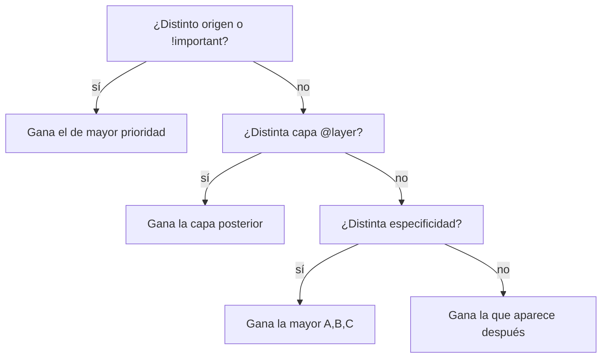

# CSS - selectores y especificidad

Parte de: [[04-JavaScript-Web/01 HTML y CSS/_Índice HTML y CSS|HTML y CSS]]

> [!info] Cómo avanzar
> `progreso`: **pendiente** → **viendo** (estudiando) → **visto** (contestaste la autoevaluación sin abrir las respuestas) → **dominado** (hiciste el laboratorio o lo aplicaste de verdad).

## Contenido

### Qué es
Los **selectores** indican a qué elementos aplica una regla CSS. Cuando varias reglas asignan la misma propiedad al mismo elemento, la **cascada** decide cuál gana; la **especificidad** es uno de sus criterios: una medida de qué tan "concreto" es un selector.

### Tipos de selectores
- **Tipo**: `p`, `button`. **Clase**: `.nota`. **ID**: `#nav`. **Universal**: `*`.
- **Atributo**: `[type="email"]`, `[href^="https"]`.
- **Pseudoclases** (estado o posición): `:hover`, `:focus-visible`, `:nth-child(2n)`, `:not()`, `:is()`, `:where()`, `:has()`.
- **Pseudoelementos** (partes): `::before`, `::after`, `::placeholder`.
- **Combinadores**: descendiente (espacio), hijo (`>`), hermano adyacente (`+`), hermanos siguientes (`~`).

`:has()` permite seleccionar un padre según sus hijos: `label:has(input:invalid)` pinta la etiqueta de un campo inválido.

### Cómo se calcula la especificidad
Se cuenta como un trío **(A, B, C)**:
- **A**: número de **IDs**.
- **B**: número de **clases, atributos y pseudoclases**.
- **C**: número de **tipos (etiquetas) y pseudoelementos**.

El universal `*` y los combinadores no suman. Se compara de izquierda a derecha: cualquier ID gana a cualquier cantidad de clases.

| Selector | A,B,C | Por qué |
|---|---|---|
| `#nav .item a` | 1,1,1 | un ID, una clase, una etiqueta |
| `ul li a:hover` | 0,1,3 | `:hover` cuenta como clase; tres etiquetas |
| `.nota` | 0,1,0 | |
| `:where(#a) p` | 0,0,1 | `:where()` vale cero |
| `:is(#a, .b) p` | 1,0,1 | `:is()` vale lo de su argumento más específico (`#a`) |

Pseudoclases especiales:
- **`:is()`, `:not()`, `:has()`** valen la especificidad de su argumento **más específico**.
- **`:where()`** vale **siempre cero**. Sirve para estilos base fáciles de sobrescribir.

Entonces, para un `<p class="nota">` dentro de `<div id="a">`, `.nota` (0,1,0) gana a `:where(#a) p` (0,0,1).

### La cascada completa, en orden
1. **Origen e importancia**: estilos de usuario/autor/navegador y si llevan `!important`.
2. **Capas** (`@layer`): las capas declaradas después ganan; los estilos sin capa ganan a los que están en capas.
3. **Especificidad**.
4. **Orden de aparición**: con la misma especificidad, **gana la regla que aparece después** (más abajo en el archivo o en un archivo cargado después).

Los estilos en línea (`style="..."`) ganan a cualquier selector del autor, salvo `!important`.



### Ejemplo
```css
/* Base de bajo peso: fácil de sobrescribir */
:where(.formulario) input { border: 1px solid #8c959f; }

/* Estado de error: una clase + pseudoclase (0,2,0) */
.campo:has(input:user-invalid) input { border-color: #b00020; }

/* Misma especificidad que la anterior pero aparece después: gana */
.campo--deshabilitado:has(input:user-invalid) input { border-color: #8c959f; }
```

En DevTools, la pestaña *Styles* muestra tachadas las declaraciones que perdieron; al pasar el cursor sobre un selector muestra su especificidad.

### Cuándo usarlo y cuándo no
Mantén la especificidad **baja y pareja**: una clase por selector (ver [[CSS - metodologías (BEM)]]). Evita IDs para estilos (son difíciles de vencer) y reserva `!important` para utilidades que deben ganar siempre o para sobrescribir CSS de terceros. Usa `:where()` en resets y librerías, y `@layer` para ordenar bloques grandes.

### Errores comunes
- **Subir especificidad para "ganar"** (`.a .b .c .d`): crea una carrera armamentista.
- **`!important` para arreglar un choque**: el siguiente necesitará otro `!important`.
- **Olvidar que `:is()` hereda la mayor especificidad** de su lista: `:is(#id, .clase)` vale como un ID para todos.
- **Creer que la regla más cercana en el DOM gana**: la cercanía no importa, solo cascada y especificidad (la herencia aplica únicamente cuando ninguna regla asigna la propiedad).

### Para profundizar
- [Especificidad (MDN)](https://developer.mozilla.org/en-US/docs/Web/CSS/Specificity)
- [Cascada (MDN)](https://developer.mozilla.org/en-US/docs/Web/CSS/CSS_cascade/Cascade)
- [Selectors Level 4 (W3C)](https://www.w3.org/TR/selectors-4/)

## Ejercicios

Resuélvelos en papel o en la herramienta; la solución está plegada.

> [!question]- Calcula la especificidad de `#nav .item a`.
> (1, 1, 1): un id, una clase, un elemento.

> [!question]- Calcula la especificidad de `ul li a:hover`.
> (0, 1, 3): una pseudoclase y tres elementos.

> [!question]- ¿Cuál gana sobre un `<p class="nota">` dentro de `<div id="a">`: `:where(#a) p` o `.nota`?
> Gana `.nota` (0,1,0) porque `:where(#a) p` vale (0,0,1): `:where()` aporta cero.

> [!question]- Calcula `:is(#a, .b) p`.
> (1, 0, 1): `:is()` toma el argumento más específico (`#a`) aunque coincida por `.b`.

## Autoevaluación

Contesta primero en voz alta o en papel; luego despliega la respuesta.

> [!question]- ¿Cómo se calcula la especificidad?
> Como una tupla (a, b, c): a = selectores de id; b = clases, atributos y pseudoclases; c = elementos y pseudoelementos. Se compara de izquierda a derecha. El estilo en línea gana a todos y `!important` gana a lo anterior.

> [!question]- ¿Qué diferencia hay entre `:is()` y `:where()`?
> Los dos agrupan selectores. `:is()` toma la especificidad de su argumento más específico; `:where()` siempre aporta 0, por eso se usa en estilos base fáciles de sobrescribir.

> [!question]- Caso: dos reglas con la misma especificidad chocan. ¿Cuál gana?
> La que aparece después en el orden de la cascada (más abajo en la hoja o en una hoja cargada después). Las capas `@layer` se evalúan antes que la especificidad.

