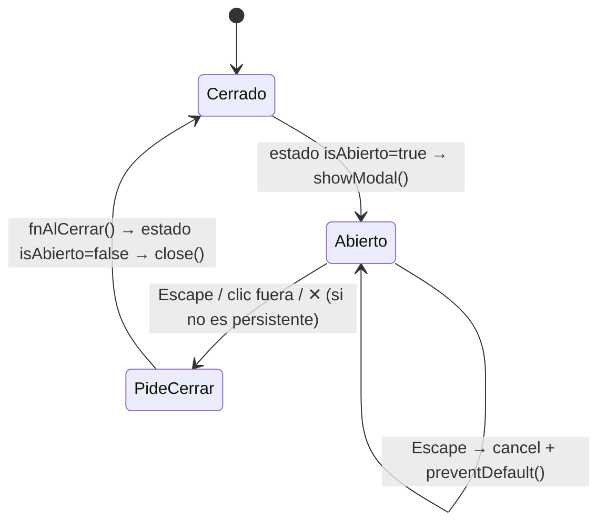

# Elemento dialog

> Elemento HTML nativo `<dialog>` para ventanas modales y no modales, con capa superior (*top layer*), fondo `::backdrop`, foco atrapado y cierre con Escape incluidos.

## Qué es y qué problema resuelve
Antes de `<dialog>`, un modal se hacía con un `div` posicionado, `z-index` alto, un fondo oscuro a mano, código para atrapar el foco y para cerrar con Escape. Era fácil equivocarse en accesibilidad.

`<dialog>` lo trae resuelto por el navegador: `showModal()` lo pinta por encima de todo, vuelve *inerte* el resto de la página (no se puede hacer clic ni tabular fuera), y Escape lo cancela.

## Cómo funciona por dentro
- `dialog.showModal()`: abre como **modal**, en el *top layer* (por encima de cualquier `z-index`), con `::backdrop` y el resto del documento inerte.
- `dialog.show()`: abre como **no modal** (sin backdrop ni bloqueo).
- `dialog.close(valor?)`: cierra y dispara el evento `close`; `returnValue` guarda el valor.
- `dialog.open`: booleano que indica si está abierto (refleja el atributo `open`).
- **Evento `cancel`**: se dispara al pulsar Escape (o la solicitud de cierre del sistema). Si llamas `e.preventDefault()`, el diálogo **no** se cierra.
- **`::backdrop`**: pseudo-elemento estilable que cubre la ventana detrás del modal.
- `<form method="dialog">` dentro cierra el diálogo al enviar.
- Un clic en el backdrop llega al propio `<dialog>` como `target` (útil para "cerrar al hacer clic fuera").



## Cuándo usarla y cuándo no
### Ventajas
- Accesible por defecto (rol de diálogo, foco, inercia del fondo).
- Sin peleas de `z-index` ni overlays manuales.
- Cero dependencias.
### Desventajas
- Su estado "abierto" vive en el DOM: con vistas declarativas hay que sincronizarlo con el estado de la app.
- `showModal()` lanza error si el elemento no está conectado al documento o ya está abierto como no modal.
- El estilo por defecto (borde, padding, tamaño máximo) suele tener que resetearse.
- Animar apertura y cierre requiere CSS más reciente.

## Alternativas
| Alternativa | En qué se diferencia |
|---|---|
| `div` + overlay a mano | Control total, pero hay que implementar foco, Escape, inercia y capas. |
| Atributo `popover` | Para menús y tooltips no modales; no vuelve inerte la página. |
| Librerías (a11y-dialog, Headless UI, MUI Dialog) | Más funciones/animaciones; dependencia extra o ligada a framework. |
| `confirm()` / `alert()` nativos | Bloquean el hilo, no se pueden estilar; Iris los reemplaza con `fnUiConfirmacion`. |

## Cómo se usó en Ocelotl
En [[Ocelotl.Iris]], `shared/components/ui-modal.js` envuelve `<dialog>` en un componente de [[lit-html]] **controlado** (ver [[Componentes controlados]]):
- Se abre y cierra solo con la prop `isAbierto` que viene del estado de la pantalla.
- La directiva `ref` entrega el `<dialog>` real y, en un `queueMicrotask` (para que ya esté en el documento), llama `showModal()` o `close()` según corresponda.
- El evento `cancel` (Escape) hace `preventDefault()`: **el navegador no cierra solo**; se llama `fnAlCerrar` y el estado decide.
- Clic fuera de la caja (`e.target == e.currentTarget`) también llama `fnAlCerrar`.
- `isPersistente` desactiva Escape, clic fuera y el botón ✕ (p. ej. mientras se procesa una confirmación).
- `fnUiConfirmacion` construye sobre él un "¿Seguro?" con Cancelar / Confirmar, en lugar de `confirm()`.

`Ocelotl.Iris/src/shared/components/ui-modal.js`:
```js
const fnSincronizar = (isAbierto) => (Dialogo) => {
    if (!Dialogo) return
    queueMicrotask(() => {
        if (!Dialogo.isConnected) return
        if (isAbierto && !Dialogo.open) Dialogo.showModal()
        if (!isAbierto && Dialogo.open) Dialogo.close()
    })
}
// ...
const fnAlCancelar = (e) => {
    // Escape: el estado decide, no el navegador.
    e.preventDefault()
    if (!isPersistente) fnAlCerrar?.()
}
```

Estilos del `<dialog>` y su fondo (`Ocelotl.Iris/src/shared/components/ui-modal.css`):
```css
.ui-modal {
    padding: 0;
    border: none;
    background: transparent;
    width: min(420px, 92vw);
}
.ui-modal::backdrop { background: rgba(0, 0, 0, .45); }
```

Dónde se usa:
- `core/layout.js`: confirmación de "¿Cerrar sesión?" ([[Sesión y roles]]).
- `features/ingresos/ingresos.view.js`: modal de registro de ingreso ([[Ingresos]]).
- `features/reportes/reportes.view.js`: modales de cajas y de egreso ([[Stock e inventario]], [[Trazabilidad por caja]], [[Historial de salidas]]).

> [!warning] Pendiente de confirmar
> `styles/main.css` importa `./components/modal.css` (y `ui-modal.css` dice que la caja `.modal` se estiliza ahí), pero ese archivo no está en la copia revisada de `src/styles/components/` (solo existe `toast.css`).

> [!tip] Reutilizable
> El patrón "dialog controlado: `ref` + `queueMicrotask` para sincronizar `showModal/close` con el estado, y `cancel` con `preventDefault()`" sirve con cualquier librería declarativa (lit-html, React, Vue).

## Errores comunes y buenas prácticas
- Llamar `showModal()` antes de que el elemento esté en el documento → `InvalidStateError` (Iris espera un microtask y revisa `isConnected`).
- Dejar que Escape cierre el diálogo sin actualizar el estado: el DOM y el estado quedan desincronizados. Usar `cancel` + `preventDefault()`.
- Usar `show()` cuando se quería un modal (no bloquea el fondo).
- Olvidar `aria-label` o un título visible.
- Resetear `padding`, `border` y `max-width` del estilo por defecto si la caja visible es un elemento interno.
- No renderizar el contenido pesado del modal cuando está cerrado (Iris pinta `Contenido` solo si `isAbierto`).

## Qué estudiar después
- [[Componentes controlados]]
- [[lit-html]] (directiva `ref`)
- Atributo `popover` y *top layer*.
- Atributo `inert` y gestión del foco.

## Documentación oficial
- https://developer.mozilla.org/en-US/docs/Web/HTML/Element/dialog
- https://developer.mozilla.org/en-US/docs/Web/API/HTMLDialogElement
- https://developer.mozilla.org/en-US/docs/Web/API/HTMLDialogElement/cancel_event
- https://developer.mozilla.org/en-US/docs/Web/CSS/::backdrop

## Autoevaluación

Contesta primero en voz alta o en papel; luego despliega la respuesta.

> [!question]- ¿Qué diferencia hay entre `dialog.showModal()` y `dialog.show()`?
> `showModal()` abre en la *top layer*, con `::backdrop`, vuelve inerte el resto de la página y cierra con Esc. `show()` lo abre sin modalidad: el resto de la página sigue interactuable.

> [!question]- ¿Cómo obtienes qué botón cerró el diálogo?
> Un `<form method="dialog">` dentro del diálogo lo cierra al enviarse y asigna el `value` del botón a `dialog.returnValue`; lo lees en el evento `close`.

> [!question]- Error común: abrir el modal con `dialog.setAttribute('open', '')`. ¿Qué falla?
> Lo muestra como no modal: sin backdrop, sin foco atrapado y sin cerrar con Esc. Usa siempre `showModal()` para modales.

