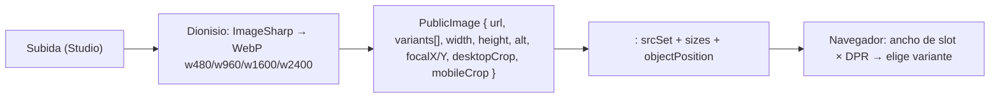

# Imágenes responsive

> Servir a cada pantalla la imagen del tamaño que necesita (`srcset` + `sizes`) y encuadrarla bien en cualquier proporción (`object-fit` + `object-position` o recorte).

## Qué es y qué problema resuelve
Una foto de 4000 px descargada en un celular desperdicia datos y tiempo; una de 400 px en una pantalla grande se ve borrosa. Además, el mismo retrato se muestra en marcos 4:5, 1:1 o 16:9 y no debe cortar la cara. Las imágenes responsive combinan:
- **Variantes por ancho** (p. ej. 480, 960, 1600, 2400 px) en un formato eficiente (WebP).
- **`srcset` con descriptores `w`** y **`sizes`**: el navegador elige la variante según el ancho que ocupará la imagen y la densidad de píxeles.
- **Encuadre**: `object-fit: cover` + `object-position` (punto focal) o un recorte guardado.
- **Carga**: `loading="lazy"` fuera del primer pantallazo, `decoding="async"`, y `width`/`height` para reservar espacio (evita saltos de layout, CLS).

## Cómo funciona por dentro

- `sizes="(max-width: 760px) 70vw, 30vw"` dice "en móvil la imagen ocupa 70 % del viewport; si no, 30 %". Con eso y la densidad, el navegador calcula cuántos píxeles necesita y toma la variante más cercana por arriba.
- `object-position: 30% 20%` ancla ese punto del original al mismo punto del marco al recortar con `cover`.

## Cuándo usarla y cuándo no
### Ventajas
- Menos bytes en móvil; nitidez en pantallas grandes.
- Encuadre controlado por el creador, sin generar archivos recortados.
- Mejores métricas de carga (LCP, CLS).
### Desventajas
- Hay que generar y almacenar varias variantes.
- `sizes` mal escrito anula el beneficio (el navegador elige de más).
- El punto focal es aproximado; un recorte exacto requiere más lógica.

## Alternativas
| Alternativa | En qué se diferencia |
|---|---|
| `<picture>` con `<source media>` | Permite cambiar de imagen o recorte por breakpoint (*art direction*), no solo de tamaño. |
| CDN de imágenes (redimensiona por URL) | Variantes al vuelo; dependencia y costo externos. |
| `x` descriptors (`1x`, `2x`) | Para imágenes de ancho fijo (íconos, logos). |
| Una sola imagen grande | Simple; lenta en móvil. |

## Cómo se usó en Itzamna
**Back** ([[Itzamna.Dionisio]], ver [[Biblioteca de medios]] y [[ImageSharp]]): al subir una imagen se generan variantes WebP con anchos `MediaRules.VariantWidths = [480, 960, 1600, 2400]` (solo los menores al original, más uno del ancho real con tope 2400) y se guardan como `w{ancho}.webp`. `PortfolioSnapshotBuilder` las publica como `PublicImageVariantDto(Url, Width)`.

**Front** ([[Itzamna.Clio]]):
- `packages/portfolio-core/src/image.ts`: `srcSet(img)` arma `"url 480w, url 960w, …"`, `focalPosition(img)` convierte `focalX/focalY` (0–1) en porcentajes.
- `packages/templates/src/shared/Img.tsx`: componente único que usan todas las secciones de la plantilla Editorial ([[Plantillas y diseño]]).

`Itzamna.Clio/packages/templates/src/shared/Img.tsx`:
```tsx
const crop = mobile ? img.mobileCrop ?? img.desktopCrop : img.desktopCrop ?? img.mobileCrop;
const objectPosition = crop
  ? `${Math.round((crop.x + crop.width / 2) * 100)}% ${Math.round((crop.y + crop.height / 2) * 100)}%`
  : focalPosition(img);
return (
  
);
```

- `sizes` por uso: Hero `(max-width: 760px) 70vw, 30vw` con `eager` (está en el primer pantallazo); historias `(max-width: 760px) 74vw, 30vw`; logos de marcas `200px`.
- Móvil vs desktop con `useIsMobile()` = `matchMedia('(max-width: 760px)')` (`shared/hooks.ts`).
- El `alt` viene de `MediaReference.alt` (lo escribe el creador en `MediaField`) o del título del contenido; los logos decorativos usan `alt=""`.
- Sin imagen se pinta un `span.ph-empty` con `aria-hidden`.
- Recortes y punto focal se eligen en el Studio con [[react-easy-crop]].
- `apps/studio` usa `thumbUrl` (la variante ≥ 480 px, calculada en `MediaFeatures`) para miniaturas.

> [!note] Pendiente de confirmar
> El recorte se aproxima con `object-position` en el centro del área (sin zoom); `cropStyle()` de `image.ts` haría el encuadre exacto pero no se usa. Tampoco se usa `<picture>`, así que el cambio de recorte móvil/desktop depende de JavaScript (`useIsMobile`) y no del navegador.

> [!tip] Reutilizable
> `srcSet()` + `focalPosition()` + un componente `Img` con `sizes` obligatorio por uso es un patrón chico y portable.

## Errores comunes y buenas prácticas
- Omitir `sizes` con descriptores `w`: el navegador asume `100vw` y descarga de más.
- `loading="lazy"` en la imagen principal (LCP): retrasa lo más visible. Usa `eager` ahí.
- No poner `width`/`height`: la página salta al cargar.
- `alt` vacío en imágenes con contenido, o descriptivo en las decorativas.
- Generar variantes más anchas que el original: no ganan nitidez (Dionisio las limita).

## Qué estudiar después
- `<picture>` y *art direction*
- `fetchpriority="high"` para la imagen LCP
- Formatos AVIF vs WebP
- [[ImageSharp]] y [[Azure Blob Storage]] (dónde se generan y guardan las variantes)

## Documentación oficial
- https://developer.mozilla.org/en-US/docs/Web/HTML/Responsive_images
- https://developer.mozilla.org/en-US/docs/Web/HTML/Element/img#srcset
- https://developer.mozilla.org/en-US/docs/Web/CSS/object-position
- https://web.dev/articles/browser-level-image-lazy-loading

## Autoevaluación

Contesta primero en voz alta o en papel; luego despliega la respuesta.

> [!question]- ¿Qué diferencia hay entre `srcset` + `sizes` y `<picture>`?
> `srcset`/`sizes`: mismas imágenes en varios tamaños y el navegador escoge la adecuada (*resolution switching*). `<picture>` con `<source media|type>`: tú decides recortes distintos (*art direction*) o formatos (AVIF/WebP con respaldo).

> [!question]- ¿Por qué debes poner `width` y `height` en ``?
> El navegador reserva el espacio con esa proporción antes de descargar la imagen y evitas saltos de diseño (CLS).

> [!question]- ¿Cuándo NO usar `loading="lazy"`?
> En la imagen principal visible al cargar (la que suele ser el LCP): retrasarla empeora el LCP. Para esa usa carga normal y, si acaso, `fetchpriority="high"`.

## Práctica

- [[Lab 8 - Medir Core Web Vitals con DevTools y Lighthouse]]

