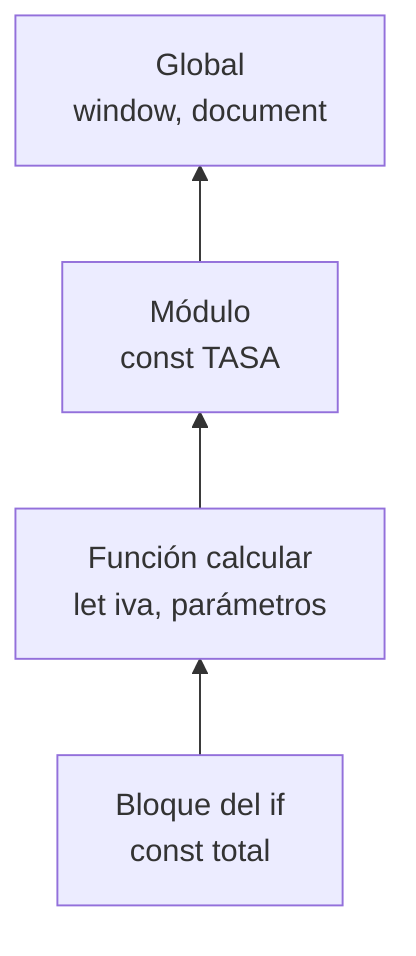

# Alcance (scope)

Parte de: [[04-JavaScript-Web/02 Básico de JavaScript/_Índice Básico de JavaScript|Básico de JavaScript]]

> [!info] Cómo avanzar
> `progreso`: **pendiente** → **viendo** (estudiando) → **visto** (contestaste la autoevaluación sin abrir las respuestas) → **dominado** (hiciste el laboratorio o lo aplicaste de verdad).

## Contenido

### Qué es
El **alcance** (*scope*) es la región del código donde un nombre (variable, función, clase) es visible. JavaScript usa **alcance léxico**: lo que una función puede ver depende de **dónde está escrita**, no de desde dónde se llama. Entender el alcance explica [[Closures]], [[Hoisting]] y la diferencia práctica entre [[var, let y const]].

### Tipos de alcance
1. **Global**: lo declarado fuera de toda función o bloque en un script clásico. En el navegador, `var` y las funciones globales se vuelven propiedades de `window`; `let`, `const` y `class` globales no.
2. **De módulo**: en un archivo cargado como módulo (`<script type="module">` o `import`), lo de nivel superior es privado del módulo; solo sale lo que exportas. Ver [[ES Modules e import maps]].
3. **De función**: cada función crea su propio alcance; parámetros y variables internas no se ven desde fuera.
4. **De bloque**: cada par de llaves `{ }` (de un `if`, `for`, `while`, `try` o un bloque suelto) crea un alcance para `let`, `const` y `class`. **`var` ignora los bloques**: solo respeta funciones.

### Cómo funciona: la cadena de alcances
Cuando el motor encuentra un nombre, lo busca en el alcance actual; si no está, sube al alcance que lo contiene, y así hasta el global. Si no lo encuentra, lanza `ReferenceError`.



La búsqueda solo va **hacia afuera**: el alcance externo nunca ve las variables de uno interno.

```js
const TASA = 0.16;                 // alcance de módulo

function calcular(subtotal) {      // alcance de función
  let iva = subtotal * TASA;       // ve TASA subiendo un nivel
  if (subtotal > 1000) {
    const descuento = 50;          // alcance de bloque
    iva -= descuento * TASA;
  }
  // console.log(descuento);       // ReferenceError: fuera de su bloque
  return subtotal + iva;
}
```

### Shadowing (sombreado)
Ocurre cuando declaras en un alcance interno un nombre que ya existe en uno externo. El interno **tapa** al externo dentro de su región; el externo no cambia.

```js
const estado = 'global';
function procesar() {
  const estado = 'local';   // sombrea al externo
  console.log(estado);      // 'local'
}
procesar();
console.log(estado);        // 'global'
```

Es legal y a veces útil, pero confunde cuando es accidental (un parámetro que se llama igual que una variable de módulo). ESLint tiene la regla `no-shadow` para detectarlo.

### Asignar a una variable no declarada
En **modo no estricto** (script clásico sin `'use strict'`), `total = 10` sin `let`/`const`/`var` crea silenciosamente una **variable global** (propiedad de `window`). Es una fuente clásica de errores: un typo crea una global nueva en lugar de fallar.

En **modo estricto** lanza `ReferenceError: total is not defined`. Los **módulos ES y el cuerpo de las clases son estrictos automáticamente**, así que si trabajas con módulos (como tu front en ES2022 sin bundler) ya estás protegido.

### Ejemplo
En el molde de servicio de Itzamna, el estado privado vive en el alcance del módulo:

```js
// pedidos-service.js (módulo)
const cache = new Map();          // no se exporta: nadie de fuera puede tocarlo

export async function obtenerPedido(id) {
  if (cache.has(id)) return cache.get(id);
  const r = await fetch(`/api/pedidos/${id}`);
  const pedido = await r.json();  // alcance de función
  cache.set(id, pedido);
  return pedido;
}
```

`cache` es visible para `obtenerPedido` por alcance léxico, pero inaccesible desde los archivos que importan el módulo.

### Cuándo usarlo y cuándo no
Declara cada variable en el **alcance más pequeño** que la necesite: dentro del bloque o función donde se usa. Prefiere alcance de módulo a globales. Evita depender de `window` para compartir datos entre archivos; usa `export`/`import`.

### Errores comunes
- **Globales accidentales** por olvidar `let`/`const` en código no estricto.
- **Esperar que `var` respete bloques**: `if (x) { var y = 1 }` deja `y` visible en toda la función.
- **Sombreado involuntario** de un parámetro o import.
- **Confundir alcance con `this`**: el alcance es léxico; `this` depende de la llamada (ver [[this en JavaScript]]).

### Para profundizar
- [Alcance (glosario MDN)](https://developer.mozilla.org/en-US/docs/Glossary/Scope)
- [Declaraciones y alcance de bloque (MDN)](https://developer.mozilla.org/en-US/docs/Web/JavaScript/Reference/Statements/block)
- [Modo estricto (MDN)](https://developer.mozilla.org/en-US/docs/Web/JavaScript/Reference/Strict_mode)

## Autoevaluación

Contesta primero en voz alta o en papel; luego despliega la respuesta.

> [!question]- ¿Qué tipos de alcance hay en JS?
> Global, de módulo, de función y de bloque (`let`/`const` dentro de `{}`). El alcance es **léxico**: depende de dónde está escrito el código, no de dónde se llama.

> [!question]- ¿Qué es el *shadowing*?
> Declarar en un alcance interno una variable con el mismo nombre que una externa; dentro, la interna "tapa" a la externa.

> [!question]- ¿Qué pasa si asignas a una variable no declarada?
> En modo no estricto crea una global sin querer; en modo estricto (y en módulos ES) lanza `ReferenceError`.

