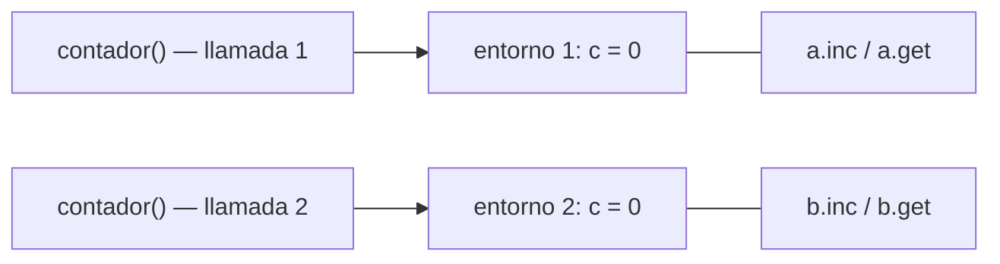

# Closures

Parte de: [[04-JavaScript-Web/02 Básico de JavaScript/_Índice Básico de JavaScript|Básico de JavaScript]]

> [!info] Cómo avanzar
> `progreso`: **pendiente** → **viendo** (estudiando) → **visto** (contestaste la autoevaluación sin abrir las respuestas) → **dominado** (hiciste el laboratorio o lo aplicaste de verdad).

## Contenido

### Qué es
Un **closure** (clausura) es una función junto con **las variables del alcance donde fue creada**, que sigue pudiendo usar aunque ese alcance ya haya terminado de ejecutarse. En JavaScript, toda función es un closure: recuerda su entorno léxico (ver [[Alcance (scope)]]). Es la base de la privacidad de datos, las fábricas de funciones, los callbacks y los hooks de React.

### Cómo funciona
Cuando se ejecuta una función, el motor crea un **entorno** con sus variables. Normalmente se descarta al terminar, pero si alguna función interna creada ahí sigue viva (porque la devolviste, la guardaste en un listener o en un `setTimeout`), esa función conserva una **referencia** al entorno, y el recolector de basura no lo libera.



Dos ideas que lo explican todo:
1. **Se captura la variable, no su valor**: si la variable cambia después, el closure ve el valor nuevo.
2. **Cada ejecución crea un entorno nuevo**: dos llamadas a la misma fábrica producen closures independientes.

```js
function contador() {
  let c = 0;                         // vive en el entorno de esta llamada
  return { inc: () => ++c, get: () => c };
}
const a = contador();
const b = contador();
a.inc(); a.inc(); b.inc();
console.log(a.get(), b.get());       // 2 1
```

### El clásico `for (var i ...)`
```js
var fs = [];
for (var i = 0; i < 3; i++) fs.push(() => i);
fs.map(f => f());   // [3, 3, 3]
```

`var` tiene alcance de función: hay **una sola** `i` para todo el bucle. Las tres flechas capturan esa misma variable, y cuando se ejecutan el bucle ya terminó con `i = 3`.

Con `let`, cada iteración del `for` crea **una variable nueva** con el valor de esa vuelta, así que cada flecha captura la suya: `[0, 1, 2]`. Ese es el arreglo moderno; la solución antigua era una función autoejecutable (IIFE) que recibía `i` como parámetro.

### Usos prácticos
- **Estado privado** sin clases (como `contador`).
- **Fábricas de funciones** configuradas: `const conIva = crearCalculo(0.16)`.
- **Callbacks y listeners** que recuerdan datos del momento en que se registraron.
- **Memoización y `once`**: guardar resultados entre llamadas.
- **[[Debounce y throttle]]**: guardan el temporizador entre llamadas.
- **Hooks de React**: cada render crea closures nuevos sobre las props y el estado de ese render (el famoso "estado viejo" en un `useEffect` es un closure sobre un render anterior).

### Ejemplo
Formateador de moneda configurado una sola vez y un `once` para inicializar:

```js
function crearFormateador(moneda) {
  const fmt = new Intl.NumberFormat('es-MX', { style: 'currency', currency: moneda });
  return (n) => fmt.format(n);       // closure sobre fmt
}
const mxn = crearFormateador('MXN');
mxn(1500);                           // "$1,500.00"

function once(fn) {
  let llamado = false, resultado;
  return (...args) => {
    if (!llamado) { llamado = true; resultado = fn(...args); }
    return resultado;
  };
}
const cargarConfig = once(() => fetch('/config.json').then(r => r.json()));
cargarConfig(); cargarConfig();      // solo una petición; ambas reciben la misma promesa
```

### Closures y memoria
Un closure mantiene vivo **todo lo que referencia**. Si un listener o un `setInterval` que nunca se quita captura un arreglo grande o un nodo del DOM, ese dato no se libera aunque ya no lo uses: es una fuga. Se evita **quitando** listeners e intervalos cuando el componente se destruye (`removeEventListener`, `clearInterval`, `AbortController`, la función de limpieza de `useEffect`) y no capturando más de lo necesario. Ver [[Fugas de memoria]].

### Cuándo usarlo y cuándo no
Úsalos con naturalidad; son la forma idiomática de encapsular en JS funcional. Si el estado privado crece y tiene muchos métodos, una clase con [[Campos privados en clases JS]] puede leerse mejor.

### Errores comunes
- **`var` en bucles con callbacks**: usa `let`.
- **Esperar que el closure "congele" el valor**: captura la variable viva.
- **Estado viejo en React** por un closure de un render anterior: dependencias correctas o actualización funcional `setX(x => x + 1)`.
- **Fugas** por listeners o timers no limpiados.

### Para profundizar
- [Closures (MDN)](https://developer.mozilla.org/en-US/docs/Web/JavaScript/Guide/Closures)
- [`let` en bucles (MDN)](https://developer.mozilla.org/en-US/docs/Web/JavaScript/Reference/Statements/let)
- [Gestión de memoria (MDN)](https://developer.mozilla.org/en-US/docs/Web/JavaScript/Guide/Memory_management)

## Ejercicios

Resuélvelos en papel o en la herramienta; la solución está plegada.

> [!question]- ¿Qué imprime este código?
> ```js
> var fs = [];
> for (var i = 0; i < 3; i++) fs.push(() => i);
> console.log(fs.map(f => f()).join(','));
> ```
>
> > [!success]- Respuesta
> > `3,3,3`.

> [!question]- Mismo código con `let i`. ¿Qué imprime?
> `0,1,2`.

> [!question]- ¿Qué imprime este código?
> ```js
> function contador() { let c = 0; return { inc: () => ++c, get: () => c }; }
> const a = contador(), b = contador();
> a.inc(); a.inc(); b.inc();
> console.log(a.get(), b.get());
> ```
>
> > [!success]- Respuesta
> > `2 1`: cada llamada a `contador()` crea su propio `c`.

> [!question]- Implementa `once(fn)`: la primera llamada ejecuta `fn` y las siguientes devuelven el mismo resultado.
> ```js
> function once(fn) {
>   let hecho = false, r;
>   return (...args) => {
>     if (!hecho) { hecho = true; r = fn(...args); }
>     return r;
>   };
> }
> const doble = once(x => x * 2);
> doble(2); // 4
> doble(5); // 4
> ```

## Autoevaluación

Contesta primero en voz alta o en papel; luego despliega la respuesta.

> [!question]- ¿Qué es un closure?
> Una función junto con las variables del alcance donde se creó; las sigue "recordando" aunque ese alcance ya terminó. Toda función en JS es un closure.

> [!question]- ¿Para qué se usan en la práctica?
> Estado privado (contadores, módulos), fábricas de funciones (`crearSaludo('Hola')`), `debounce`/`once`, y callbacks que necesitan datos del momento en que se crearon.

> [!question]- Error clásico: `for (var i...)` con callbacks. ¿Qué pasa y cómo se arregla?
> Todos los callbacks comparten la misma `i` (alcance de función) y ven su valor final. Con `let`, cada iteración tiene su propia `i`.

> [!question]- ¿Pueden los closures causar fugas de memoria?
> Sí: mientras la función viva (p. ej. un listener registrado), retiene las variables que captura, aunque sean objetos grandes. Quita listeners que ya no necesitas.

## Práctica

- [[Lab 2 - Predecir la salida de JavaScript (coerción, closures y this)]]

