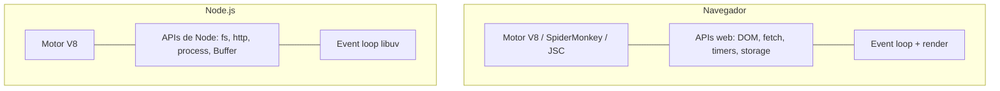

# Cómo se ejecuta JavaScript (navegador y Node)

Parte de: [[04-JavaScript-Web/02 Básico de JavaScript/_Índice Básico de JavaScript|Básico de JavaScript]]

> [!info] Cómo avanzar
> `progreso`: **pendiente** → **viendo** (estudiando) → **visto** (contestaste la autoevaluación sin abrir las respuestas) → **dominado** (hiciste el laboratorio o lo aplicaste de verdad).

## Contenido

### Qué es
JavaScript es un lenguaje definido por la especificación **ECMAScript**; para ejecutarlo hace falta un **motor** (V8 en Chrome, Edge y Node.js; SpiderMonkey en Firefox; JavaScriptCore en Safari) y un **entorno anfitrión** (*host*) que le da acceso al mundo exterior. El mismo código de lenguaje corre en el navegador y en Node, pero las APIs disponibles son distintas.

### Cómo funciona
**El motor** se encarga del lenguaje puro:
1. **Analiza** (*parsea*) el código y construye un árbol de sintaxis.
2. Lo **compila a bytecode** y lo empieza a ejecutar con un intérprete.
3. Las funciones que se usan mucho ("calientes") se **recompilan con un compilador JIT** a código máquina optimizado, basándose en los tipos observados. Si esas suposiciones fallan, desoptimiza.
4. Administra la memoria con un **recolector de basura**.
5. Mantiene la **pila de llamadas** (*call stack*) y el **heap** de objetos.

El motor solo sabe de objetos, funciones, promesas, `Array`, `Map`, `JSON`, `Math`… No sabe qué es una ventana, un archivo ni una red.

**El entorno** agrega:
- **Navegador**: `window`, `document` (el DOM), `fetch`, `localStorage`, `setTimeout`, eventos de usuario, `Worker`, Canvas, WebSocket.
- **Node.js**: `process`, módulos como `node:fs` (archivos), `node:http`, `node:path`, `Buffer`; también `fetch` y `setTimeout` (implementados por Node, no por V8). La E/S la gestiona la biblioteca libuv.

Ambos aportan el **event loop** y las colas de tareas que permiten la asincronía.



### Un solo hilo
Que JS sea **de un solo hilo** significa que tu código se ejecuta en **una sola pila de llamadas**: una cosa a la vez, cada función corre hasta terminar sin que otra la interrumpa. Consecuencias:
- No hay condiciones de carrera clásicas entre líneas de tu código (no necesitas `lock`).
- Si una tarea tarda (un bucle de 2 segundos, un `JSON.parse` enorme), **bloquea todo**: en el navegador la página se congela porque el mismo hilo también pinta y atiende clics.
- La espera de E/S (red, disco, timers) **no** ocupa el hilo: el entorno la hace por fuera y, cuando termina, encola un callback que el **event loop** ejecuta cuando la pila está vacía. Así un solo hilo atiende muchas operaciones concurrentes. Ver [[Event loop]].

Para cómputo pesado real existen hilos aparte: **Web Workers** en el navegador y **worker_threads** en Node, que se comunican por mensajes.

### Ejemplo
```js
// app.js
console.log(typeof document);  // navegador: "object"; Node: "undefined"
console.log(typeof process);   // navegador: "undefined"; Node: "object"

document.querySelector('h1');  // en Node: ReferenceError: document is not defined
```

Si corres con `node app.js` un script que usa `document`, falla con **`ReferenceError: document is not defined`**, porque Node no tiene DOM. Opciones: ejecutar ese código en el navegador; separar la lógica pura (cálculos, validaciones) en módulos sin DOM para poder probarla en Node con Vitest; o, para pruebas, usar un DOM simulado como jsdom o happy-dom.

Para código que corre en ambos, usa `globalThis` (el objeto global en cualquier entorno) y detecta capacidades: `if (typeof window !== 'undefined') { ... }`.

En tu stack, el front de Itzamna.Clio corre en el navegador, mientras que herramientas como Vite, ESLint o los scripts de build de Azure DevOps corren en Node (ver [[Node.js básico]]).

### Cuándo usarlo y cuándo no
Saber qué es del lenguaje y qué es del entorno te evita buscar `fs` en el navegador o `document` en Node, y te ayuda a leer la documentación correcta (MDN para web; nodejs.org para Node). Cuando una pantalla se congela, piensa primero en código síncrono largo bloqueando el hilo.

### Errores comunes
- **Usar APIs del DOM en Node** (o `require`/`fs` en el navegador).
- **Creer que `setTimeout` o `fetch` son parte de JavaScript**: son del entorno; por eso su comportamiento fino difiere entre navegador y Node.
- **Bloquear el hilo** con bucles largos y culpar a la red.
- **Pensar que "asíncrono" significa "en otro hilo"**: tu callback siempre vuelve a correr en el hilo principal.

### Para profundizar
- [Introducción a JavaScript (MDN)](https://developer.mozilla.org/en-US/docs/Web/JavaScript/Guide/Introduction)
- [Modelo de ejecución de JavaScript (MDN)](https://developer.mozilla.org/en-US/docs/Web/JavaScript/EventLoop)
- [Diferencias entre Node.js y el navegador (Node.js)](https://nodejs.org/learn/getting-started/differences-between-nodejs-and-the-browser)
- [Blog del motor V8](https://v8.dev/)

## Autoevaluación

Contesta primero en voz alta o en papel; luego despliega la respuesta.

> [!question]- ¿Qué es un motor de JavaScript y qué agrega el entorno (navegador o Node)?
> El motor (V8, SpiderMonkey, JavaScriptCore) interpreta/compila el lenguaje. El entorno aporta las APIs: el navegador da DOM, `fetch`, `localStorage`; Node da `fs`, `process`, módulos de red. `setTimeout` lo proveen ambos entornos, no el lenguaje.

> [!question]- ¿Qué significa que JS sea de un solo hilo?
> Tu código corre en un único hilo con una pila de llamadas; lo asíncrono (red, timers) lo hace el entorno y te avisa con callbacks que el event loop ejecuta cuando la pila queda vacía. Un cálculo largo bloquea la página.

> [!question]- Caso: tu script usa `document` y lo corres con `node app.js`. ¿Qué pasa?
> `ReferenceError: document is not defined`: Node no tiene DOM. El objeto global común a ambos es `globalThis`.

