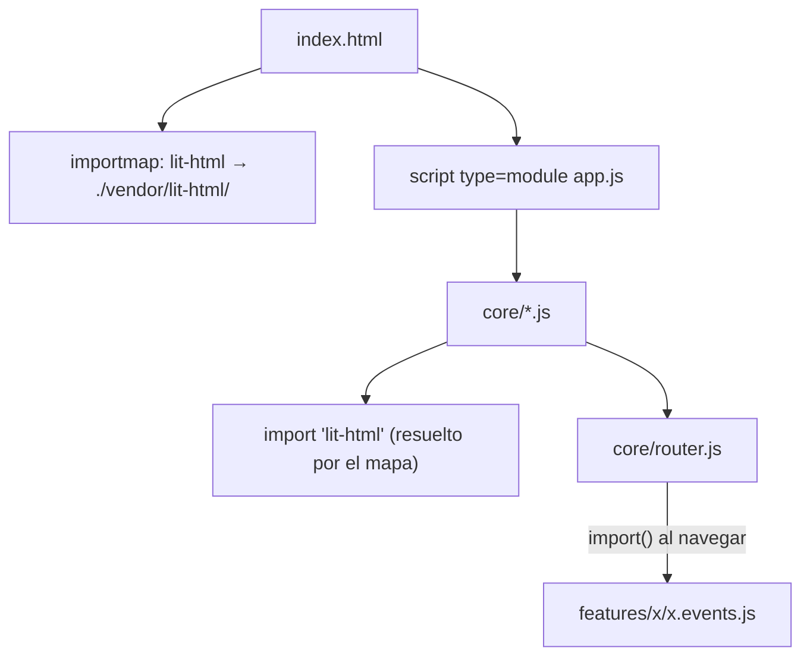

# ES Modules e import maps
> [!warning] Iris ya no usa import map ni `vendor.mjs`
> Desde el 2026-11-08, [[Ocelotl.Iris]] se empaqueta con [[Vite]]: importa lit-html y SignalR directo de `node_modules`, y `scripts/vendor.mjs`, `src/vendor/` y el import map se quitaron. Los **ES modules** siguen siendo la base del código. Las secciones sobre el import map describen cómo estaba antes.


> Sistema de módulos nativo de JavaScript (`import` / `export`) más un mapa en el HTML que traduce nombres de paquete como `'lit-html'` a rutas reales, sin necesidad de bundler.

## Qué es y qué problema resuelve
- **ES Modules (ESM)**: cada archivo es un módulo con su propio ámbito; comparte lo que exporta con `export` y usa lo de otros con `import`. El navegador los carga con `<script type="module">`.
- **Import maps**: un `<script type="importmap">` con JSON que dice al navegador "cuando alguien importe `lit-html`, búscalo en `./vendor/lit-html/lit-html.js`". Sin él, el navegador solo entiende rutas relativas o URLs (`'./x.js'`), no *bare specifiers* (`'lit-html'`).
- **`import()` dinámico**: carga un módulo bajo demanda y devuelve una promesa.

Juntos permiten escribir código moderno modular **sin bundler** (Webpack, Vite, Rollup): lo que está en disco es lo que corre.

## Cómo funciona por dentro
- El navegador construye un grafo de módulos a partir del punto de entrada, descarga cada dependencia una vez y la evalúa una sola vez (los módulos son *singletons*: el estado de nivel de módulo se comparte).
- Los módulos corren en modo estricto y con `defer` implícito.
- Las importaciones estáticas se resuelven antes de ejecutar; `import()` en tiempo de ejecución.
- El import map se debe declarar **antes** de cualquier `<script type="module">`. Una entrada con `/` final (`"lit-html/"`) mapea un prefijo: `'lit-html/directives/repeat.js'` → `./vendor/lit-html/directives/repeat.js`.
- `import.meta.url` da la URL del módulo actual (útil en scripts Node ESM).



## Cuándo usarla y cuándo no
### Ventajas
- Cero configuración de build; depurar es leer los mismos archivos que escribiste.
- Carga perezosa natural con `import()` (cada pantalla solo se baja al visitarla).
- Funciona offline si las dependencias están copiadas localmente.
### Desventajas
- Sin *tree-shaking*, minificación ni transpilación: se sirve el código tal cual.
- Muchas peticiones pequeñas (irrelevante desde disco en Electron; importante en web).
- Paquetes npm que solo publican CommonJS o dependen de otros bare specifiers necesitan más entradas en el mapa o no funcionan.
- No hay TypeScript ni JSX sin un paso de compilación.

## Alternativas
| Alternativa | En qué se diferencia |
|---|---|
| Vite / esbuild / Rollup / Webpack | Empaquetan, minifican y resuelven bare specifiers en build; añaden toolchain. |
| CommonJS (`require`) | Sistema de Node; no corre en el navegador sin bundler. |
| `<script>` clásicos + globales | Lo que Iris hace con SignalR (`window.signalR`); sin aislamiento de ámbito. |
| CDN con ESM (esm.sh, unpkg) | Sin copiar archivos, pero requiere internet y debilita la [[Content Security Policy]]. |

## Cómo se usó en Ocelotl
En [[Ocelotl.Iris]] no hay bundler:
- `src/index.html` declara el import map para `lit-html` y carga `app.js` como módulo. SignalR se carga aparte como script clásico.
- `scripts/vendor.mjs` (script Node ESM) copia de `node_modules` a `src/vendor/` solo los `.js` de producción de lit-html (raíz y `directives/`) más su `LICENSE`, y `signalr.min.js`. Así Iris funciona sin internet.
- `core/router.js` usa `import()` dinámico para cargar el `*.events.js` de la pantalla destino (ver [[SPA y router por hash]]).

`Ocelotl.Iris/src/index.html`:
```html
<script type="importmap">
  {
    "imports": {
      "lit-html": "./vendor/lit-html/lit-html.js",
      "lit-html/": "./vendor/lit-html/"
    }
  }
</script>
<script src="vendor/signalr/signalr.min.js"></script>
<!-- ... -->
<script type="module" src="app.js"></script>
```

`Ocelotl.Iris/src/core/router.js`:
```js
const Base = `features/${Ruta.Feature}/${Ruta.Feature}`
const [Html, Modulo] = await Promise.all([
    fnCargarTexto(`${Base}.html`),
    import(`../${Base}.events.js`),
    fnCargarCss(`${Base}.css`)
])
```

Copiado de lit-html (`Ocelotl.Iris/scripts/vendor.mjs`):
```js
for (const Carpeta of ['', 'directives']) {
    mkdirSync(join(LitDestino, Carpeta), { recursive: true })
    for (const Archivo of readdirSync(join(LitOrigen, Carpeta))) {
        if (Archivo.endsWith('.js')) cpSync(join(LitOrigen, Carpeta, Archivo), join(LitDestino, Carpeta, Archivo))
    }
}
```

Como los módulos son singletons, `core/hermes.signal.js`, `core/robot.events.js` o `core/sesion.js` guardan estado global de la app simplemente en variables de módulo.

> [!warning] Importante
> El import map es un script *inline*; la [[Content Security Policy]] lo permite por su **hash sha256**. Si cambias una sola letra o espacio del import map, hay que recalcular el hash en el meta CSP o el navegador lo bloqueará.

> [!note] Confirmado
> `package.json` de Iris tiene `"postinstall": "node scripts/vendor.mjs"` y `"vendor": "node scripts/vendor.mjs"`: corre solo después de `npm install`, o a mano con `npm run vendor`.

> [!tip] Reutilizable
> "`vendor.mjs` copia solo lo necesario + import map local" es una receta para cualquier app de escritorio o intranet que deba funcionar sin internet y sin toolchain.

## Errores comunes y buenas prácticas
- Declarar el import map antes del primer `type="module"`; solo se admite uno (en navegadores modernos se pueden fusionar varios, pero no conviene depender de ello).
- Incluir la entrada con `/` final si importas subrutas (`lit-html/directives/...`).
- Escribir siempre la extensión `.js` en rutas relativas: el navegador no la adivina.
- En `import()` con plantillas de texto, controlar los valores (Iris solo usa `Feature` de su tabla `Rutas`, nunca texto del usuario).
- Recordar que `fetch()` no funciona con `file://` en Chromium; los módulos sí se cargan. Por eso Iris lee los `.html` con `XMLHttpRequest` (`core/cargador.js`).

## Qué estudiar después
- [[SPA y router por hash]]
- [[Content Security Policy]]
- [[lit-html]]
- Herramientas de build (Vite/esbuild) para cuando haga falta TypeScript o minificación.
- `modulepreload` para precargar módulos.

## Documentación oficial
- https://developer.mozilla.org/en-US/docs/Web/JavaScript/Guide/Modules
- https://developer.mozilla.org/en-US/docs/Web/HTML/Element/script/type/importmap
- https://developer.mozilla.org/en-US/docs/Web/JavaScript/Reference/Operators/import

## Autoevaluación

Contesta primero en voz alta o en papel; luego despliega la respuesta.

> [!question]- ¿Qué diferencia hay entre exportación nombrada y por defecto?
> Nombrada: `export function f` / `import { f } from './m.js'` (el nombre debe coincidir; puedes renombrar con `as`). Por defecto: `export default` / `import cualquierNombre from './m.js'`, una por módulo.

> [!question]- ¿Qué problema resuelve un import map?
> Permite usar especificadores "desnudos" (`import { html } from 'lit-html'`) en el navegador sin bundler, mapeándolos a una URL en `<script type="importmap">`.

> [!question]- ¿Qué características tiene un `<script type="module">` frente a uno clásico?
> Modo estricto siempre, alcance propio (sus variables no son globales), se difiere por defecto (como `defer`), se ejecuta una sola vez aunque se importe varias veces y admite `await` en el nivel superior.

> [!question]- Error común: `import { x } from './utils'` sin extensión en el navegador. ¿Qué pasa?
> El navegador pide literalmente `./utils` y da 404: sin bundler debes escribir la ruta completa `./utils.js`.

