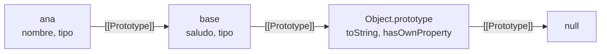

# Prototipos y herencia prototípica

Parte de: [[04-JavaScript-Web/02 Básico de JavaScript/_Índice Básico de JavaScript|Básico de JavaScript]]

> [!info] Cómo avanzar
> `progreso`: **pendiente** → **viendo** (estudiando) → **visto** (contestaste la autoevaluación sin abrir las respuestas) → **dominado** (hiciste el laboratorio o lo aplicaste de verdad).

## Contenido

### Qué es
JavaScript implementa la herencia con **prototipos**, no con clases al estilo de C#. Cada objeto tiene un enlace interno (`[[Prototype]]`) a **otro objeto**, su prototipo. Cuando lees una propiedad que el objeto no tiene, el motor la busca en su prototipo, luego en el prototipo de ese, y así sucesivamente. Ese camino es la **cadena de prototipos**, y es como los objetos "heredan" métodos y valores.

### Cómo funciona
**Lectura**: se busca la propiedad en el objeto; si no está, se sube por la cadena hasta encontrarla o llegar a `null` (entonces da `undefined`).

**Escritura**: asignar `obj.x = 1` crea o cambia la propiedad **en el propio objeto**, aunque exista `x` en el prototipo; no modifica el prototipo (la propiedad propia "tapa" a la heredada).

```js
const base = { saludo() { return 'Hola, ' + this.nombre; }, tipo: 'base' };
const ana = Object.create(base);   // ana → base → Object.prototype → null
ana.nombre = 'Ana';

ana.saludo();          // 'Hola, Ana': saludo viene de base, this es ana
ana.tipo;              // 'base' (heredado)
ana.tipo = 'propio';   // crea propiedad propia; base.tipo sigue 'base'
Object.hasOwn(ana, 'saludo');            // false
Object.getPrototypeOf(ana) === base;     // true
```



Así es como `[1, 2].map` funciona: `map` no está en tu arreglo, sino en `Array.prototype`; y `toString` está en `Object.prototype`, al final de casi todas las cadenas.

Para leer o cambiar el prototipo usa `Object.getPrototypeOf(obj)` y `Object.setPrototypeOf(obj, p)` (este último es lento; evítalo en código caliente). `__proto__` es un acceso heredado de compatibilidad; no lo uses en código nuevo.

### `F.prototype` y `new F()`
Toda función normal tiene una propiedad `prototype` (un objeto). Cuando haces `new F()`:
1. Se crea un objeto vacío **cuyo `[[Prototype]]` es `F.prototype`**.
2. Se ejecuta `F` con `this` apuntando a ese objeto.
3. Se devuelve el objeto (salvo que `F` devuelva otro objeto explícitamente).

```js
function Cliente(nombre) { this.nombre = nombre; }
Cliente.prototype.saludar = function () { return 'Hola, ' + this.nombre; };

const c = new Cliente('Luis');
Object.getPrototypeOf(c) === Cliente.prototype; // true
c.saludar();                                    // 'Hola, Luis'
c instanceof Cliente;                           // true: Cliente.prototype está en la cadena de c
```

Ojo con la terminología: `F.prototype` **no es** el prototipo de `F`; es el objeto que se usará como prototipo **de las instancias** creadas con `new F()`. El prototipo de la función `F` misma es `Function.prototype`.

Los métodos puestos en `F.prototype` existen **una sola vez** en memoria y todas las instancias los comparten.

### Clases y prototipos
Las clases (ver [[Clases en JS]]) **no reemplazan** a los prototipos: son **sintaxis** sobre el mismo mecanismo. Los métodos de una `class` terminan en `Clase.prototype`, y `extends` encadena `Hija.prototype` con `Padre.prototype`:

```js
class Pedido { total() { return 0; } }
class PedidoMayoreo extends Pedido {}

typeof Pedido;                                         // 'function'
Object.getPrototypeOf(PedidoMayoreo.prototype) === Pedido.prototype; // true
```

Las clases sí agregan cosas que el patrón de funciones no tenía: modo estricto, error si las llamas sin `new`, campos y [[Campos privados en clases JS]], `super`. Hoy se escriben clases; entender prototipos sirve para depurar, leer código antiguo y saber qué hace `instanceof`.

### Ejemplo
Ver la cadena en DevTools: escribe `console.dir(new PedidoMayoreo())` y despliega `[[Prototype]]` varias veces; verás `PedidoMayoreo.prototype`, luego `Pedido.prototype`, luego `Object.prototype`.

Un uso práctico de `Object.create(null)`: crear un diccionario **sin prototipo**, donde claves como `toString` o `__proto__` no chocan con nada heredado (aunque normalmente es más claro usar un `Map`).

```js
const conteo = Object.create(null);
for (const palabra of ['constructor', 'a', 'a']) conteo[palabra] = (conteo[palabra] ?? 0) + 1;
```

### Cuándo usarlo y cuándo no
Usa `class` para definir tipos; usa `Object.create` cuando quieras un objeto que delegue en otro sin constructor. **No modifiques prototipos nativos** (`Array.prototype.miMetodo = ...`): choca con futuras versiones del lenguaje y con otras bibliotecas.

### Errores comunes
- **Confundir `F.prototype` con el prototipo de `F`**.
- **Creer que asignar en la instancia modifica el prototipo**.
- **Poner arreglos u objetos mutables en el prototipo**: todas las instancias comparten el mismo.
- **Extender prototipos nativos**.
- **Pensar que las clases de JS son "otro sistema"**: son prototipos con mejor sintaxis.

### Para profundizar
- [Herencia y cadena de prototipos (MDN)](https://developer.mozilla.org/en-US/docs/Web/JavaScript/Inheritance_and_the_prototype_chain)
- [`Object.create()` (MDN)](https://developer.mozilla.org/en-US/docs/Web/JavaScript/Reference/Global_Objects/Object/create)
- [`instanceof` (MDN)](https://developer.mozilla.org/en-US/docs/Web/JavaScript/Reference/Operators/instanceof)

## Ejercicios

Resuélvelos en papel o en la herramienta; la solución está plegada.

> [!question]- ¿Qué imprime este código?
> ```js
> function Animal(n) { this.n = n; }
> Animal.prototype.hablar = function () { return this.n + ' hace ruido'; };
> const a = new Animal('gato');
> console.log(a.hablar(), a.hasOwnProperty('hablar'));
> ```
>
> > [!success]- Respuesta
> > `gato hace ruido false`: `hablar` está en el prototipo, no en la instancia.

## Autoevaluación

Contesta primero en voz alta o en papel; luego despliega la respuesta.

> [!question]- ¿Qué es la cadena de prototipos?
> Cada objeto tiene un enlace interno a otro objeto (su prototipo). Si una propiedad no está en el objeto, JS la busca en el prototipo, y así hasta llegar a `null`.

> [!question]- ¿Qué relación hay entre `F.prototype` y un objeto creado con `new F()`?
> El objeto nuevo tiene como prototipo a `F.prototype`: `Object.getPrototypeOf(obj) === F.prototype`. Los métodos definidos ahí se comparten entre todas las instancias.

> [!question]- ¿Las clases de JS reemplazan a los prototipos?
> No: `class` es sintaxis sobre el mismo mecanismo de prototipos; los métodos de la clase viven en `Clase.prototype`.

